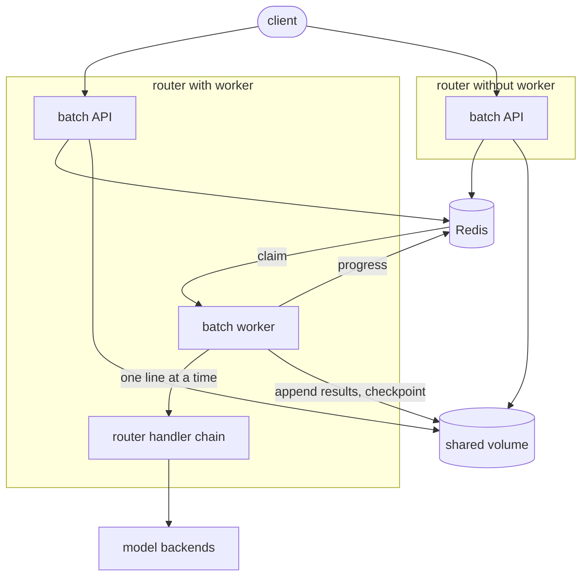
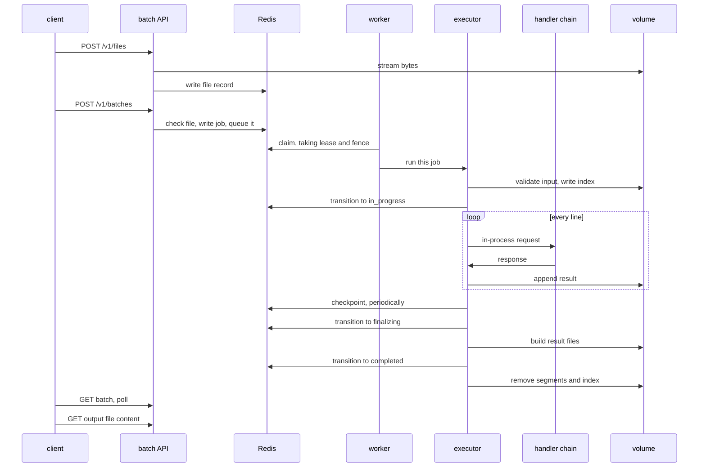
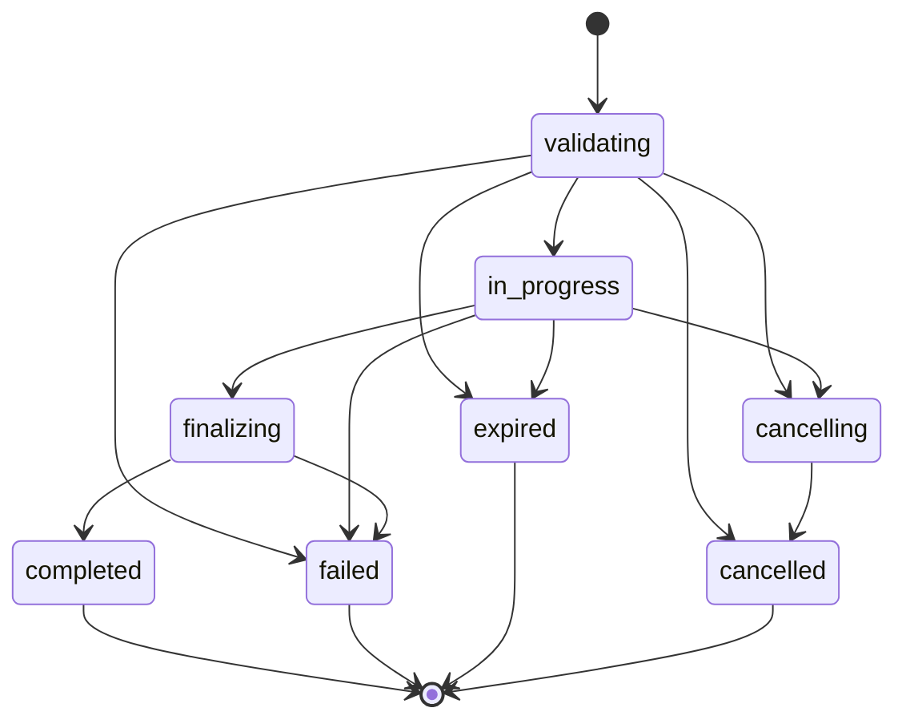

## OpenAI-Compatible Batch API in the Kthena Router

### Summary

Kthena serves interactive traffic well, but offline work (dataset inference, embedding
generation, evaluation runs) has no home. Today a user has to write their own loop over
`/v1/chat/completions`, and own the retries, the progress tracking and the restart
behavior themselves.

This proposal adds an OpenAI-compatible `/v1/files` and `/v1/batches` to the
kthena-router. A user uploads a JSONL file, creates a batch, polls it, and downloads a
result file, the same way they would against OpenAI. Kthena owns the whole lifecycle:
neither vLLM nor SGLang serves `/v1/files` or `/v1/batches` on its online server, so the
router reads the input file line by line and sends each line through its own request path,
reusing the routing, rate limiting, fairness and KV-cache aware scheduling that
interactive requests already get.

State lives in Redis and file bytes live behind a storage interface, so any replica can
serve the API, one replica owns a given batch at a time, and a batch survives the pod that
created it.

A proof of concept of the core path is implemented and measured, see
[Evidence](#evidence-from-the-proof-of-concept). Testing it against this design found
gaps, and [the list of differences](#where-the-proof-of-concept-differs-from-this-design)
names every one. [Decisions needed](#decisions-needed) lists the five questions this
proposal needs answered by reviewers.

For a first read, [Proposal](#proposal), [End to end](#end-to-end-the-steps-for-one-batch),
[Dispatch](#dispatch) and [Decisions needed](#decisions-needed) cover the design. The other
sections are the detail behind them.

### Motivation

Large offline inference is a first-class LLM workload and a poor fit for a synchronous
API. It is throughput-oriented rather than latency-sensitive, it runs for hours, and it
needs to survive process restarts. Running it through the interactive path means the
client owns durability, and a client that dies loses its progress.

OpenAI's Batch API is the de facto shape for this, so matching its schema lets existing
clients move to Kthena without code changes.

Putting it in the router rather than in a new component is what makes it cheap: the router
already knows backend load, already owns model-aware routing, and already talks to Redis
for the on-flight counter, the global rate limit and the KV-cache index. Batch dispatch
reuses all of it, and operators get the feature by flipping a Helm value rather than
deploying and scaling another service.

#### Goals

- OpenAI-compatible `/v1/files` and `/v1/batches` served by the kthena-router, with the
  same object shapes, status values and error envelope. The differences are listed under
  [Compatibility with OpenAI](#compatibility-with-openai).
- Batches of tens of thousands of requests, with bounded router memory regardless of batch
  size.
- Each batch line takes the same path as an interactive request, so route matching, rate
  limiting, fairness and the KV-cache aware plugins all still apply.
- Every `custom_id` in the input appears exactly once across the output and error files,
  including across a takeover. This is a guarantee about committed results: a line in
  flight during a takeover can reach the backend twice.
- A temporary failure delays a line instead of failing it. A rate limit or a model with no
  ready pods does not turn a batch into a file of errors.
- Any replica can serve the API, one replica owns a batch at a time, and a batch survives
  the loss of the pod running it.
- Cancellation, expiry, and garbage collection of finished batches and their files.
- Off by default, configured through Helm values, and never a reason for interactive
  traffic to fail.

#### Non-Goals

- Requiring engine-native batch support. vLLM's online server has no `/v1/files` or
  `/v1/batches` (its batch mode is the offline `vllm run-batch`, which starts its own
  engine), and SGLang's online server has neither. Kthena owns the lifecycle.
- A new component. The batch API and worker run inside kthena-router. The optional worker
  pool is a second Deployment of the same binary.
- Matching OpenAI's 24-hour discount pricing semantics. `completion_window` is accepted
  and enforced as a deadline; it is not a billing input.
- Cross-cluster or cross-region batch scheduling.
- Object storage in the first phase. The storage seam exists, but the first backend is a
  shared volume, see [File storage](#file-storage).
- Reordering lines by prompt prefix to keep the KV cache warm, which the issue suggests.
  The KV-cache aware plugins still place each line by its prefix, so this is an
  optimization to add once there are numbers from real model servers.
- A separate priority for batch inside a model server. Once a line reaches a pod, the
  engine treats it like any other request.

### Proposal

A user uploads a JSONL input file to `/v1/files` with `purpose: batch`, creates a batch
against it at `/v1/batches`, polls that batch, and when it reaches `completed` downloads
`output_file_id` and `error_file_id`. Every line of the input is one chat completion
request with a `custom_id`. Every line of the output is that `custom_id` and the response,
and a request that failed goes to the error file instead.

Inside the router, creating a batch writes a job record to Redis and pushes its ID onto a
queue. Every replica that has the worker enabled runs a claim loop. A claim takes a
renewable lease on the job and stamps it with a fence token, so one replica owns it at a
time. The executor validates the input file, then dispatches lines through the router's
own handler with bounded concurrency, retries temporary failures, appends results as they
arrive, and checkpoints progress. If the owning pod dies, the lease expires, another
replica requeues and claims the job, and resumes from the last checkpoint.

The shape of it:



| Box | What it holds |
| --- | --- |
| batch API | `/v1/files`, `/v1/batches` |
| batch worker | claim, renew, reap, release, sweep |
| router handler chain | route match, rate limit, fairness, KV-cache aware scheduling |
| Redis | jobs, queue, leases, checkpoints, cleanup schedule |
| shared volume | input and result files |
| model backends | vLLM, SGLang |

A default install has only routers with a worker. An operator who wants batch load off the
routers carrying interactive traffic turns the worker off there and runs a small worker
pool, see [Configuration](#configuration). If a router dies mid-batch, its lease expires,
and any replica with a worker requeues and resumes the job from its last checkpoint.

#### User Stories

##### Story 1: offline dataset inference

A team has 50,000 prompts to score against a model Kthena already serves. They upload one
JSONL file, create a batch, and poll it every few minutes. The job runs for an hour, and
they download one output file. They never write a retry loop, and a router rollout in the
middle does not lose their progress.

##### Story 2: batch kept off the interactive routers

A platform team wants to use spare GPU capacity overnight without adding load to the
routers that carry daytime traffic. They set `worker.enabled: false` on the main
Deployment and turn on `workerPool` with two replicas and a low per-batch concurrency. The
main routers serve the API and the pool runs every batch. Both still share the model
backends, so batch lines can still slow interactive requests on a busy pod. The team keeps
concurrency low until adaptive back-off lands, see [Flow control](#flow-control).

##### Story 3: a batch that must stop

A user notices a bad prompt template 3,000 requests into a 20,000 request batch and
cancels it. Work stops within seconds, the answers already produced stay in the output
file, and every request that never finished is written to the error file with
`batch_cancelled`, so they know exactly what to resubmit.

##### Story 4: a batch that hits a rate limit

A ModelRoute has a token rate limit, and a batch reaches it. The lines wait and carry on
as budget comes back. The batch takes longer, and no line fails because of the limit
unless the batch runs out of time.

#### Notes/Constraints/Caveats

- **Redis is required when batch is enabled, and only for batch.** The router already uses
  Redis for the shared on-flight counter, the global rate limit and the KV-cache index,
  but all of these are optional today. With batch enabled, Redis holds the job records,
  the queue and the leases. If Redis is down, the batch endpoints answer 503 and the
  workers wait. Interactive traffic and `/readyz` do not depend on it, and batch comes
  back by itself when Redis does.
- **The shared volume must be ReadWriteMany for more than one pod.** Every replica serving
  the API must be able to read any file, and a takeover must read a file another pod
  wrote. A single-node test cluster gets away with ReadWriteOnce; a real cluster does not.
  See [Readiness](#readiness) for how a wrong volume is detected.
- **Batch cost lands on the replica running the job.** This is why the worker has a
  separate switch from the API. The switch moves router CPU and memory, not model load:
  every router shares the same backends.
- **Streaming is off for batch lines.** A batch result is a complete response body. A line
  with `stream: true` fails validation with `streaming_unsupported`.
- **One input file targets one model**, which is OpenAI's rule too. See
  [Decisions needed](#decisions-needed).
- **First phase is `/v1/chat/completions` only.** `/v1/completions`, `/v1/embeddings` and
  `/v1/responses` are the same mechanism and are the obvious next endpoints, but each
  needs its own validation and response shaping.

#### Risks and Mitigations

| Risk | Mitigation |
| --- | --- |
| Batch traffic degrades interactive latency | Per-job and per-replica concurrency caps, and an optional worker pool for the router side. Backends stay shared, so the full answer is adaptive back-off (phased, see [Flow control](#flow-control)) |
| A batch spends the model's rate limit | Rate limits are per model today, so batch and interactive draw from one budget. See [How batch lines count against limits](#how-batch-lines-count-against-limits) and Decision 2 |
| A rate limit or a restart fails a whole batch | Temporary failures are retried, see [When a line fails](#when-a-line-fails) |
| A partitioned owner keeps writing after takeover | Fence token on every state write; segment files scoped per ownership attempt, so a stale writer cannot corrupt the new owner's output |
| A batch that crashes its owner takes down every router in turn | `maxAttempts` fails a batch that keeps losing its owner without making progress |
| A large file exhausts router memory | Input read line by line, results appended as they complete; measured 15-40 MiB at 50,000 requests against the chart's 512Mi limit |
| Redis loses batch state | Require AOF with `appendfsync everysec` or stricter, plus `maxmemory-policy noeviction`. RDB alone is not enough. What a crash still loses is listed under [What a Redis failure loses](#what-a-redis-failure-loses) |
| Forged batch identity | Owner and gateway context travel in the request context, never in a header; the engine that trusts them binds no listener, and a client cannot write into a Go `context.Context` |
| One tenant starves the queue | `maxQueuedBatchesPerTenant` and `maxActiveBatchesPerTenant`, see [Multi-tenancy](#multi-tenancy) |
| Files fill the volume | Expiry, a sweeper, per-batch and per-tenant byte limits, see [Reclaiming storage](#reclaiming-storage) |
| Prompts and answers sit on a shared volume | Files are stored as plain bytes, and encryption is left to the volume. With auth disabled every caller shares one tenant, so batch should not be enabled on a shared cluster without auth |

### Design Details

#### What is added

All new Go code lives in one new package, `pkg/kthena-router/batch`, plus one wiring file
under `cmd`. The Implementation Plan at the end splits these into serial PRs.

| File | Responsibility |
| --- | --- |
| `batch/types.go` | `Job`, `File`, `Lease`, `Checkpoint`, `Status` |
| `batch/store.go` | the `Store` interface, the only writer of job state |
| `batch/redis_store.go` | Redis implementation: keys, indexes, script loading |
| `batch/scripts/*.lua` | the ten scripts listed under [State model](#state-model) |
| `batch/files.go` | `/v1/files`, the `FileStore` interface and its volume implementation |
| `batch/batches.go` | `/v1/batches`: create, list, get, cancel |
| `batch/validate.go` | input validation and the OpenAI error envelope |
| `batch/api.go` | implements `APIExtension`, dispatches the nine endpoints |
| `batch/worker.go` | claim loop, lease renewal, reaper, graceful release |
| `batch/exec.go` | runs one claimed batch: dispatch, retry, checkpoint, finalize |
| `batch/dispatch.go` | `Identity` on the request context, `HandlerDispatcher`, `batchWriter` |
| `batch/gc.go` | the sweeper. New in this design, not in the proof of concept |
| `cmd/kthena-router/app/batch.go` | builds the components, the in-process engine and `batchIdentity` |

The proof of concept is about 3,300 lines of Go and 120 of Lua, plus 3,700 lines of tests.

#### How it plugs into the existing router

Existing files are only added to, never changed. In the proof of concept the Go side is 29
added lines across two files, and there are no deletions anywhere in the four:

| Existing file | Change |
| --- | --- |
| `pkg/kthena-router/router/router.go` | +27: the `APIExtension` interface, an `apiExtension` field on `Router` that is nil unless the feature is on, its setter and getter, and the consult inside `HandlerFunc` |
| `cmd/kthena-router/app/server.go` | +2: build the batch components when the feature is on. This design adds a bounded wait for the worker on shutdown |
| `charts/kthena/charts/networking/values.yaml` | +27: the `batch` block, defaulted off |
| `charts/kthena/charts/networking/templates/kthena-router/component/deployment.yaml` | +49: the optional volume mount. The worker pool adds one new template |

Deliberately **not** modified: the scheduler, the datastore, the rate limiters, the access
log, and `AuthMiddleware`. Batch lines reach all of them by being dispatched through the
ordinary handler chain rather than by being special cased inside it. That is the one
decision the rest of this section follows from. The one exception is fairness, as Decision
2 recommends: `handleFairnessScheduling` and the two `UpdateTokenCount` calls each gain one
condition, so batch lines queue last and are not counted against their owner.

#### End to end: the steps for one batch



1. **Upload**, batch API. `POST /v1/files` with `purpose: batch` streams the JSONL body
   into the file store and writes a `file:<id>` record owned by the caller's tenant.
2. **Create**, batch API. `POST /v1/batches` checks the request, then the `create` script
   checks the file is still live, adds the batch to `fileref:<id>`, writes `job:<id>` and
   pushes the ID onto `queue`, all in one step. The client gets a batch in `validating`.
3. **Claim**, worker. Every replica with the worker enabled runs a claim loop. `claim`
   pops the oldest queued ID, writes `lease:<id>` with a TTL, stamps `holder` and `fence`
   onto the job, and adds it to `active` for the reaper. Exactly one replica wins.
4. **Validate**, executor. One pass over the input file, holding one line at a time. It
   rejects bad lines, including a duplicate `custom_id`, which is what makes the
   exactly-once guarantee well defined, and writes an index of line offsets beside the
   file. A bad file moves the batch to `failed` with its `errors` list, and no inference
   starts. A good one moves it to `in_progress`.
5. **Execute**, executor. The owner opens the input, creates output and error segments
   named with its fence, and dispatches lines with bounded concurrency. Each line goes
   through the in-process engine described under Dispatch, so it is route matched, rate
   limited, fairness queued, KV-cache scheduled and access logged as a client request is.
6. **Checkpoint**, executor. Results are appended as they arrive, and `ckpt:<id>` records
   the valid byte count per segment, the done bitmap, the counts and token usage. It is
   written after every 200 lines or 5 seconds, whichever comes first, so a takeover redoes
   at most that much work. Every write verifies the fence first.
7. **Renew, or lose the job**, worker. The lease is renewed on a timer, and `renew`
   returns the current status in the same round trip, which is how a running executor
   learns it was cancelled. If the pod dies the lease expires, `reap` requeues the job,
   and the next owner resumes from the checkpoint, skipping lines in the done bitmap.
8. **Finalize**, executor. The valid prefix of each segment is concatenated into the
   output and error files, their file records are written, and the job transitions to
   `completed`.
9. **Clean up**, executor and sweeper. The owner removes the segments, the index and the
   checkpoint, and releases the input file. The sweeper catches anything a crash left
   behind, see [Reclaiming storage](#reclaiming-storage).
10. **Poll and download**, batch API. The client polls `GET /v1/batches/{id}` throughout,
    then fetches `output_file_id` and `error_file_id`.

Only steps 3 to 9 need a worker. A replica with `worker.enabled: false` still serves steps
1, 2 and 10, which is what lets an operator run the API everywhere and batches only where
the load is wanted.

#### API surface

Served from inside the router. `Handles` claims the paths and `Serve` answers them:

| Method | Path | Behavior |
| --- | --- | --- |
| `POST` | `/v1/files` | multipart upload, `purpose` must be `batch`; streams to the file store |
| `GET` | `/v1/files` | list the caller's files, optional `purpose` filter, paginated |
| `GET` | `/v1/files/{id}` | file object |
| `GET` | `/v1/files/{id}/content` | raw bytes |
| `DELETE` | `/v1/files/{id}` | marks deleted; bytes stay while a batch still needs them |
| `POST` | `/v1/batches` | create from an `input_file_id` |
| `GET` | `/v1/batches` | list the caller's batches, newest first, paginated |
| `GET` | `/v1/batches/{id}` | batch object with live `request_counts` |
| `POST` | `/v1/batches/{id}/cancel` | cancel |

Errors use the OpenAI shape, which nests the fields under a top-level `error` object:

```json
{"error": {"message": "...", "type": "invalid_request_error", "param": null, "code": null}}
```

This differs from the rest of the router and is deliberate, because clients parse it. The
parity covers errors these endpoints generate themselves. A request rejected earlier, by
`AuthMiddleware`, still gets the router's existing `{"error": "<string>"}` body. The
official Python SDK copes with that: it unwraps the string and raises
`AuthenticationError` with `code` set to `None`. So this proposal leaves the auth
middleware alone.

Status values and transitions match OpenAI:



`validating --> cancelled` and `validating --> expired` are a batch still in the queue,
which no worker has claimed. A running batch stays in `cancelling` or `in_progress` while
its result files are built, and only then becomes `cancelled` or `expired`, so
`finalizing` always means the batch ran to the end.

##### Input and output lines

An input line is OpenAI's request line:

```json
{"custom_id": "req-1", "method": "POST", "url": "/v1/chat/completions", "body": {"model": "my-model", "messages": [{"role": "user", "content": "Hello"}]}}
```

Validation fails the batch before any line is dispatched, listing up to 100 errors in the
batch's `errors` field with the line number and field, when a line:

- is not a JSON object, or is longer than `maxLineBytes`
- has an empty `custom_id`, or one used by an earlier line
- has a `method` other than `POST`, or a `url` other than the batch's `endpoint`
- has no `body.model`, or a model different from the first line's (Decision 5)
- sets `body.stream: true`

An output line carries the response the model server returned:

```json
{"id": "batch_req_7f2c", "custom_id": "req-1", "response": {"status_code": 200, "request_id": "batch_req_7f2c", "body": {"id": "chatcmpl-1", "object": "chat.completion", "model": "my-model", "choices": [{"index": 0, "message": {"role": "assistant", "content": "Hi"}, "finish_reason": "stop"}]}}, "error": null}
```

The same `batch_req_` ID is sent as `X-Request-ID`, so a line can be found in the access
log. Error file lines are described under [When a line fails](#when-a-line-fails).

##### Compatibility with OpenAI

| Area | OpenAI | This proposal |
| --- | --- | --- |
| Limits | 50,000 requests, 200 MB per file | same defaults, configurable |
| Model | one model per input file | same (Decision 5) |
| Endpoints | responses, chat, embeddings, completions, moderations, images, videos | chat completions first |
| `completion_window` | `24h` only | same |
| Create parameters | `output_expires_after` | accepted, applied to the result files |
| `metadata` | up to 16 key-value pairs on create, returned on the batch | same, stored on the job record |
| Batch object | includes `model` and `usage` | same; usage detail fields are 0 unless the backend reports them |
| File expiry | batch files default to 30 days, `expires_after` from 1 hour to 30 days | same |
| Result order | not the input order, use `custom_id` | same |
| Cancel | `cancelling` until in-flight requests finish, up to 10 minutes | in-flight lines are aborted, so it is quicker |
| Rate limits | a separate pool from the per-model limits | one shared budget by default (Decision 2) |
| File listing | `limit` up to 10,000, `order` | `order` honored, pages of at most 100 with `has_more` |

##### Why an extension hook rather than gin routes

The router does not register model paths individually. It registers one catch-all that
claims everything under `/v1` (`cmd/kthena-router/app/router.go:293-296`):

```go
v1Group := engine.Group("/v1")
v1Group.Use(AccessLogMiddleware(cfg.defaultRouter))
v1Group.Use(AuthMiddleware(cfg.defaultRouter))
v1Group.Any("/*path", cfg.defaultRouter.HandlerFunc())
```

gin builds a radix tree per HTTP method, and a catch-all owns its whole subtree. So
`/v1/files` beside `/v1/*path` is not a route that loses a priority contest, it is a tree
gin refuses to build. On gin v1.10.0 it panics at registration:

```
'/files' in new path '/v1/files' conflicts with existing wildcard '/*path'
in existing prefix '/v1/*path'
```

Registering the specific route first does not help, it only moves the panic:

```
catch-all wildcard '*path' in new path '/v1/*path' conflicts with existing
path segment 'files' in existing prefix '/v1/files'
```

That leaves two real options. Drop the catch-all and enumerate every model path, which
means the router stops forwarding any OpenAI path it has not been taught, and a new
upstream endpoint becomes a code change. Or let the catch-all hand off the paths it does
not own. This proposal takes the second, as a two-method seam:

```go
type APIExtension interface {
	Handles(method, path string) bool
	Serve(c *gin.Context)
}
```

`Router.HandlerFunc` (`pkg/kthena-router/router/router.go:284`) consults the extension
before it parses a model request, and only for `/v1/` paths, which `AuthMiddleware`
(`cmd/kthena-router/app/router.go:711`) has already authenticated. If `Handles` returns
false the request continues down the existing model path unchanged. When batch is disabled
the field is nil and the cost is one nil comparison per request.

The route table itself is never touched, which is the point: batch adds a branch inside
the catch-all instead of competing with it. Any future non-model OpenAI endpoint can use
the same seam.

#### State model

All keys live in Redis under a prefix, `kthena:batch:{b}:` by default. The `{b}` hash tag
keeps every key in one slot, because the Lua scripts touch several keys at once. The
prefix is configurable, so two installs can share a Redis without colliding; a custom
prefix must keep a `{...}` hash tag, or the scripts fail on Redis Cluster.

| Key | Type | Holds |
| --- | --- | --- |
| `job:<id>` | hash | the batch object, plus `holder`, `fence`, `attempts` and per-status timestamps |
| `file:<id>` | hash | file record: tenant, filename, purpose, status, bytes, expiry |
| `queue` | zset | claimable job IDs, scored by enqueue time |
| `active` | zset | claimed job IDs, for the reaper |
| `lease:<id>` | string with TTL | `holder:fence` of the current owner |
| `ckpt:<id>` | hash | resumable progress: segments, done bitmap, counts, usage |
| `fileref:<id>` | set | batches still needing this file, so a delete keeps the bytes |
| `idx:batches:<tenant>` | zset | a tenant's batches, for listing |
| `idx:files:<tenant>` | zset | a tenant's files, for listing |
| `gc` | zset | files and finished jobs, scored by when they may be removed |

Every multi-step state change is a Lua script, so it is atomic against other replicas.
There are ten, and each one is short enough to read in full: `create`, `claim`, `renew`,
`transition`, `checkpoint`, `cancel`, `reap`, `release`, `delete_file`, `sweep`.

##### What a Redis failure loses

With `appendfsync everysec` a crash can lose up to about a second of writes. Each case
stays consistent, because a checkpoint is a complete record on its own and the fence is
never issued twice:

| What was lost | What happens |
| --- | --- |
| A create | The client gets a 404 when it polls and creates the batch again. The input file is still there |
| A checkpoint | The next owner resumes from the one before and redoes those lines. The valid byte counts went back with it, so the output stays exactly once |
| A claim or a lease | The old owner's next write is rejected or its next renew reports the loss, and it stops. Two owners can overlap for one renew interval, which costs duplicate backend work only |
| The final transition | The batch looks unfinished. The next owner rebuilds the same result files and transitions again |
| Everything, on a Redis with no persistence | Batches are gone and the API answers 404. Running executors stop at their next renew, and the bytes left on the volume are removed by the orphan sweep |

#### Ownership: leases and fencing

`claim` takes the lease and stamps `holder` and `fence` onto the job, as in step 3. It
expires a batch that blew its deadline while queued rather than starting it.

Every subsequent write, `transition` and `checkpoint`, verifies the fence still matches
before it does anything. A partitioned owner that comes back to life has a stale fence and
every write it attempts is rejected with `CONFLICT_FENCE`. This is what makes takeover
safe without needing to stop the old owner.

The fence is a random token the claimer generates, not a counter. The scripts only ever
compare it for equality, so what matters is that it is never issued twice. A Redis counter
cannot promise that: a crash can lose the last increment and hand the same number to a
second owner, whose fence then matches the first owner's.

`renew` extends the lease and returns the current status in the same round trip. On
`cancelling` the executor aborts its in-flight lines. An owner that has not managed to
renew for a full `leaseTTL` stops sending new lines until it can, so a partition does not
keep spending backend capacity on lines another replica may be running.

The timers, with the proof of concept's defaults: the lease lasts `leaseTTL` (30 seconds),
the owner renews every third of it, an idle worker polls the queue every 3 seconds, and
`reap` runs every 30 seconds. So after a crash a batch waits at most about a minute for a
new owner; the measured takeover was 36 seconds.

`reap` runs on a timer, finds `active` entries whose lease key is gone, and requeues them.
`release` is the graceful path: on shutdown the worker hands unfinished batches straight
back to the queue instead of making the cluster wait out the lease. Both put a batch back
at its original enqueue time, so a long batch does not fall behind newer ones at every
rollout.

The server has to wait for that. `Server.Run` returns as soon as its context is cancelled
and the process exits right after, so the worker's final checkpoint and `release` race the
exit. `Server.Run` waits for the worker for a bounded time, about 15 seconds, and the
chart's 330 second grace period already leaves room for it.

`claim` also counts attempts. A graceful `release` gives its attempt back, and a
checkpoint with progress resets the count. A batch that reaches `maxAttempts` without
progress moves to `failed` with `too_many_attempts`, with whatever was committed still
published. This is what stops a batch that always fails, such as one that crashes its
owner or meets a full volume, from retrying forever. A worker also waits one poll interval
before claiming again after a run ends in an error.

#### Resumable execution

Naive resumption double-answers lines. The design avoids that with two pieces:

**Segments.** Each ownership attempt writes its own output and error segment, named with
the fence. The checkpoint records, for each segment, how many bytes are *valid*. On
resume, a new owner reads only the first `ValidBytes` of each earlier segment and starts
fresh segments of its own. Anything a dying owner half-wrote past its last checkpoint is
ignored, because the checkpoint never counted it.

**A done bitmap.** The checkpoint carries a bitmap of completed line numbers. A resuming
owner skips lines already answered. Combined with segments, every `custom_id` appears
exactly once in the committed output, even when a pod dies mid-write.

What the fence does not cover is work already in flight at the backend. An owner that has
been partitioned can still have requests outstanding when its lease expires, and taking
over does not cancel them. Its results are never committed, because every checkpoint write
is rejected on the stale fence, but the backend may have served those lines twice. The
guarantee is therefore exactly-once committed output, with duplicate backend work possible
for the lines in flight across a takeover.

The two stores have to be ordered against each other. A checkpoint is only safe once the
bytes it counts are durable, otherwise losing a node could leave Redis holding a done bit
for a line whose output never reached the volume. So the executor syncs both open segments
before it writes the checkpoint, which is the file-side counterpart to requiring AOF on
Redis: whichever store is weaker sets the real guarantee.

What a new owner does depends on the status it finds:

| Status at claim | What the new owner does |
| --- | --- |
| `validating` | validates from the start |
| `in_progress`, deadline not passed | resumes from the checkpoint |
| `in_progress`, deadline passed | writes `batch_expired` for the lines not done, publishes, moves to `expired` |
| `cancelling` | writes `batch_cancelled` for the lines not done, publishes, moves to `cancelled` |
| `finalizing` | publishes only, and dispatches nothing |

Finalizing concatenates the valid prefix of every segment into the final output and error
files, then transitions to the terminal status. The result files are written under
deterministic names through `Create`, which stages a temporary file and renames it into
place, so a finalize that is interrupted and retried by the next owner rebuilds the same
lines and swaps them in once. A stale owner that renames late cannot change the result
either: a batch only reaches `finalizing` once its checkpoint is final, so both owners
build the same bytes from the same segments. The stale owner also never gets as far as
cleanup, because removing the segments comes after the fenced transition to a terminal
status, which its fence fails.

#### When a line fails

A batch runs for hours against model servers that restart, scale and hit rate limits, so a
failed attempt is not a failed line. What happens depends on the answer:

| Answer | Retry | Recorded as |
| --- | --- | --- |
| 2xx | no | output file |
| 429 from the rate limiter or a backend | yes, until the batch deadline. The whole batch pauses, and the wait does not use up the line's attempts | `batch_expired` if the deadline arrives first |
| 500, 502, 503, 504, a connection error, `lineTimeout` | yes, up to `maxLineAttempts` | error file, with the last status |
| Any other 4xx, such as 400 or a 404 for an unknown model | no, the same request gives the same answer | error file |
| A response over `maxResponseBytes` | no, and it is never truncated into the output file | error file, `response_too_large` |

The 503 case matters most: the router answers it when a model server has no ready pods,
which is normal during a rollout or a scale up. The 504 case is a line that outlived
`FAIRNESS_QUEUE_TIMEOUT`.

Retries back off from 1 second to 60 seconds with jitter, and honor `Retry-After` when
there is one. A retrying line keeps its concurrency slot, so a struggling backend sees
less batch traffic without anything else having to notice. Attempts are not checkpointed,
so a line starts counting again after a takeover. In the error file, a line that got an
answer has the OpenAI shape `{"response": {"status_code": 503, ...}, "error": null}`, and
a line that got no answer has
`{"response": null, "error": {"code": "...", "message": "..."}}`.


#### How batch lines count against limits

Because a line goes through the ordinary handler chain, it meets the ordinary limits. What
that means differs per limit:

- **The rate limit is per model.** `RateLimit(modelName, prompt)` takes no user, so a
  batch and interactive traffic for the same model draw from one budget, and a large batch
  can use it up. Per-user limits are a separate open issue, #293.
- **The rate limiter is per process unless the ModelRoute sets `rateLimit.global`.** With
  a local limit each router replica has its own budget, so a worker pool gets its own
  budget too, and the model's real limit is the sum across pods. Only a global limit, kept
  in Redis, is one shared budget.
- **Fairness puts batch last.** When `ENABLE_FAIRNESS_SCHEDULING` is on, which is not the
  default, a batch line gets the lowest priority, the one unauthenticated requests get
  today, so it waits behind interactive requests. Its tokens are not added to the fairness
  tracker, so a batch does not lower its owner's priority for their own interactive
  requests. `batchIdentity` marks the line in the gin context, which is how the router
  tells it apart. With session boost on instead, a batch line carries no session ID, so it
  is never boosted.
- **The on-flight counter is shared** when Redis is configured, so the scheduler sees
  batch load on a pod from any router.

Decision 2 is about the rate limit. OpenAI keeps batch out of the per-model limits, and
this design does not, because the limit is what protects the model server.

#### Dispatch

Each line becomes an in-process HTTP request through the router's own `http.Handler`:

```go
identity := Identity{Tenant: request.Tenant, Dispatch: request.Dispatch}
httpRequest, err := http.NewRequestWithContext(
	WithIdentity(lineCtx, identity), http.MethodPost, request.Endpoint,
	bytes.NewReader(request.Body))
```

This is the core design decision and the reason batch lines get everything interactive
requests get: the same route matching, the same rate limits, the same fairness queue, the
same KV-cache aware scheduling, the same access log.

##### Where a line enters the chain

Not through the network-facing engine. A `/v1` request from a client passes
`AccessLogMiddleware` and then `AuthMiddleware`, and it is `AuthMiddleware` that sets
`common.UserIdKey` from the verified token. The fairness queue and token usage tracking
read that key, so a line that skipped it would run as an empty user, and the paragraph
above would not be true.

The worker therefore dispatches into a second gin engine, assembled in process and never
bound to a listener:

```
recovery -> batchIdentity -> [access log] -> Router.HandlerFunc()
```

`batchIdentity` stands in for `AuthMiddleware`. It reads the identity from the Go request
context, aborts with 403 when there is none, and sets `common.UserIdKey` and, in Gateway
API mode, the listener keys: the same gin context state the authenticated path would have
produced. It also sets a batch flag, which the fairness path reads, see
[How batch lines count against limits](#how-batch-lines-count-against-limits). From that
point on the request is handled by the ordinary chain.

This is also why the identity travels in the context rather than a header. A client cannot
write a value into a Go `context.Context`; the only writer is the dispatcher, in the same
process, and the engine that trusts it accepts no connections. The real `AuthMiddleware`
is left untouched, so nothing reachable from the network is taught to trust a
context-carried identity.

Authentication happens once, when the batch is created. A token that expires or is revoked
later does not stop a batch that is already running. `filters/auth/authorization.go` is an
empty stub today, so there is no per-model authorization for a line to skip. If one is
added as middleware, `batchIdentity` has to apply it too.

##### Batch lines are not session sticky

`batchIdentity` does not set `common.JWTTokenKey`, so a ModelServer whose session key
source is `JWTClaim` finds no session key on a batch line, and the same goes for `Cookie`
and `Query` sources. The router handles an empty key by scheduling the line normally. That
is the right result: session stickiness keeps one conversation on one pod, and batch lines
are unrelated requests. Resolving a claim once and replaying it would give every line the
same key, which pins a whole batch to one pod and turns off load balancing for it.
Replaying the token would also put a bearer credential in Redis for the life of the batch.

Decision 4 confirms this. For the same reason, an operator should not list a session
header in `forwardHeaders`.

##### Two more details

- **Identity is captured once, not per line.** The owning tenant and, under Gateway API,
  the listener the batch arrived on, are recorded when the batch is created and replayed
  on every line through `context.WithValue`, so a batch keeps the identity it was created
  with even when another replica takes it over.
- **The response writer has to look like a real connection.** `batchWriter` collects the
  body up to a cap and implements `Flush` and `CloseNotify`, because gin's streaming path
  casts the writer to `http.CloseNotifier` and a writer without it panics. Its notify
  channel follows the line's context, so the goroutine ends with the line.

A panic in a line is recovered and recorded as that line's error rather than taking down
the worker, and a panic in the executor itself fails that run, which counts as an attempt.

#### File storage

File bytes sit behind a `FileStore` interface with `Create`, `Open`, `Size`, `Append`,
`Remove` and `Probe`. The first implementation is a shared volume, which is what the issue
discussion settled on as the simpler starting point.

On the volume a file lives at `<mountPath>/<hash of tenant>/<file id>`. The router
generates the ID and checks it against a fixed pattern before building a path, so neither
the client's filename nor the tenant string ever reaches the filesystem.

The proof of concept's interface returns `*os.File` from `Open` and `Append`. That is
honest about the shared volume but cannot be implemented for S3, so those two methods
should return `io.ReadSeekCloser` and `io.WriteCloser`. It is a small change, and the
recommendation is to make it in the first PR, while there is one implementation to update.

The reference count only protects the bytes if taking it and checking the file are one
step. So `create` checks the deleted flag and adds to `fileref` in the same script, and
`delete_file` sets the flag and reads the reference count in the same script. Redis runs
scripts one at a time, so either the delete comes first and the create answers 400, or the
create comes first and the delete sees the reference and keeps the bytes. Every path to a
terminal status drops the reference: `transition`, `cancel` on a queued batch, and `claim`
when it expires one.

#### Reclaiming storage

What removes what:

- **Working files.** After a batch reaches a terminal status, its owner removes the
  segments and the index, and the checkpoint. The bytes they hold are already in the
  result files.
- **Expiry.** An upload expires after `expires_after`, or `retention.files` by default. A
  result file expires after `output_expires_after`, or `retention.files`. A finished job
  record stays for `retention.jobs`. All of them go into the `gc` zset, scored by when
  they may be removed.
- **The sweeper.** Every replica with a worker runs `sweep` on a timer. The script pops
  what is due, and pushes back a file that a batch still references. The Go side removes
  the bytes first and the record second, so a crash in between leaves something the next
  pass can see. Removal is idempotent, so replicas need no lock between them.
- **Deleted files.** When the last reference on a deleted file is dropped, the file goes
  into `gc` at the current time.
- **Orphans.** A slower pass walks the volume and removes files with no record that are
  older than `retention.orphanGrace`, 48 hours by default, which is longer than any batch
  can run. This catches temporary files from crashed uploads and the bytes left after
  losing Redis.

Limits keep the volume from filling before any of that runs. 50,000 lines of 2 MiB is
about 100 GiB in theory; real batches land nearer 100 MB to 1 GB, but one bad batch should
not fill a volume other tenants depend on:

- `maxOutputBytes` bounds one batch. A batch that passes it stops dispatching and moves to
  `failed` with `output_too_large`, with what it already committed still published.
- `maxStorageBytesPerTenant` bounds one tenant, checked on upload and when claiming a
  batch. An upload over the limit gets a 413.
- A full volume is an error like any other: the run fails, the attempt counts, and
  `maxAttempts` ends it.

#### Flow control

Built in the proof of concept: a cap on concurrently running batches per replica
(`maxConcurrentJobs`) and a per-batch cap on in-flight lines (`concurrency`), plus the
worker switch. Worst case, lines and answers held in memory are
`maxConcurrentJobs x concurrency x (maxLineBytes + maxResponseBytes)`, which is 48 MiB
with the defaults.

Part of this design: a retrying line holds its slot, and a 429 pauses the batch, as
described under [When a line fails](#when-a-line-fails).

Proposed next, and **not yet built**: additive-increase/multiplicative-decrease on the
per-batch concurrency, driven by the waiting and running request counts the datastore
already tracks per pod (`GetRequestWaitingNum`, `GetRequestRunningNum`). When interactive
pressure rises, batch concurrency backs off; when it falls, batch creeps back up. This is
the piece that turns "batch runs somewhere else" into "batch yields", and it is
deliberately scoped as a follow-up so the first PRs stay reviewable.

#### Multi-tenancy

The owning tenant is the authenticated subject, read from the same gin key the rest of the
router uses (`common.UserIdKey`). Files and batches are scoped to it: a lookup that does
not match the caller's tenant is a 404, not a 403, so IDs cannot be probed.

When auth is disabled every caller shares one tenant, which is the same posture the rest
of the router takes. In that mode any caller can read any file.

The queue is FIFO by enqueue time, so one tenant submitting many large batches delays
everyone behind them. `maxQueuedBatchesPerTenant` is checked when a batch is created, and
an over-limit create gets a 429. `maxActiveBatchesPerTenant` is checked when claiming: a
batch whose tenant is at its cap goes back to the queue at its original score and the
claim moves on. OpenAI bounds queued work for the same reason. The per-tenant indexes
already hold the counts, so no new state is needed. Both default to off, which suits a
single-tenant install.

#### Configuration

Off by default, under `kthenaRouter.batch` in the networking chart:

```yaml
batch:
  enabled: false
  redis:
    address: ""              # empty: the Redis the router already uses (REDIS_HOST)
    keyPrefix: "kthena:batch:{b}:"
  storage:
    claimName: ""            # required; ReadWriteMany when more than one pod runs
    mountPath: /var/lib/kthena/batch
    fsGroup: 65532
  worker:
    enabled: true            # false: this Deployment serves the API only
    maxConcurrentJobs: 2
    concurrency: 8
    leaseTTL: 30s
    lineTimeout: 10m
    maxLineAttempts: 5
    maxAttempts: 5
  workerPool:
    enabled: false           # a second Deployment that only runs batches
    replicas: 2
    resource: {}
  limits:
    maxFileBytes: 209715200      # 200 MB, OpenAI's limit
    maxRequestsPerBatch: 50000   # OpenAI's limit
    maxLineBytes: 1048576
    maxResponseBytes: 2097152
    maxOutputBytes: 10737418240  # 10 GiB
    maxStorageBytesPerTenant: 0  # 0 is no limit, here and below
    maxQueuedBatchesPerTenant: 0
    maxActiveBatchesPerTenant: 0
  retention:
    files: 720h                  # 30 days, OpenAI's default
    jobs: 720h
    orphanGrace: 48h
  accessLog: true            # one access log line per batch request
  forwardHeaders: []         # header names to replay, for header-matching ModelRoutes
```

`forwardHeaders` is an allowlist an operator sets. The values are captured once from the
create request and replayed on every line. OpenAI's input lines carry no headers, so there
is no per-line source.

Enabling batch without `storage.claimName` fails at `helm install`, through Helm's
`required`.

`worker.enabled` is a property of a Deployment rather than of a single replica: the chart
renders one router Deployment, so every replica in it shares the setting.

Splitting interactive and batch load, as Story 2 does, is what `workerPool` is for. It
renders a second Deployment, `kthena-router-batch-worker`, with the same image,
ServiceAccount, router config, Redis and volume. Its pods carry a different
`app.kubernetes.io/component` label, so the router Services do not select them and they
take no client traffic, and they run with `--enable-webhook=false`. A second release of
the chart cannot do this. Every router resource has a fixed name and the ClusterRole is
cluster-scoped, while the PVC ties the release to one namespace. Tried on a live cluster,
`helm install` fails either way:

```
same namespace:  ServiceAccount "kthena-router" in namespace "dev" exists and cannot be imported
other namespace: ClusterRole "kthena-router" in namespace "" exists and cannot be imported
```

#### Readiness

Batch must never be the reason a router pod does not serve interactive traffic, so its
dependencies stay out of `/readyz`. At startup the batch API comes up not ready, and a
background loop retries these checks until they pass:

1. **Redis answers.**
2. **The volume is writable by this pod.** `Probe` writes, syncs, renames and deletes a
   file, because a mounted volume can still be read-only for the user the pod runs as.
3. **The volume is the shared one.** A writable volume is not enough: replicas on separate
   volumes would accept uploads and then lose them on takeover. The first replica writes a
   random `volume-id` file to the volume and sets the same value in Redis if none is
   there. Every replica compares the file it sees with the value in Redis, and a mismatch
   stays not ready. A ReadWriteOnce claim across nodes shows up separately, as a
   Multi-Attach event on the pod that cannot start.

While not ready, the batch endpoints answer 503 with the OpenAI error envelope, the worker
does not claim, the reason is logged at error level, and, once the metrics land,
`kthena_router_batch_ready` is 0. There
is no other state to recover from, so batch comes back without a restart.

#### Observability

The proof of concept has no metrics. This design adds them in PR 11 of the
[Implementation Plan](#implementation-plan), and batch should not be called production
ready before they land:

| Metric | Type | Labels |
| --- | --- | --- |
| `kthena_router_batch_ready` | gauge | none |
| `kthena_router_batch_jobs` | gauge | `status` |
| `kthena_router_batch_lines_total` | counter | `outcome` |
| `kthena_router_batch_line_retries_total` | counter | `reason` |
| `kthena_router_batch_job_duration_seconds` | histogram | none |
| `kthena_router_batch_claims_total` | counter | `result` |
| `kthena_router_batch_takeovers_total` | counter | none |
| `kthena_router_batch_queue_depth` | gauge | none |
| `kthena_router_batch_storage_bytes` | gauge | none |

Batch lines already appear in the existing access log, with a switch to turn that off for
large batches. They also count in the router's existing request metrics under the same
labels, so on a router running a worker, latency and rate graphs mix batch and interactive
traffic. A worker pool keeps them apart. A label for it is a change to existing metrics,
so it is left out of this proposal.

#### Backward compatibility

Additive. With `batch.enabled: false`, the default, no Redis keys are written, no volume
is mounted, the API extension is nil, and `Router.HandlerFunc` performs one extra nil
check per request. Requests to `/v1/files` and `/v1/batches` then behave as they do today:
they reach the model handler, which rejects them. Existing deployments are unaffected.

Job, file and checkpoint records carry a format version, starting at 1. Old and new routers
run side by side during a rolling update, so a later release that changes a record's format
has to keep reading the version before it.

#### Test Plan

Unit tests per component: the Redis store against a Redis fake including every Lua script
and the fence-conflict paths; the file store including the probe and the size limits; the
API including tenant isolation, validation and the error envelope; the executor including
resume-from-checkpoint, the segment prefix rules, retries and every row of the takeover
table; the worker including claim, renew, lease loss, graceful release and the attempt
limit; the sweeper including a file still referenced and a crash between removing bytes
and the record; the router including that a batch line gets the lowest fairness priority,
is left out of the token tracker, and that a request from the network cannot set the batch
flag.

E2E on kind, with two router replicas sharing one volume and one Redis, against the
`llm-d-inference-sim` mock the existing e2e tests already use:

1. Happy path: every `custom_id` appears exactly once, with a line over 64 KiB in the
   input.
2. Takeover: kill the pod running a batch mid-flight, assert the batch still completes
   with no missing and no duplicated `custom_id`.
3. Rollout: `kubectl rollout restart` mid-flight, assert the same, and that the batch is
   picked up without waiting out the lease.
4. Cancel mid-flight: completed answers kept, the rest recorded as `batch_cancelled`, with
   slow backend responses so a line is in flight when the cancel arrives.
5. Expiry: same shape, recorded as `batch_expired`.
6. Rate limit: a ModelRoute with a low token limit, assert no line fails and the batch
   completes.
7. No ready pods: scale the model server to zero mid-flight and back, assert the batch
   completes.
8. Redis restart with AOF on, mid-flight, assert the batch completes with no duplicated
   `custom_id`.
9. Gateway API mode: a batch against a model only reachable through a Gateway-bound
   ModelRoute.
10. Worker pool: batches run only on the pool, and the main routers still serve the API.

### Evidence from the proof of concept

The branch is [`poc/batch-api`](https://github.com/aeron-gh/kthena/tree/poc/batch-api).

Measured on kind: two router replicas, one shared volume, one Redis, `llm-d-inference-sim`
as the backend. Single node, so ReadWriteOnce sufficed there; a real multi-node cluster
needs ReadWriteMany.

**Correctness**

| Scenario | Result |
| --- | --- |
| 200 / 10k / 20k / 50k request batches | every `custom_id` exactly once |
| Pod killed (`--force --grace-period=0`) at 6,400 of 20,000 | other replica took over 36s later (30s lease + reap tick); final 20,000 completed, 0 missing, 0 duplicated |
| Cancel at 3,600 done | cancelled ~8s later; 3,800 answers kept, 16,200 `batch_cancelled` |
| Expiry | 2,400 kept, 17,600 `batch_expired` |
| Gateway API mode | 300/300 completed |

**Cost to interactive traffic**, 200 samples each, same cluster:

```
idle                            p50  8.3ms   p99 14.9ms
during a 50k batch              p50 16.8ms   p99 84.6ms
same, batch concurrency 1       p50  9.2ms   p99 73.5ms
```

Measured per pod while a batch ran, the replica doing the work was at p99 102ms and the
idle replica at p99 28ms, with the node using 1.2 of 8 cores. The cost lands on the
replica running the batch, which is the argument for the worker pool and for the adaptive
back-off in [Flow control](#flow-control).

**Memory**: 15-40 MiB against the chart's 512Mi limit, even at 50,000 requests. The input
is read line by line and answers are appended as they arrive, so only the lines in flight
are held.

**Not measured yet**: a graceful rollout, a real multi-node ReadWriteMany volume, and a
real model server. The simulator has no GPU behind it, so the latency numbers show the
cost in the router and say nothing about contention on a model server.

**Age of the branch**: measured at `80e1747d`, built on `723b149f`. Rebased onto
`4df04f30` (2026-11-01, 226 commits later) the Go changes apply cleanly, it builds, and
its unit tests pass. The only conflict is a neighbouring block in the Helm template. The
measurements were not repeated on the rebased code.

#### Where the proof of concept differs from this design

The proof of concept came first, and this design is what reviewing and testing it led to.
"Test" means the behavior was reproduced with a test against the rebased branch. "Code"
means it follows from reading the code.

| Area | What the proof of concept does | Checked | What this design does |
| --- | --- | --- | --- |
| Long lines | A line over 64 KiB passes validation, then fails at dispatch with an empty `custom_id`, because `readLineAt` reads at most 64 KiB | Test | Reads up to `maxLineBytes` |
| Temporary failures | Every non-2xx answer fails the line. A rate limited batch of 50 ended `completed` with 50 failed lines | Test | [When a line fails](#when-a-line-fails) |
| Cancel, then takeover while finalizing | The new owner ran all 10 lines and reported `completed` | Test | `finalizing` publishes only; a cancelled batch never enters it |
| Noticing a cancel | `renew` returns the status but nothing acts on it, so a cancel waits for the next line to finish, up to `lineTimeout` | Test | `renew` aborts in-flight lines |
| Input file reference | Taken separately from the check, and still held after a failed validation or a cancel while queued | Test | Atomic in `create`, dropped on every terminal status |
| Queue position | A released batch goes behind newer ones | Test | Keeps its original score |
| A batch that always fails | Retried 104 times in one second with a failing volume, with no limit | Test | `maxAttempts`, and a wait before the next claim |
| Fence | A counter, so a value reissued after losing Redis writes passes the old owner's check | Test | Random token |
| Cleanup | Segments and the index stay on the volume, job and checkpoint keys have no TTL, result files have no expiry | Test | [Reclaiming storage](#reclaiming-storage) |
| Dependencies at startup | Logs an error and leaves batch off until the pod restarts | Code | [Readiness](#readiness) |
| Shared volume | Checks only that this pod can write | Code | Volume identity check |
| Shutdown | `go worker.Run(ctx)` is not waited for, so `release` races the exit | Code | Bounded wait in `Server.Run` |
| API fields | Rejects `output_expires_after`, does not return `model` or `usage`, accepts mixed models | Code | [Compatibility with OpenAI](#compatibility-with-openai) |
| Worker pool | Not in the chart | Code | `workerPool` |
| Metrics and adaptive flow control | Not built | Code | Follow-up PRs |

### Implementation Plan

Serial PRs, each independently reviewable. Nothing is reachable until the seam lands in PR
7, and nothing is on until an operator sets `batch.enabled` after PR 9.

1. Redis store, types and the Lua scripts
2. File store and `/v1/files`
3. `/v1/batches` and listing
4. Input validation
5. Executor: checkpoints, segments, line retries
6. Worker: claim, renew, reap, release, attempt limit, shutdown wait
7. Router API extension seam, dispatch and the fairness condition
8. Sweeper and storage limits
9. Helm chart, worker pool, readiness and docs
10. E2E suite
11. Metrics
12. Per-tenant queue limits
13. Adaptive flow control

### Decisions needed

Each of these has a recommendation, and the design above assumes it. Any of them can
change before implementation starts.

1. **Is the in-process handler chain the right dispatch hook?** Recommended: yes. It gives
   batch lines every router feature with 29 lines of change to existing Go files, and the
   identity cannot be forged from the network.
2. **How should batch lines count against rate limits and fairness?** Recommended for the
   first phase: batch lines count against the model's rate limit, because the limit
   protects the backend, and they pace themselves on 429. When fairness is on, they queue
   behind interactive requests by taking the lowest priority, the same one unauthenticated
   requests get today, and they stay out of the token tracker so a batch does not lower
   its owner's interactive priority. That is one condition in `handleFairnessScheduling`
   and one at each of the two `UpdateTokenCount` calls. The alternative is OpenAI's model,
   a separate budget for batch, which is cleaner for interactive traffic but needs a
   second limiter per ModelRoute, so it is better as a follow-up.
3. **Is it acceptable to require AOF and `noeviction`?** Recommended: yes, documented,
   with a warning at startup when `CONFIG GET` shows otherwise, since managed Redis may
   block that command. A catch: `REDIS_HOST` is shared with the on-flight counter and the
   KV-cache index, and on `noeviction` a full Redis rejects their writes too. Anyone
   running that Redis with an eviction policy needs a separate one for batch, which is
   what `batch.redis.address` is for.
4. **Should batch lines be session sticky?** Recommended: no, as explained under
   [Batch lines are not session sticky](#batch-lines-are-not-session-sticky). This
   replaces the idea, raised earlier on the PR, of resolving the key at create time.
5. **Should one input file be limited to one model?** Recommended: yes, as OpenAI does. It
   is easier to allow more later than to take it back, and it keeps a 429 pause simple,
   because the batch has one rate limit to wait on.

### Alternatives

**A separate batch deployment.** Cleanest isolation, and batch load could never touch an
interactive replica. Rejected because it means a second component to scale and operate, it
duplicates the router's routing and scheduling or needs an RPC into it, and the issue
explicitly asks for a router-integrated design. A worker pool running the same router
binary recovers most of the isolation without a new component.

**Engine-native batch.** Would be less code. Not available: neither vLLM's nor SGLang's
online server has `/v1/files` or `/v1/batches`. vLLM does serve
`/v1/chat/completions/batch` (vllm-project/vllm#38011), but that is one synchronous request
carrying several conversations, with no files, no job state and nothing that survives a
restart, and only vLLM has it. It could later be a way to send several lines to one vLLM
pod at once; it does not replace the lifecycle this proposal adds. Waiting on upstream
engines would block the feature indefinitely.

**A Kubernetes Job per batch.** Kubernetes-native, and gets restart semantics for free.
Rejected because a batch would no longer flow through the router's scheduling path, so it
would lose KV-cache aware routing and the shared view of backend load, and because job
startup latency is poor for small batches.

**In-memory queue.** Simplest. Rejected outright: a batch would not survive a restart,
which defeats the purpose. In-memory implementations exist only in tests.

**HTTP loopback instead of an in-process handler.** Dispatching each line over localhost
to the router's own listener would reuse the path without the `APIExtension` seam.
Rejected for the extra serialization and connection overhead per line, and because the
identity would then have to travel in a header, where a client could forge it.
