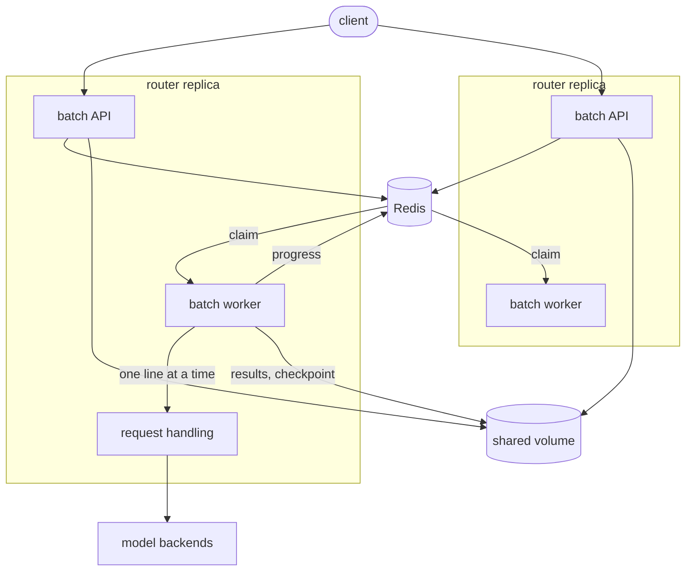
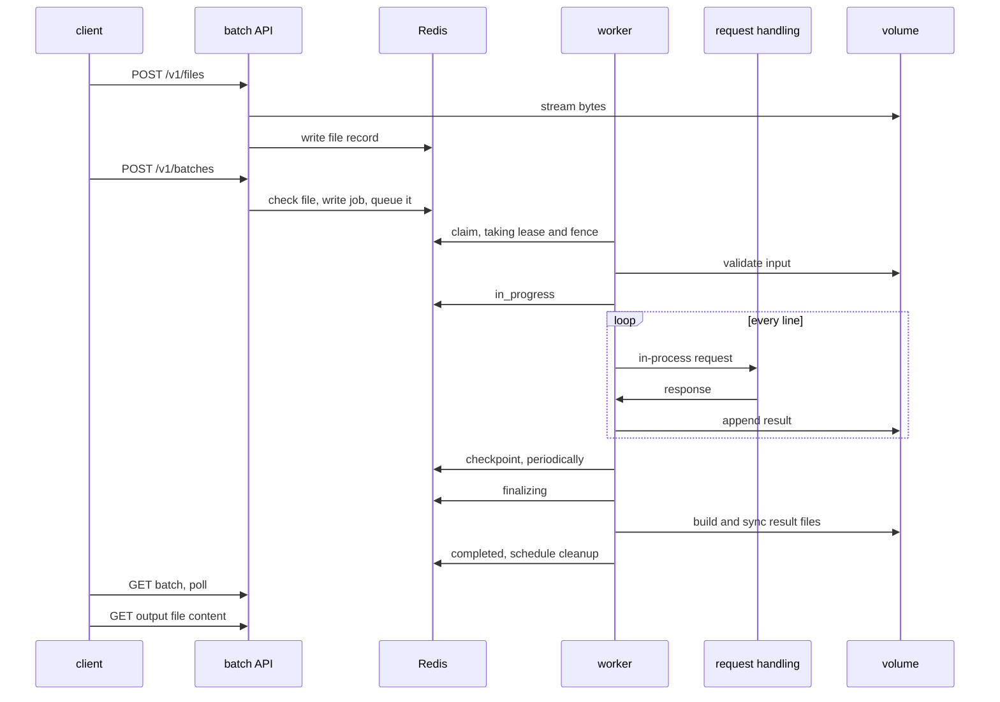
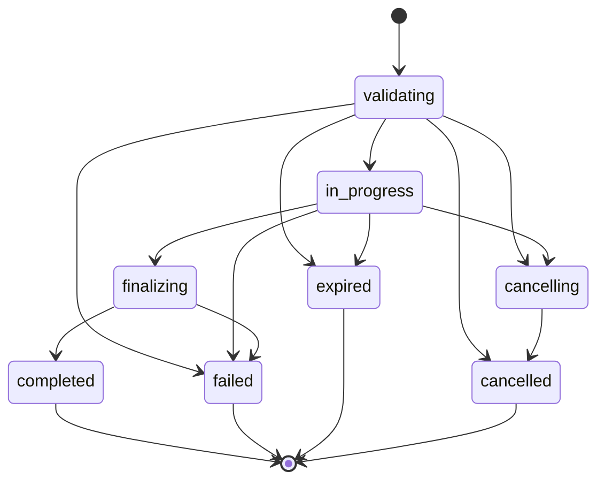

## OpenAI-Compatible Batch API in the Kthena Router

### Summary

Kthena serves interactive traffic well, but offline work (dataset inference, embedding
generation, evaluation runs) has no home. Today a user has to write their own loop over
`/v1/chat/completions`, and own the retries, the progress tracking and the restart
behavior themselves.

This proposal adds an OpenAI-compatible `/v1/files` and `/v1/batches` to the
kthena-router. A user uploads a JSONL file, creates a batch, polls it, and downloads a
result file, the same way they would against OpenAI. Kthena owns the whole lifecycle:
neither vLLM nor SGLang serves `/v1/files` or `/v1/batches` on its online server, so the
router reads the input file line by line and sends each line through its own request path,
reusing the routing, rate limiting, fairness and KV-cache aware scheduling that
interactive requests already get.

State lives in Redis and file bytes live behind a storage interface, so any replica can
serve the API, one replica runs a given batch at a time, and a batch survives the pod that
was running it.

### Motivation

Large offline inference is a first-class LLM workload and a poor fit for a synchronous
API. It is throughput-oriented rather than latency-sensitive, it runs for hours, and it
needs to survive process restarts. Running it through the interactive path means the
client owns durability, and a client that dies loses its progress.

OpenAI's Batch API is the de facto shape for this, so matching its schema lets existing
clients move to Kthena without code changes.

Putting it in the router rather than in a new component is what makes it cheap: the router
already knows backend load, already owns model-aware routing, and already talks to Redis
for the on-flight counter, the global rate limit and the KV-cache index. Batch dispatch
reuses all of it, and operators get the feature by flipping a Helm value rather than
deploying and scaling another service.

#### Goals

- OpenAI-compatible `/v1/files` and `/v1/batches` served by the kthena-router, with the
  same object shapes, status values and error envelope. The differences are listed under
  [Compatibility with OpenAI](#compatibility-with-openai).
- Batches of tens of thousands of requests, with bounded router memory regardless of batch
  size.
- Each batch line takes the same path as an interactive request, so route matching, rate
  limiting, fairness and the KV-cache aware plugins all still apply. The three places a
  batch line is treated differently are listed under
  [Components and how they connect](#components-and-how-they-connect).
- For every batch that starts running, every `custom_id` in the input appears exactly once
  across the output and error files, including across a takeover. This is a guarantee
  about committed results: a line in flight during a takeover can reach the backend twice.
- A temporary failure delays a line instead of failing it. A rate limit or a model with no
  ready pods does not turn a batch into a file of errors.
- Any replica can serve the API, one replica runs a batch at a time, and a batch survives
  the loss of the pod running it.
- Cancellation, expiry, and garbage collection of finished batches and their files.
- Off by default, configured through Helm values, and never a reason for interactive
  traffic to fail.

#### Non-Goals

- Requiring engine-native batch support. vLLM's online server has no `/v1/files` or
  `/v1/batches` (its batch mode is the offline `vllm run-batch`, which starts its own
  engine, and its `/v1/chat/completions/batch` is one synchronous request, not a job), and
  SGLang's online server has neither. Kthena owns the lifecycle.
- A new component. The batch API and the worker that runs batches live inside
  kthena-router and are one feature: `batch.enabled` turns both on or off together, on
  every router replica.
- Matching OpenAI's 24-hour discount pricing semantics. `completion_window` is accepted
  and enforced as a deadline; it is not a billing input.
- Cross-cluster or cross-region batch scheduling.
- Object storage in the first phase. The storage interface allows it, but the first
  backend is a shared volume.
- Reordering lines by prompt prefix to keep the KV cache warm, which the issue suggests.
  The KV-cache aware plugins still place each line by its prefix, so this is an
  optimization to add once there are numbers from real model servers.
- A separate priority for batch inside a model server. Once a line reaches a pod, the
  engine treats it like any other request.

### Proposal

A user uploads a JSONL input file to `/v1/files` with `purpose: batch`, creates a batch
against it at `/v1/batches`, polls that batch, and when it reaches `completed` downloads
`output_file_id` and `error_file_id`. Every line of the input is one chat completion
request with a `custom_id`. Every line of the output is that `custom_id` and the response,
and a request that failed goes to the error file instead.

Inside the router, creating a batch writes a job record to Redis and pushes its ID onto a
queue. Every router replica runs a worker. A worker claims a batch by taking a renewable
lease on it, stamped with a fence token, so one replica runs it at a time. The worker
validates the input file, then dispatches lines through the router's own request handling
with bounded concurrency, retries temporary failures, appends results as they arrive, and
checkpoints progress. If the pod dies, the lease expires, another replica claims the
batch, and resumes from the last checkpoint.



| Box | What it holds |
| --- | --- |
| batch API | `/v1/files`, `/v1/batches` |
| batch worker | claim, renew, take over, release, clean up |
| request handling | route match, rate limit, fairness, KV-cache aware scheduling |
| Redis | jobs, queue, leases, checkpoints, cleanup schedule |
| shared volume | input and result files |
| model backends | vLLM, SGLang |

#### User Stories

##### Story 1: offline dataset inference

A team has 50,000 prompts to score against a model Kthena already serves. They upload one
JSONL file, create a batch, and poll it every few minutes. The job runs for an hour, and
they download one output file. They never write a retry loop, and a router rollout in the
middle does not lose their progress.

##### Story 2: a batch that must stop

A user notices a bad prompt template 3,000 requests into a 20,000 request batch and
cancels it. Work stops within seconds, the answers already produced stay in the output
file, and every request that never finished is written to the error file with
`batch_cancelled`, so they know exactly what to resubmit.

##### Story 3: a batch that hits a rate limit

A ModelRoute has a token rate limit, and a batch reaches it. The lines wait and carry on
as budget comes back. The batch takes longer, and no line fails because of the limit
unless the batch runs out of time. The one exception is a line whose prompt is larger than
the whole budget: waiting cannot help it, so it fails at once and the rest carry on.

#### Notes/Constraints/Caveats

- **Redis is required when batch is enabled.** The router already uses Redis for the
  shared on-flight counter, the global rate limit and the KV-cache index, but all of these
  are optional today. With batch enabled, Redis holds the job records, the queue and the
  leases, so it must run with AOF (`appendfsync everysec` or stricter) and
  `maxmemory-policy noeviction`; RDB alone can lose too much. The router warns at startup
  when it can read a different setting. The Redis the router already uses for the
  on-flight counter and the KV-cache index may run with an eviction policy, so
  `batch.redis.address` can point batch at a separate Redis. If Redis is down, the batch
  endpoints answer 503 and the workers wait; interactive traffic and `/readyz` do not
  depend on it.
- **The shared volume must be ReadWriteMany for more than one pod.** Every replica must be
  able to read any file, and a takeover must read a file another pod wrote. A single-node
  test cluster gets away with ReadWriteOnce; a real cluster does not.
- **Batch cost lands on the replicas running batches.** Every replica runs a worker, and
  the per-replica and per-batch concurrency caps under [Flow control](#flow-control) bound
  how much of a replica a batch can use. Model servers are shared with interactive traffic.
- **Streaming is off for batch lines.** A batch result is a complete response body. A line
  with `stream: true` fails validation with `streaming_unsupported`.
- **One input file targets one model**, which is OpenAI's rule too. It keeps a rate-limit
  pause simple, because the batch has one limit to wait on, and it is easier to allow more
  later than to take it back.
- **The first phase is `/v1/chat/completions` only.** `/v1/completions`, `/v1/embeddings`
  and `/v1/responses` use the same mechanism and are the obvious next endpoints, but each
  needs its own validation and response shaping.

#### Risks and Mitigations

| Risk | Mitigation |
| --- | --- |
| Batch traffic degrades interactive latency | Batch lines queue behind interactive requests when fairness is on, and per-replica and per-batch concurrency caps bound batch load. Adaptive back-off is the follow-up, see [Flow control](#flow-control) |
| A batch spends the model's rate limit | Batch and interactive traffic share the route's budget by design, because the limit protects the model server. See [How batch lines meet the router's limits](#how-batch-lines-meet-the-routers-limits) |
| A rate limit or a rollout fails a whole batch | Temporary failures wait or are retried, see [When a line fails](#when-a-line-fails) |
| A partitioned owner keeps writing after takeover | A fence on every state write, and result files named per owner, so a stale owner cannot change the published results |
| A batch that crashes its owner takes down every router in turn | `maxAttempts` fails a batch that keeps losing its owner without making progress |
| A large file exhausts router memory | The input is read line by line and results are appended as they complete, so memory depends on concurrency, not on batch size |
| Redis loses batch state | AOF and `noeviction` are required. What a crash can still lose is listed under [What a Redis failure loses](#what-a-redis-failure-loses) |
| A batch identity is forged from the network | The identity travels inside the router process, never in a header, see [Dispatch](#dispatch) |
| One tenant starves the queue | Per-tenant caps on queued and running batches, see [Multi-tenancy](#multi-tenancy) |
| Files fill the volume | Expiry, a sweeper, and per-batch and per-tenant byte limits, see [Storage](#storage) |
| Two token issuers hand out the same subject | The tenant is the issuer and subject together, see [Multi-tenancy](#multi-tenancy) |
| Prompts and answers sit on a shared volume | Encryption is left to the volume. With auth disabled every caller shares one tenant, so batch should not be enabled on a shared cluster without auth |

### Design Details

#### Components and how they connect

The new parts, all inside kthena-router and all on when `batch.enabled` is set:

| Part | What it does |
| --- | --- |
| batch API | serves `/v1/files` and `/v1/batches` |
| worker | claims batches, runs their lines, renews leases, takes over expired ones, hands batches back on shutdown, and removes expired files |
| batch pipeline | an in-process request pipeline that gives each line its batch's identity and hands it to the router's request handling |
| batch store | job records, the queue, leases and checkpoints, behind an interface; Redis is the first implementation |
| file store | file bytes, behind an interface; a shared volume is the first implementation |

How they connect to the existing router:

- The router's `/v1` catch-all asks the batch API first, see
  [How the endpoints are served](#how-the-endpoints-are-served).
- Batch lines enter the router's existing request handling, so routing, rate limiting,
  fairness, KV-cache aware scheduling and the access log apply to them unchanged.
- Three behaviors differ for a batch line, each explained where it matters: the fairness
  queue places it after interactive requests, a model server's error is passed through
  instead of retried on the next pod, and the rate limiter reports a prompt that can never
  fit separately.
- The Helm chart adds the `batch` values and mounts the shared volume, and the router waits
  briefly for the worker when it shuts down.

#### End to end: the steps for one batch



1. **Upload.** `POST /v1/files` with `purpose: batch` streams the JSONL body to the volume
   and records the file under the caller's tenant.
2. **Create.** `POST /v1/batches` checks the request, including that `endpoint` is
   `/v1/chat/completions`. In one atomic step in Redis it checks the file is still there,
   records that the batch needs it, writes the job and queues it. The client gets a batch
   in `validating`.
3. **Claim.** Every replica's worker polls the queue. A claim takes the oldest batch,
   writes a lease with a TTL and stamps the job with the new owner and its fence. Exactly
   one replica wins.
4. **Validate.** One pass over the input, holding one line at a time. It rejects bad
   lines, including a duplicate `custom_id`, and indexes the line offsets. A bad file
   moves the batch to `failed` with its `errors` list, and no inference starts.
5. **Execute.** The owner dispatches lines with bounded concurrency through the router's
   own request handling, see [Dispatch](#dispatch), and appends each result to an output or
   error segment of its own.
6. **Checkpoint.** After every 200 lines or 5 seconds, the owner records in Redis how much
   of each segment is valid, which lines are done, the counts and token usage. Every write
   checks the fence first.
7. **Renew, or lose the batch.** The owner renews its lease on a timer, and each renew
   also returns the batch's status, which is how a running batch learns it was cancelled.
   If the pod dies, the lease expires, and another replica claims the batch and resumes
   from the checkpoint.
8. **Finalize.** When every line is done, the batch moves to `finalizing`. The valid part
   of each segment is copied into result files named with the owner's fence and synced to
   disk. One fenced step then records them and moves the batch to `completed`.
9. **Clean up.** The same step releases the input file and schedules the segments, the
   line index and the checkpoint for removal a few minutes later.
10. **Poll and download.** The client polls `GET /v1/batches/{id}` throughout, then fetches
    `output_file_id` and `error_file_id`.

#### API surface

| Method | Path | Behavior |
| --- | --- | --- |
| `POST` | `/v1/files` | multipart upload, `purpose` must be `batch`; streams to the volume |
| `GET` | `/v1/files` | list the caller's files, optional `purpose` filter, paginated |
| `GET` | `/v1/files/{id}` | file object |
| `GET` | `/v1/files/{id}/content` | raw bytes |
| `DELETE` | `/v1/files/{id}` | marks deleted; bytes stay while a batch still needs them |
| `POST` | `/v1/batches` | create from an `input_file_id` |
| `GET` | `/v1/batches` | list the caller's batches, newest first, paginated |
| `GET` | `/v1/batches/{id}` | batch object with live `request_counts` |
| `POST` | `/v1/batches/{id}/cancel` | cancel |

Errors use the OpenAI shape, which nests the fields under a top-level `error` object:

```json
{"error": {"message": "...", "type": "invalid_request_error", "param": null, "code": null}}
```

This parity covers errors these endpoints generate themselves. A request rejected earlier,
by the router's authentication, still gets the router's existing `{"error": "<string>"}`
body. The official Python SDK copes with that: it unwraps the string and raises
`AuthenticationError` with `code` set to `None`. So authentication is left unchanged.

Status values and transitions match OpenAI:



`validating --> cancelled` and `validating --> expired` are a batch still in the queue,
which no worker has claimed. Its input was never read, so it has no result files and its
`request_counts` stay at 0; the exactly-once guarantee covers batches that start running.
A running batch stays in `cancelling` or `in_progress` while its result files are built,
and only then becomes `cancelled` or `expired`, so `finalizing` always means the batch ran
to the end.

##### Input and output lines

An input line is OpenAI's request line:

```json
{"custom_id": "req-1", "method": "POST", "url": "/v1/chat/completions", "body": {"model": "my-model", "messages": [{"role": "user", "content": "Hello"}]}}
```

Validation fails the batch before any line is dispatched, listing up to 100 errors with
the line number and field, when a line:

- is not a JSON object, or is longer than `maxLineBytes`
- has an empty `custom_id`, or one used by an earlier line
- has a `method` other than `POST`, or a `url` other than the batch's `endpoint`
- has no `body.model`, or a model different from the first line's
- sets `body.stream: true`

An output line carries the response the model server returned:

```json
{"id": "batch_req_7f2c", "custom_id": "req-1", "response": {"status_code": 200, "request_id": "batch_req_7f2c", "body": {"id": "chatcmpl-1", "object": "chat.completion", "model": "my-model", "choices": [{"index": 0, "message": {"role": "assistant", "content": "Hi"}, "finish_reason": "stop"}]}}, "error": null}
```

The same `batch_req_` ID is sent as `X-Request-ID`, so a line can be found in the access
log. Error lines are described under [When a line fails](#when-a-line-fails).

##### Compatibility with OpenAI

| Area | OpenAI | This proposal |
| --- | --- | --- |
| Limits | 50,000 requests, 200 MB per file | same defaults, configurable |
| Model | one model per input file | same |
| Endpoints | responses, chat, embeddings, completions, moderations, images, videos | chat completions first |
| `completion_window` | `24h` only | same |
| Create parameters | `output_expires_after` | accepted, applied to the result files |
| `metadata` | up to 16 key-value pairs on create, returned on the batch | same |
| Batch object | includes `model` and `usage` | same; usage detail fields are 0 unless the backend reports them |
| File expiry | batch files default to 30 days, `expires_after` from 1 hour to 30 days | same |
| Result order | not the input order, use `custom_id` | same |
| Cancel | `cancelling` until in-flight requests finish, up to 10 minutes | in-flight lines are aborted, so it is quicker |
| Rate limits | a separate pool from the per-model limits | the route's limit, shared with interactive traffic |
| File listing | `limit` up to 10,000, `order` | `order` honored, pages of at most 100 with `has_more` |

##### How the endpoints are served

The router does not register model paths one by one. It sends everything under `/v1` to
one catch-all handler, and its HTTP framework cannot register `/v1/files` beside that
catch-all. Rather than replace the catch-all with a list of every model path, which would
make each new OpenAI endpoint a code change, the catch-all asks the batch API first: the
batch API answers its own paths, and every other request continues down the model path
unchanged. With batch disabled the batch API is absent, and `/v1/files` and `/v1/batches`
behave as they do today. A batch line can never reach the batch API: the only endpoint a
batch accepts is `/v1/chat/completions`, every line's `url` must match it, and the batch
API ignores requests that come from a batch.

#### State and ownership

Batch state goes through a store interface, so another backend can be added later; Redis
is the first implementation, which the issue discussion agreed on. In Redis, all of it
lives under one configurable prefix, `kthena:batch:{b}:` by default. The `{b}` hash tag
keeps every key in one slot, because the multi-key updates below are atomic Lua scripts;
a custom prefix must keep a hash tag, or they fail on Redis Cluster.

| Key | Holds |
| --- | --- |
| `job:<id>` | the batch object, plus owner, fence, attempts and per-status timestamps |
| `file:<id>` | file record: tenant, filename, purpose, status, bytes, expiry |
| `queue` | claimable batches, scored by enqueue time |
| `active` | claimed batches, for takeover |
| `lease:<id>` | the current owner and fence, with a TTL |
| `ckpt:<id>` | resumable progress: valid bytes per segment, done lines, counts, usage |
| `fileref:<id>` | batches still needing a file, so a delete keeps its bytes |
| `idx:batches:<tenant>`, `idx:files:<tenant>` | a tenant's batches and files, for listing |
| `gc` | files, finished jobs and working files, scored by when they may be removed |
| `bytes:<tenant>` | bytes reserved by a tenant's files and running batches |

**Leases and fencing.** A claim takes the lease and stamps the job with the owner and a
fence: a random token the claimer generates, compared only for equality, so it is never
issued twice even if Redis loses its last writes. Every later write checks the fence, so a
partitioned owner that comes back to life cannot change anything. A batch that passed its
deadline while queued is expired at claim instead of started.

**Timers.** The lease lasts `leaseTTL` (30 seconds) and is renewed every third of that;
an idle worker polls the queue every 3 seconds; takeover of expired leases runs every 30
seconds. After a crash a batch waits at most about a minute for a new owner. An owner that
cannot renew for a full `leaseTTL` stops sending new lines, so a partition does not keep
spending model capacity on lines another replica may be running.

**Shutdown.** On shutdown a worker hands its batches straight back to the queue instead of
making the cluster wait out the lease, and the router waits a bounded time, about 15
seconds, for that before it exits; the chart's 330 second grace period leaves room for it.
A released or taken-over batch keeps its original place in the queue, so a long batch does
not fall behind newer ones at every rollout.

**Attempts.** Each claim counts an attempt. A graceful release gives it back, and a
checkpoint with progress resets the count. A batch that reaches `maxAttempts` without
progress moves to `failed` with `too_many_attempts`: what was committed is published, and
the remaining lines are written to the error file with `batch_failed`. This stops a batch
that always fails, such as one that crashes its owner or meets a full volume, from retrying
forever. A worker also waits one poll interval before claiming again after a run ends in
an error.

##### What a Redis failure loses

With `appendfsync everysec` a crash can lose up to about a second of writes. Each case
stays consistent, because a checkpoint is a complete record on its own and a fence is never
issued twice:

| What was lost | What happens |
| --- | --- |
| A create | The client gets a 404 when it polls and creates the batch again. The input file is still there |
| A checkpoint | The next owner resumes from the one before and redoes those lines. The valid byte counts went back with it, so each `custom_id` is still committed once |
| A claim or a lease | The old owner's next write is rejected or its next renew reports the loss, and it stops. Two owners can overlap for one renew interval, which costs duplicate backend work only |
| The final step | The batch looks unfinished. Nothing was removed, because the cleanup it scheduled was lost with it, so the next owner resumes, publishes result files under its own fence, and finishes. The first owner's files are never referenced, and the orphan sweep removes them |
| Everything, on a Redis with no persistence | Batches are gone and the API answers 404. Running batches stop at their next renew, and the files left on the volume are removed by the orphan sweep |

#### Resumable execution

Naive resumption answers lines twice. The design avoids that with two pieces:

- **Segments.** Each owner writes its own output and error segments, named with its fence.
  A checkpoint records how many bytes of each segment are valid. A new owner reads only
  the valid part of earlier segments and starts its own, so anything a dying owner wrote
  after its last checkpoint is ignored.
- **Done lines.** A checkpoint records which lines are done, and a new owner skips them.
  Together with segments, every `custom_id` is committed once, even when a pod dies
  mid-write.

What fencing does not cover is work already in flight at the model server. A partitioned
owner can still have requests outstanding when its lease expires. Their results are never
committed, but the model server may have served those lines twice. The guarantee is
therefore exactly-once committed output, with duplicate backend work possible for the
lines in flight across a takeover.

A checkpoint is only safe once the bytes it counts are on disk, otherwise losing a node
could leave Redis marking a line done whose result never reached the volume. So the owner
syncs its segments before every checkpoint.

What a new owner does depends on the status it finds:

| Status at claim | What the new owner does |
| --- | --- |
| `validating` | validates from the start |
| `in_progress`, deadline not passed | resumes from the checkpoint |
| `in_progress`, deadline passed | writes `batch_expired` for the lines not done, publishes, moves to `expired` |
| `cancelling` | writes `batch_cancelled` for the lines not done, publishes, moves to `cancelled` |
| `finalizing` | publishes only, and dispatches nothing |

**Publishing results.** Two rules make it safe for an owner to die or stall at any point:

- **Each owner publishes its own files.** Result files are named with the owner's fence,
  so two owners never write the same file. Two owners can build different bytes: if Redis
  loses the last checkpoint, the next owner re-runs some lines and the model may answer
  differently. Only one set is ever referenced, because the step that records the result
  files and sets `output_file_id` and `error_file_id` is fenced. A stale owner's files are
  never referenced, and the orphan sweep removes them.
- **The bytes are on disk before Redis points at them.** A result file is written to a
  temporary name, synced, renamed into place, and its directory synced, before that step
  runs.

The owner removes nothing itself. The final step schedules the segments, the line index
and the checkpoint for removal `retention.removalGrace` later, 10 minutes by default. If
Redis loses that step, it loses the schedule with it, so the files are still there for the
next owner.

#### When a line fails

A batch runs for hours against model servers that restart, scale and hit rate limits, so a
failed attempt is not a failed line. What happens depends on who answered and how.

Today the router treats any non-2xx answer from a model server as a failed attempt, tries
the next pod, and after the last one answers a generic 503, so a model server's 400 or 429
never reaches the client as itself. For a batch line, the router instead passes the model
server's answer through unchanged, status and body, and leaves retrying to the worker,
which knows the deadline and the attempts left. A connection error still moves on to the
next pod, as it does today.

The router already records a reason with every answer it makes itself, such as a rate
limit, no available pods or a fairness queue timeout. That reason is copied onto the
line's result, and the worker decides by the reason and the status together, because one
reason can come with different statuses: no ready pods is a 503, an unknown model server
a 404. If the line's own deadline or a cancel ended it, that decides first, whatever the
router answered.

| Who answered | Answer | Retry | Recorded as |
| --- | --- | --- | --- |
| model server | 2xx | no | output file |
| model server | 429 | yes, until the batch deadline. The whole batch pauses, and the wait does not use up the line's attempts | `batch_expired` if the deadline arrives first |
| model server | 500, 502, 503, 504 | yes, up to `maxLineAttempts` | error file, with the server's answer |
| model server | any other 4xx, such as 400 | no, the same request gives the same answer | error file, with the server's answer |
| router | 429, the token budget is used up for now | yes, until the batch deadline, pausing the batch | `batch_expired` if the deadline arrives first |
| router | 429, the prompt is larger than the whole budget | no, waiting cannot help | error file, `rate_limit_capacity` |
| router | 503, no ready pods | yes, until the batch deadline, pausing the batch | `batch_expired` if the deadline arrives first |
| router | 504 fairness queue timeout, 503 queue closing | yes, until the batch deadline, pausing the batch | `batch_expired` if the deadline arrives first |
| router | 503, no pod could be reached | yes, up to `maxLineAttempts` | error file, with the last status |
| router | 500, listing the pods failed | yes, up to `maxLineAttempts` | error file, with the last status |
| router | 404 unknown model server, or any other refusal | no | error file |
| nobody | the line took longer than `lineTimeout` | yes, up to `maxLineAttempts` | error file |
| either | a response over `maxResponseBytes` | no, and it is never truncated into the output file | error file, `response_too_large` |

No ready pods and a queue timeout matter most. Both are normal during a rollout, a scale up
or a burst of interactive traffic, so they wait for the deadline instead of spending
attempts. Every line of a batch targets the same model, so they pause the whole batch.

A prompt larger than the whole budget is the one 429 that waiting cannot fix. Both the
local and the global rate limiter are token buckets as large as the route's per-unit
token limit, so a prompt estimated above that size is refused every time. The limiter
reports this case separately: an interactive client still gets a 429, and a batch line
fails at once instead of pausing the batch until its deadline.

Retries back off from 1 second to 60 seconds with jitter, and honor `Retry-After`. A
retrying line keeps its concurrency slot, so a struggling backend sees less batch traffic.
Attempts are not checkpointed, so a line starts counting again after a takeover. In the
error file, a line that got an answer has the OpenAI shape
`{"response": {"status_code": 503, ...}, "error": null}`, and a line that got none has
`{"response": null, "error": {"code": "...", "message": "..."}}`.

#### Dispatch

Each line becomes an HTTP request handled inside the router process, never over the
network. Where it enters matters. A client's `/v1` request passes the access log and then
authentication before it reaches request handling, and it is authentication that records
the verified user, which fairness and token accounting then read. A line sent straight to
request handling would run as an empty user, so fairness could not treat it as its
owner's.

So lines enter a second request pipeline, assembled in process and never bound to a
listener. Its first step stands in for authentication: it reads the batch's identity from
the request's Go context and records the same state an authenticated client request would
carry, the owner's subject and, in Gateway API mode, the listener the batch arrived on,
plus a batch flag. From there the line goes through the access log and the ordinary request
handling: route matching, rate limiting, fairness and KV-cache aware scheduling.

- **The identity cannot be forged from the network.** It travels in the Go context, not a
  header. Only the worker writes it, and the pipeline that trusts it accepts no
  connections. The router's real authentication is unchanged.
- **Identity is captured once.** The tenant, the subject, the `Host` of the create request
  and the Gateway listener are recorded when the batch is created and replayed on every
  line, so a batch keeps them after a takeover. Replaying the `Host` matters: an HTTPRoute
  that lists hostnames would not match a line without one.
- **Authentication happens once,** when the batch is created. A token that expires or is
  revoked later does not stop a running batch. There is no per-model authorization today;
  if one is added, the batch pipeline has to apply it too.
- **Batch lines are not session sticky.** Session stickiness keeps one conversation on one
  pod, and batch lines are unrelated requests. A line carries no session key, whatever the
  ModelServer's session key source is, a header, a cookie, a query parameter or a JWT
  claim, so it is scheduled normally. Resolving one key for the whole batch would pin it
  to one pod, and replaying the token would keep a bearer credential in Redis for the life
  of the batch.
- **A response is never streamed.** The line's response is collected up to
  `maxResponseBytes`; a panic in a line is recorded as that line's error rather than taking
  down the worker.

##### How batch lines meet the router's limits

- **Fairness puts batch last.** When fairness scheduling or session boost is on, neither of
  which is the default, a batch line waits behind every interactive request, including its
  owner's. A low
  priority alone would not do that: the fairness queue orders two requests from the same
  user by arrival before priority, and priority refresh, when enabled, recomputes queued
  priorities from token usage. So batch lines carry a batch class that the queue compares
  first, and refresh leaves them alone. Among themselves, batch lines keep arrival order.
  Their tokens are not counted against the owner, so a batch does not lower its owner's
  priority for their own interactive requests.
- **The rate limit is shared.** The route's token limit is per model, so batch and
  interactive traffic for one model draw from one budget, and batch paces itself on the
  429s it meets. OpenAI keeps batch in a separate pool; that needs a second limiter per
  route and is better as a follow-up. A local limit is per router replica, so the real
  limit is the sum across replicas; only a global limit, kept in Redis, is one shared
  budget.
- **The on-flight counter is shared** when Redis is configured, so scheduling sees batch
  load on a pod from any router.

#### Storage

File bytes sit behind a storage interface with create, open, append, remove and a health
probe. The first implementation is a shared volume, which the issue discussion settled on
as the simpler start. Creating a file returns only once it is durable, and an appended
segment has an explicit sync, which the checkpoint rule above depends on. An S3 backend can
implement the same interface later.

On the volume a file lives at `<mountPath>/<hash of tenant>/<file id>`. The router
generates the ID and checks it before building a path, so neither the client's filename
nor the tenant string reaches the filesystem.

A batch holds a reference on its input file. Taking the reference and checking the file is
still there are one atomic step, and so are deleting a file and reading its references, so
a delete either comes first and the create fails, or comes second and keeps the bytes.
Every way a batch ends drops the reference.

##### Reclaiming storage

- **Working files.** A batch's final step schedules its segments, line index and
  checkpoint for removal `retention.removalGrace` later, 10 minutes by default. That is
  far longer than the second of writes a Redis crash can lose, so if Redis loses the step,
  the files are still there.
- **Expiry.** An upload expires after `expires_after`, or `retention.files`. A result file
  expires after `output_expires_after`, or `retention.files`. A finished job record stays
  for `retention.jobs`. All of them go into the cleanup schedule.
- **The sweeper.** Every replica sweeps what is due. An entry stays in the schedule until
  both the bytes and the record are gone, so a crash midway leaves it for the next pass.
  A file a batch still references is put back. Removal is idempotent, so replicas need no
  lock.
- **Deleted files.** When the last reference on a deleted file is dropped, it is scheduled
  `retention.removalGrace` later, for the same reason as working files.
- **Orphans.** A slower pass removes files with no record that are older than
  `retention.orphanGrace`, 48 hours by default, longer than any batch can run. This
  catches crashed uploads, stale owners' result files and files left after losing Redis.
  The batch's own marker files live in a reserved `.kthena/` directory that it skips.

Limits keep the volume from filling before any of that runs. 50,000 lines of 2 MiB is
about 100 GiB in theory, and one bad batch should not fill a volume other tenants depend on:

- `maxOutputBytes` bounds one batch. A batch that passes it stops dispatching and moves to
  `failed` with `output_too_large`: what it committed is published, and every line it did
  not get to is written to the error file with `batch_failed`, so every `custom_id` still
  appears once.
- `maxStorageBytesPerTenant` bounds one tenant through reservations in Redis, not a
  check. An upload reserves `maxFileBytes` before it writes and corrects that to its real
  size at the end; a claim reserves twice the batch's `maxOutputBytes`, because result
  files are built while the segments still exist. Each reservation is atomic, so
  concurrent uploads and claims cannot pass the limit together: an upload over it gets a
  413, and a batch over it goes back to the queue. Removing a file returns its bytes.
- A full volume is an error like any other: the run fails, the attempt counts, and
  `maxAttempts` ends it. If the volume cannot take even the error lines, the batch still
  moves to `failed`, with the reason in its `errors` list.

#### Flow control

Two caps bound batch load on a replica: the number of batches it runs at once
(`maxConcurrentJobs`) and the lines in flight per batch (`concurrency`). The lines and
answers held in memory are at most `maxConcurrentJobs x concurrency x (maxLineBytes +
maxResponseBytes)`, which is 48 MiB with the defaults. A retrying line holds its slot, and
a rate limit, no ready pods or a queue timeout pauses the batch, as described under
[When a line fails](#when-a-line-fails).

Proposed next, and not part of the first phase: additive-increase/multiplicative-decrease
on the per-batch concurrency, driven by the waiting and running request counts the router
already tracks per pod. When interactive pressure rises, batch backs off; when it falls,
batch creeps back up.

#### Multi-tenancy

The owning tenant is the validated token's issuer and subject together. A subject is only
unique within its issuer, and the router's authentication accepts any issuer signed by the
configured keys when `auth.issuer` is unset, so the subject alone could give users from two
issuers one tenant. Fairness keeps using the subject alone, as it does for interactive
requests. Files and batches are scoped to the tenant: a lookup that does not match the
caller's tenant is a 404, not a 403, so IDs cannot be probed. When auth is disabled every
caller shares one tenant, the same posture the rest of the router takes.

The queue is FIFO by enqueue time, so one tenant submitting many large batches delays
everyone behind them. `maxQueuedBatchesPerTenant` is checked when a batch is created, and
an over-limit create gets a 429. `maxActiveBatchesPerTenant` is checked when claiming: a
batch whose tenant is at its cap goes back to the queue at its original place, and the
claim moves on. Both default to off, which suits a single-tenant install.

#### Configuration

Off by default, under `kthenaRouter.batch` in the networking chart. `enabled` turns on the
API and the worker together, on every router replica:

```yaml
batch:
  enabled: false
  redis:
    address: ""              # empty: the Redis the router already uses
    keyPrefix: "kthena:batch:{b}:"
  storage:
    claimName: ""            # required; ReadWriteMany when more than one pod runs
    mountPath: /var/lib/kthena/batch
    fsGroup: 65532
  worker:
    maxConcurrentJobs: 2
    concurrency: 8
    leaseTTL: 30s
    lineTimeout: 10m
    maxLineAttempts: 5
    maxAttempts: 5
  limits:
    maxFileBytes: 209715200      # 200 MB, OpenAI's limit
    maxRequestsPerBatch: 50000   # OpenAI's limit
    maxLineBytes: 1048576
    maxResponseBytes: 2097152
    maxOutputBytes: 10737418240  # 10 GiB
    maxStorageBytesPerTenant: 0  # 0 is no limit, here and below
    maxQueuedBatchesPerTenant: 0
    maxActiveBatchesPerTenant: 0
  retention:
    files: 720h                  # 30 days, OpenAI's default
    jobs: 720h
    orphanGrace: 48h
    removalGrace: 10m            # delay before working and deleted files are removed
  accessLog: true            # one access log line per batch request
  forwardHeaders: []         # header names to replay, for header-matching ModelRoutes
```

Enabling batch without `storage.claimName` fails at `helm install`. `forwardHeaders` is an
allowlist an operator sets: the values are captured once from the create request and
replayed on every line, because OpenAI's input lines carry no headers. A session header
should not be listed there, see [Dispatch](#dispatch).

#### Readiness

Batch must never be the reason a router pod does not serve interactive traffic, so its
dependencies stay out of `/readyz`. At startup the batch API comes up not ready, and it
retries these checks until they pass:

1. **Redis answers.**
2. **The volume is writable by this pod,** checked by writing, syncing, renaming and
   deleting a file, because a mounted volume can still be read-only for the pod's user.
3. **The volume is the shared one.** A writable volume is not enough: replicas on separate
   volumes would accept uploads and then lose them on takeover. A replica creates a
   `.kthena/volume-id` file holding a random value, with an exclusive create, so on a
   shared volume only the first succeeds and the rest read its value. It then stores that
   value in Redis only if none is there, and compares the two. On one shared volume every
   replica matches. On separate volumes only one value reaches Redis, and every other
   replica stays not ready. If Redis loses the value, the next check stores the file's
   value again.

While not ready, the batch endpoints answer 503 with the OpenAI error envelope, the worker
does not claim, the reason is logged, and `kthena_router_batch_ready` is 0. Batch comes
back by itself, without a restart.

#### Observability

| Metric | Type | Labels |
| --- | --- | --- |
| `kthena_router_batch_ready` | gauge | none |
| `kthena_router_batch_jobs` | gauge | `status` |
| `kthena_router_batch_lines_total` | counter | `outcome` |
| `kthena_router_batch_line_retries_total` | counter | `reason` |
| `kthena_router_batch_job_duration_seconds` | histogram | none |
| `kthena_router_batch_claims_total` | counter | `result` |
| `kthena_router_batch_takeovers_total` | counter | none |
| `kthena_router_batch_queue_depth` | gauge | none |
| `kthena_router_batch_storage_bytes` | gauge | none |

Batch lines also appear in the access log, with a switch to turn that off for large
batches, and in the router's request metrics under the same labels as interactive traffic.
A label to tell them apart would change existing metrics, so it is left out.

#### Backward compatibility

Additive. With `batch.enabled: false`, the default, no Redis keys are written, no volume
is mounted, and the batch API is absent. Requests to `/v1/files` and `/v1/batches` behave
as they do today. Existing deployments are unaffected.

Job, file and checkpoint records carry a format version, starting at 1. Old and new routers
run side by side during a rolling update, so a later release that changes a record's format
has to keep reading the version before it.

#### Test Plan

Unit tests per component: every Redis script, including fence conflicts and reservations;
the storage interface, including that create and sync reach the disk before they return;
the API, including tenant isolation, two issuers with one subject, validation and the
error envelope; the worker, including every row of the line failure table and of the
takeover table, a stale owner whose files are never referenced, and the attempt limit; the
sweeper, including a crash midway and `removalGrace`. In the router: a batch line queues
behind an interactive request from the same user, also with priority refresh on; a model
server's 400 and 429 reach a batch line as themselves while an interactive request still
tries the next pod; an oversized prompt gets its own reason; a line's `Host` matches an
HTTPRoute that lists hostnames; and a network request cannot carry the batch flag.

E2E on kind, with two router replicas sharing one volume and one Redis, against the
`llm-d-inference-sim` mock the existing e2e tests already use:

1. Happy path: every `custom_id` appears exactly once, with a line over 64 KiB in the
   input.
2. Takeover: kill the pod running a batch mid-flight, assert the batch still completes
   with no missing and no duplicated `custom_id`.
3. Rollout: `kubectl rollout restart` mid-flight, assert the same, and that the batch is
   picked up without waiting out the lease.
4. Cancel mid-flight: completed answers kept, the rest recorded as `batch_cancelled`, with
   slow backend responses so a line is in flight when the cancel arrives.
5. Expiry: same shape, recorded as `batch_expired`.
6. Rate limit: a ModelRoute with a low token limit that every prompt still fits in, assert
   no line fails and the batch completes; and one line whose prompt is larger than the
   limit, assert it alone fails with `rate_limit_capacity`.
7. No ready pods: scale the model server to zero mid-flight and back, assert the batch
   completes.
8. Redis restart with AOF on, mid-flight, assert the batch completes with no duplicated
   `custom_id`.
9. Gateway API mode: a batch against a model only reachable through a Gateway-bound
   ModelRoute, and one through an HTTPRoute that lists hostnames.
10. Backend errors: a backend that answers 400 for some lines, assert the error file holds
    the backend's 400 and body rather than a 503.
