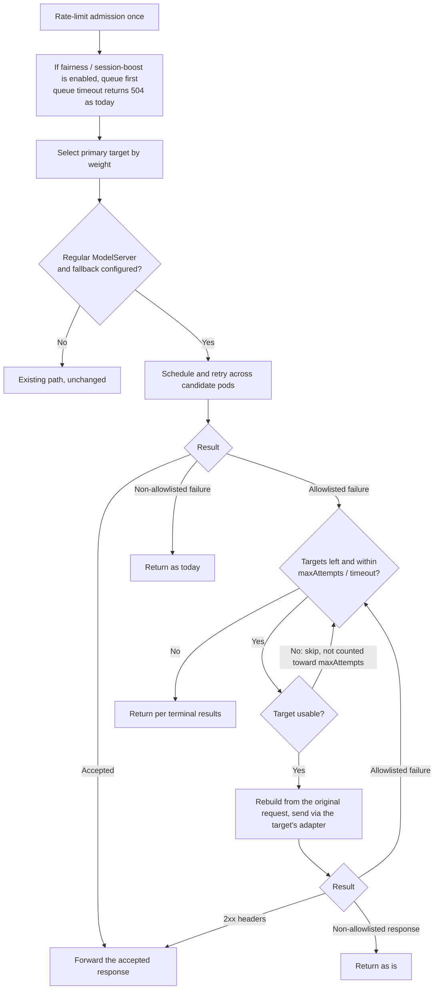

## ModelRoute Fallback: Switch to an ExternalModelProvider When the Local ModelServer Is Unavailable or Saturated

<!-- Issue: https://github.com/volcano-sh/kthena/issues/2036 -->

### Summary

Add an optional `fallback` field to `ModelRoute` rules. When the local `ModelServer` has no available pods, is saturated, or its upstream is unavailable, kthena-router switches **within the same request**, in order, to preconfigured `ExternalModelProvider`s, such as a self-hosted copy of the same model in another cluster or a public cloud API.

The feature is opt-in: without `fallback`, routing, status codes, rate limiting, and metrics behave exactly as they do today.

Phase one scope:

- The primary target is a regular (non-PD-disaggregated) `ModelServer`.
- Fallback targets can only be `ExternalModelProvider`s.
- A switch happens only before an attempt is **accepted**. An attempt is accepted once it receives 2xx response headers; after that, both pod-level retries and cross-target switching stop.

### Motivation

#### Scenario: fixed GPU capacity with an external backstop

A cluster has a fixed number of GPUs. Scaling out requires scheduling, pulling images, and loading weights, which can take several minutes or longer, while traffic spikes and node failures happen suddenly. A common practice is to serve everything in-cluster normally and, when saturated or failing, temporarily hand the requests the cluster cannot handle to the same model outside the cluster: a self-hosted copy in another data center, rented cloud GPUs, or a hosted public cloud API. To the router, each of these is an OpenAI-compatible HTTPS endpoint.

Kthena already has `ExternalModelProvider`. What is missing is automatic switching between the local `ModelServer` and it.

#### Current behavior: the request fails when the selected target cannot serve it

`targetModels` selects a single target by weight and never reselects ([`selectDestination`][select-dest]). On the regular ModelServer path, before the response is committed to the client, failures return:

| Case | Current response |
|---|---|
| No available pods ([code][no-pods]) | `503 no available pods for model server` |
| Filter plugins remove every candidate, e.g. all reach `maxWaitingRequests` ([`>=` check][least-req], [response][sched-400]) | `400 can't schedule to target pod` |
| All candidate pods fail: at most 5, or 1 on a session-sticky hit ([topN][top-n], [exhausted][all-failed]) | `503 request to all pods failed` |
| Queue wait timeout with the fairness / session-boost queue enabled ([code][queue-timeout]) | `504 Request processing timed out in queue` |

#### Relationship to existing work

- [#145](https://github.com/volcano-sh/kthena/issues/145) asked for "failover between different models" and was closed as ["#107 Done"][145-close]. PR #107 implemented retries **between candidate pods (and PD pairs) within a single ModelServer**, not cross-target switching. The docs home page lists "automated failover" ([intro][intro-29]); the existing routing capability we could verify is this pod / PD-pair retry.
- [#1024](https://github.com/volcano-sh/kthena/issues/1024) proposed external providers partly to "Fallback to cloud LLMs when GPU pods are unavailable"; the automatic switching half was not included when it landed.
- The [third-party model API proposal](./kthena-router-third-party-model-api.md) lists automatic cross-target fallback as an MVP [Non-Goal][proposal-ng]. This proposal fills that gap after the MVP.

| Capability | Problem it solves | Mechanism |
|---|---|---|
| Weighted split `weight` | Canary rollout | Active, proportional split |
| Autoscaler | Capacity shortage on the scale of minutes | Add or remove replicas |
| Pod-level retry (#107) | A single failing pod | Switch pods within one ModelServer |
| **fallback (this proposal)** | Availability before scale-out finishes, or when a whole ModelServer is down | Passive: fallback targets are used only after the primary fails |

#### Goals

- Configure ordered fallback `ExternalModelProvider`s on a `ModelRoute` rule.
- Switch only for allowlisted failure reasons; by default, enable only reasons that cannot cause a request to execute twice.
- Forward only the single final response, so the client never receives a mixed response.
- Provide a total budget shared by all attempts and a per-fallback-target header-wait limit.
- Admit and settle usage once per logical request; logs and metrics distinguish attempts from the final result.
- Without `fallback`, existing behavior (including status codes) is unchanged.

#### Non-Goals

- `ModelServer` as a fallback target (the API reserves `modelServerName`), PD-disaggregated primary targets, and routes with `loraAdapters`.
- Protocol translation between OpenAI and Anthropic.
- Switching or resuming after an attempt is accepted.
- Spilling over while a request waits in the fairness / session-boost queue; see [Queueing modes](#queueing-modes).
- Reselecting among multiple weighted primary targets; proactive routing by cost, latency, or quota.
- Concurrency limits and circuit breaking for fallback targets.
- Changing status codes when `fallback` is not configured. Returning `400` under saturation will be tracked in a separate issue.

### Proposal

#### User Stories

1. **Cross-cluster disaster recovery**: Data centers A and B each run Qwen3-32B, and data must not leave the company. When the `ModelServer` in A is entirely unavailable (node failure, or all pods recreated during a rolling upgrade), requests go to B automatically instead of users seeing 503.
2. **Peak-time backstop in the cloud**: The cluster has a fixed pool of eight GPUs. At peak, every pod's waiting queue is full and the autoscaler needs several minutes to add replicas. Overflow requests go to the same model on a public cloud during that window and return to the cluster once scale-out completes.
3. **Multi-level backstop**: Switch first to a self-hosted copy in another cluster, then to a public cloud if that is also unavailable. Within 60 seconds, the request must settle on who responds (usable response headers or an error) rather than waiting indefinitely while targets are tried one by one.

#### API example

```yaml
apiVersion: networking.serving.volcano.sh/v1alpha1
kind: ModelRoute
metadata:
  name: qwen3
spec:
  modelName: qwen3-32b
  rules:
  - name: default
    targetModels:
    - modelServerName: qwen3-local                   # primary: in-cluster GPUs
    fallback:
      targets:                                       # tried in order, same namespace as the ModelRoute
      - externalModelProviderName: qwen3-cluster-b
      - externalModelProviderName: cloud-qwen
      triggers: [NoAvailableBackend, Saturated, UpstreamUnavailable]
      maxAttempts: 2
      timeout: 60s
      attemptTimeout: 20s
```

| Field | Default | Description |
|---|---|---|
| `targets` | Required, 1–8, no duplicates | Fallback targets, tried in order. Phase one allows only `externalModelProviderName` |
| `triggers` | `[NoAvailableBackend, Saturated]` when omitted | Failure reasons that trigger a switch. `UpstreamUnavailable` can cause duplicate execution and must be enabled explicitly. An explicit `[]` is rejected |
| `maxAttempts` | `len(targets)` | Maximum number of fallback targets a request is actually sent to. Targets skipped before sending and pod attempts on the primary do not count |
| `timeout` | Unlimited | Budget shared by all attempts, ending when the final response is selected |
| `attemptTimeout` | Unlimited | How long each fallback target may take to return response headers |

> [!NOTE]
> The issue draft used the field name `on`. It is renamed to `triggers` because YAML 1.1 parsers treat an unquoted `on` as the boolean `true`.

#### Notes/Constraints/Caveats

- **Data egress**: After a switch, the request content is sent to the fallback target. The docs must say so clearly; users decide whether their data may leave.
- **HTTPS**: `ExternalModelProvider` requires an `https://` `baseURL` ([type definition][emp-https]). A self-hosted target needs TLS on its ingress.
- **Model equivalence**: The router does not check that a fallback target serves the same model; operators are responsible. `ExternalModelProvider.spec.model` handles model name mapping.
- **Duplicate execution**: "Not yet accepted" does not mean the request was not executed. The upstream may have processed it and still returned 503 / 504, or dropped the connection before responding. Switching then executes the request twice, and a pay-per-use external target may bill twice (existing pod-level retries already have this property). That is why `UpstreamUnavailable`, which can occur after the request is sent, is disabled by default.

#### Risks and Mitigations

| Risk | Mitigation |
|---|---|
| Client receives a mixed response | Only the final selected response is forwarded; other attempts write no headers or status |
| Duplicate execution and billing | By default, only triggers that occur before sending are enabled; the docs state the cost; the access log records every attempt |
| All traffic lands on fallback targets when the primary is fully down | Fallback traffic is counted separately for alerting. `maxAttempts` and `timeout` bound only a single request and do not protect fallback capacity; in phase one, users size fallback capacity assuming the primary is completely unavailable. Concurrency limits and circuit breaking are future work |
| Duplicated or misattributed billing and rate limiting | One admission and one settlement per logical request; see [Accounting and observability](#accounting-and-observability) |
| Changes to the main request path | Preparatory refactoring keeps behavior and status codes unchanged when fallback is disabled; covered by existing unit and E2E tests |

### Design Details

#### Request flow



#### Three rules

1. **Only the final selected response is forwarded.** The final response is either the accepted attempt or the error response chosen by the [terminal results](#fallback-target-handling-and-terminal-results). The current code `Header().Add`s upstream response headers into the response before forwarding ([code][hdr-add]), so checking `Written()` is not enough; classification must finish before headers are copied. Other attempts just close the upstream body. Headers set by middleware must be preserved (see [PR #1966][pr-1966]).
2. **Each attempt builds its request independently.** The client's original request bytes are an immutable template. Each attempt decodes them again (`UseNumber`) and applies the target's model name mapping; a shallow copy is not enough because adapters modify nested fields. Every fallback target goes through the same adapter flow as an `ExternalModelProvider` primary target and injects auth with **its own** Secret ([build][adapter-build], [auth][adapter-auth]). A request built for a previous attempt is never reused.
3. **Switch only to targets that support the current endpoint.** Comparing `providerType` is not enough: the OpenAI adapter accepts only three exact paths ([code][openai-paths]) and the Anthropic adapter only `/v1/messages` ([code][anthropic-path]). At runtime, the target adapter's own path check decides; unsupported targets are skipped.

#### Triggers

| Reason | Meaning | Request already sent? | Enabled by default |
|---|---|---|---|
| `NoAvailableBackend` | The primary currently has no available pods | No | Yes |
| `Saturated` | With least-request filtering enabled, every candidate pod's waiting queue has reached `maxWaitingRequests`. Other scheduling failures, such as plugin misconfiguration, are excluded | No | Yes |
| `UpstreamUnavailable` | Connection error, response header timeout, or 502 / 503 / 504. For the primary, every pod attempt allowed by retries must have failed for these reasons | Possibly | No |

No switch happens on: client cancellation, total budget exhaustion, router rate limiting and queue wait timeouts, 4xx, TLS errors, any error after an attempt is accepted, and LoRA routes. If any candidate pod of the primary fails for a non-allowlisted reason (e.g. 400), the request returns as it does today. Whether upstream `429` should trigger a switch is an [open question](#open-questions).

Classification needs each attempt's original error and cancellation source. Today the external path collapses transport errors into a generic `externalProxyError` ([code][ext-proxy-err]), and the ModelServer timeout cancels via `WithCancel` plus a timer ([code][ms-timeout]), so `context.Canceled` alone cannot tell a client disconnect from a timer expiry. After refactoring, each attempt returns a structured result (stage, original error, status code, cancellation source), with client cancellation and total budget exhaustion checked first.

#### Acceptance and timeouts

- With fallback enabled, any attempt (a pod of the primary or a fallback target) is accepted once it receives 2xx response headers, and both pod-level retries and cross-target switching stop. Later errors are not retried: if nothing has reached the client yet (e.g. a non-streaming body read fails), the router returns a generated `502`; if output has started, the response just ends. This differs from today, where the code moves on to the next pod in that case ([forwarding][forward-body], [retry][pod-retry]); the change applies only to rules with fallback configured. After acceptance, a streaming response may last indefinitely.
- The primary keeps the existing `ModelServer` timeout, which covers only up to the response headers ([code][ms-timeout]). External providers currently set no `http.Client.Timeout` ([code][ext-timeout]); as fallback targets, `attemptTimeout` bounds their wait for response headers. Their behavior as primary targets is unchanged.
- `timeout` starts when routing begins (`doLoadbalance`): without a queue the request goes there directly ([code][direct-lb]); in queueing modes that happens after dequeue ([code][queue-select]), so queue time is not included. It ends when the final response is selected. Each attempt's limit, and the time spent reading a failed response's body, is the smaller of its own limit and the remaining budget. The timer must stop on acceptance and must not cancel the stream afterward (reusing the existing `cancelOnClose` approach). When the budget runs out, the router returns `504`.
- `timeout` therefore bounds the time to settle on the final response headers. It does not bound the time to the client's first byte or the total duration, and it does not reserve time for later targets.

#### Queueing modes

With fairness or session-boost enabled, requests queue first and enter scheduling only after being dequeued ([code][queue-select]). Session-boost pauses dequeuing while every backend pod has waiting requests ([code][boost-backpressure]). That condition is met earlier than `Saturated` (every candidate at `maxWaitingRequests`), so under load a request is often already waiting in the queue before `Saturated` can fire, and it may wait until it times out without ever reaching fallback.

In phase one, fallback applies only after dequeue, and the docs state that with session-boost enabled, "switch to external when saturated" mostly does not take effect. Spilling over directly under queue backpressure, and whether to release the local inflight permit after switching, are open questions.

#### Fallback target handling and terminal results

| Case | Handling |
|---|---|
| Unusable before sending: target missing, credential Secret or key missing, endpoint unsupported | Skip and log; not counted toward `maxAttempts` |
| Sent, allowlisted failure | Keep the status code and headers; read at most 64 KiB of the body within the remaining budget, close it, try the next target |
| Sent, non-allowlisted response (400, 401, 403, etc.) | Return as is and stop |
| Every fallback target skipped before sending | Return the primary's original result, same as without fallback |
| The last **sent** attempt received an allowlisted HTTP response (later targets may all have been skipped) | Return its status code and headers. If the body was saved in full, return it as is; if it exceeded 64 KiB or was not read within the budget, the router generates the error body and resets `Content-Length` |
| The last sent attempt failed to connect / hit `attemptTimeout` / total budget exhausted | Router-generated `502` / `504` / `504` |

The attempt count and per-attempt results go only to the access log and metrics, not into the response, so provider error formats stay unchanged and internal topology is not exposed.

#### Phase one boundaries

- **PD disaggregation**: Checked at runtime; a PD-disaggregated primary takes the existing PD path and does not trigger fallback. The current code returns for "no available pods" before it reads `PDGroup` ([no pods][no-pods], [PDGroup][pd-group]), so the check must read the `ModelServer`'s `WorkloadSelector.PDGroup` directly, before `NoAvailableBackend` is determined.
- **LoRA**: The webhook rejects `loraAdapters` together with `fallback`. The existing webhook already forbids LoRA routes from referencing an `ExternalModelProvider` ([validator][lora-webhook]).
- **Mixed weighted primaries**: `targetModels` may contain both `ModelServer`s and `ExternalModelProvider`s. When an external target is selected, `fallback` does not apply.
- **Session sticky**: The current code `Delete`s the old binding and then `Commit`s before sending the request, and `Delete` does not compare the current value ([commit][sticky-commit], [store][sticky-store]). Simply deferring this could delete a healthy binding just committed by a concurrent request. Instead, commit at the acceptance point using compare-and-delete / compare-and-replace. On a cross-target switch, the primary's binding is left untouched and no binding is written for the fallback target.

#### Accounting and observability

The existing usage callback updates output rate limiting, the access log, metrics, and `TokenTracker` ([code][usage-callback]), and every `TokenTracker` update also increments the request count ([code][token-tracker]). By definition only the accepted attempt's body is parsed, so the usage callback fires at most once per logical request:

| Item | Rule |
|---|---|
| Input token rate limit | Pre-charged once at admission (as today); not charged again on switch and not refunded if all attempts fail, consistent with failed requests today |
| Output tokens, `TokenTracker`, metrics | Recorded once, by the accepted attempt only |
| Abandoned attempts | No usage callback. The upstream may have consumed tokens; the access log records usage as "unknown", not 0 |

The logical request's final target is decided when the final response is selected, not at the end of the request: the accepted attempt on a successful fallback, the last sent attempt if all fail, or the primary's result if all were skipped. At that point `BindDestination` is called once ([code][bind-dest]), and the error, `finishReason`, and pod information left by earlier attempts are cleared, since these fields are written independently ([code][finish-reason]). Gauges such as active upstream requests currently change only once a destination is bound ([code][active-gauge]); they are maintained per attempt instead, incrementing and decrementing with the same label set. Request counts are still recorded once at the end.

- **Access log**: A new attempt list records each attempt's target, failure reason, status code, and known usage, plus whether fallback occurred.
- **Metrics**: `kthena_router_requests_total` and similar metrics are still recorded once per logical request. A new `kthena_router_fallback_attempts_total{model, model_route, backend_type, backend_name, reason, result}` is added. `reason` takes only the three trigger reasons and `result` is `success` / `failed` / `skipped`; raw errors, URLs, pod IPs, and the like go only to logs, never into labels. Names can be adjusted in the implementation PR.

#### API definition

```go
type Rule struct {
	// ... existing fields unchanged ...

	// +optional
	Fallback *Fallback `json:"fallback,omitempty"`
}

type Fallback struct {
	// +kubebuilder:validation:MinItems=1
	// +kubebuilder:validation:MaxItems=8
	// +listType=atomic
	Targets []FallbackTarget `json:"targets"`

	// +optional
	// +kubebuilder:default={NoAvailableBackend,Saturated}
	// +kubebuilder:validation:MinItems=1
	// +listType=set
	Triggers []FallbackReason `json:"triggers,omitempty"`

	// Defaults to len(Targets), computed by the router.
	// +optional
	// +kubebuilder:validation:Minimum=1
	MaxAttempts *int32 `json:"maxAttempts,omitempty"`

	// +optional
	Timeout *metav1.Duration `json:"timeout,omitempty"`

	// +optional
	AttemptTimeout *metav1.Duration `json:"attemptTimeout,omitempty"`
}

// +kubebuilder:validation:XValidation:rule="has(self.externalModelProviderName) && self.externalModelProviderName != \"\" && (!has(self.modelServerName) || self.modelServerName == \"\")",message="only externalModelProviderName is supported as a fallback target"
type FallbackTarget struct {
	// Reserved for a later phase.
	// +optional
	ModelServerName string `json:"modelServerName,omitempty"`
	// +optional
	ExternalModelProviderName string `json:"externalModelProviderName,omitempty"`
}

// +kubebuilder:validation:Enum=NoAvailableBackend;Saturated;UpstreamUnavailable
type FallbackReason string
```

#### Validation

File-based configuration bypasses the API server: it applies its own defaulting and then calls the same Go validator ([code][filesource-validate]). The CRD schema (including defaults), file-mode defaulting, and the Go validator must therefore agree: an omitted `triggers` gets the default in both, and an explicit `[]` is rejected in both. The `ModelRoute` validator adds:

- `targets` allow only `externalModelProviderName`, with no duplicates;
- when `fallback` is set, `loraAdapters` must be empty;
- `triggers` values are valid, unique, and the list is not empty;
- `maxAttempts` is at most `len(targets)`; `timeout` and `attemptTimeout` are positive; when both are set, `attemptTimeout` is at most `timeout`.

Checks that need other objects run at runtime, matching the existing validator, which checks only the `ModelRoute` itself:

- A fallback target that does not exist, has unusable credentials, or does not support the endpoint is skipped with a log entry.
- If the primary is a PD-disaggregated `ModelServer`, it keeps its existing PD path and fallback is disabled for that request.

#### Test Plan

**Unit tests** (table-driven, with `-race` for concurrent parts):

- Triggers and classification: every triggering and non-triggering reason; client cancellation is distinguishable from timer expiry; default `triggers` exclude `UpstreamUnavailable`; mixed failures do not switch.
- Acceptance: with fallback enabled, a read failure after 2xx neither retries pods nor switches, and returns `502` if nothing was written; without fallback, pods are still retried as today; a streaming response keeps flowing past `timeout` after acceptance; other attempts leak no headers.
- Request building and auth: different model name mappings, large integers and nested fields; client credentials are not forwarded, and each fallback target uses its own credentials; unsupported endpoints are skipped.
- Every row of the terminal results table, including failed bodies over 64 KiB, body reads that exceed the budget, and all targets after the last sent attempt being skipped; the `maxAttempts`, `attemptTimeout`, and total budget limits.
- Accounting and observability: one admission and at most one usage settlement; no leftover primary error or pod after a successful fallback.
- Session sticky: cross-target switches leave bindings untouched; concurrent requests in one session do not delete a healthy binding.
- Validation: both the webhook and file-based configuration reject every invalid combination; PD primaries, selected external primaries, and queue timeouts do not trigger fallback.
- Without `fallback`, existing status codes and behavior are unchanged.

**E2E** (`test/e2e/router`, reusing `test/e2e/framework/` and `test/e2e/setup.sh`): switching to a mock `ExternalModelProvider` when the primary has no pods or is saturated; behavior on a primary 503 with `UpstreamUnavailable` enabled and disabled; streaming and non-streaming; switching to the second target when the first returns 503; returning a fallback target's 401 as is.

#### Rollout and rollback

- Ships in `v1alpha1` and affects only rules that explicitly configure `fallback`; no feature gate is needed.
- Older routers ignore the `fallback` field, so replicas may behave differently during a rolling upgrade. The docs advise upgrading the router before configuring `fallback`.
- Removing the `fallback` field restores the existing behavior.

### Alternatives

- **Priorities in `targetModels`**: split by weight within a priority level and fall back to lower priorities on failure. Rejected: it mixes "splitting" and "backstop" in one list and makes weights depend on priority; existing validation, `selectDestination`, and metrics all assume every listed target receives weighted traffic, so the change surface is larger.
- **A separate policy CRD** (e.g. `FallbackPolicy` attached via `targetRef`): phase one has only a few fields, and a separate CRD adds a controller, reference resolution, and status syncing. Fallback is tightly coupled to a rule's `targetModels`, so keeping it in the same object makes validation easier. It can be extracted later if fallback needs to be shared across routes.
- **Retry in the client or an outer gateway**: they cannot see pod-level state and cannot tell "no available pods / saturated" from ordinary errors; retries re-enter rate limiting and fairness admission, charging twice; and there is no unified configuration or observability.

### Open questions

1. Should upstream `429` trigger a switch? It may mean the fallback target is rate limiting, or that a quota is exhausted.
2. Is a budget allocation strategy needed to reserve time for later targets?
3. With session-boost enabled, can requests with fallback configured spill over directly under queue backpressure? How is per-user fairness preserved?
4. After switching to an external target, should the local inflight permit be released early?
5. Field naming: `fallback`, `triggers`, `maxAttempts`, `timeout`, `attemptTimeout`.

### Implementation plan

1. **API**: type definitions, CEL and the shared validator, `make generate`.
2. **Router refactoring**: structured attempt results, classify before forwarding, write the final response once, build each attempt's request independently, sticky commit timing and compare semantics, final attribution of logs and metrics. Behavior stays unchanged when fallback is disabled, so this can be submitted separately.
3. **Fallback logic** and **observability**.
4. **Tests and docs**: unit tests, E2E, user docs and `examples/`, documenting duplicate execution, data egress, and the session-boost limitation.

The implementation needs to coordinate with ongoing work (none merged as of 2026-11-17):

- [PR #1730][pr-1730] (wires up `trafficPolicy.retry`): once merged, the primary tries only the pods its retry policy allows, and `UpstreamUnavailable` is judged on those attempts; retry backoff also consumes the `timeout` budget.
- [PR #1894][pr-1894] (deferred charging and refunds of input quota): if it lands first, its charge and refund points are reused, with one charge and at most one refund per logical request.
- [PR #1914][pr-1914] (passes through selected non-retryable ModelServer 4xx responses: 400, 401, 403, 413, 422): changes the baseline for mixed failures.
- [PR #2042][pr-2042] (upstream input and cached token fields in the access log): attempt-level usage records share its structure.

Code references are based on [`3d0e3db8`](https://github.com/volcano-sh/kthena/tree/3d0e3db8ed70384da6fad91b8bfb2edf5046cd56).

[select-dest]: https://github.com/volcano-sh/kthena/blob/3d0e3db8ed70384da6fad91b8bfb2edf5046cd56/pkg/kthena-router/datastore/store.go#L1742
[no-pods]: https://github.com/volcano-sh/kthena/blob/3d0e3db8ed70384da6fad91b8bfb2edf5046cd56/pkg/kthena-router/router/router.go#L527-L531
[pd-group]: https://github.com/volcano-sh/kthena/blob/3d0e3db8ed70384da6fad91b8bfb2edf5046cd56/pkg/kthena-router/router/router.go#L626-L630
[least-req]: https://github.com/volcano-sh/kthena/blob/3d0e3db8ed70384da6fad91b8bfb2edf5046cd56/pkg/kthena-router/scheduler/plugins/least_request.go#L94
[sched-400]: https://github.com/volcano-sh/kthena/blob/3d0e3db8ed70384da6fad91b8bfb2edf5046cd56/pkg/kthena-router/router/router.go#L668-L672
[top-n]: https://github.com/volcano-sh/kthena/blob/3d0e3db8ed70384da6fad91b8bfb2edf5046cd56/pkg/kthena-router/scheduler/scheduler_impl.go#L37
[all-failed]: https://github.com/volcano-sh/kthena/blob/3d0e3db8ed70384da6fad91b8bfb2edf5046cd56/pkg/kthena-router/router/router.go#L1006-L1019
[direct-lb]: https://github.com/volcano-sh/kthena/blob/3d0e3db8ed70384da6fad91b8bfb2edf5046cd56/pkg/kthena-router/router/router.go#L399-L400
[forward-body]: https://github.com/volcano-sh/kthena/blob/3d0e3db8ed70384da6fad91b8bfb2edf5046cd56/pkg/kthena-router/providers/stream.go#L112-L117
[pod-retry]: https://github.com/volcano-sh/kthena/blob/3d0e3db8ed70384da6fad91b8bfb2edf5046cd56/pkg/kthena-router/router/router.go#L997-L1011
[active-gauge]: https://github.com/volcano-sh/kthena/blob/3d0e3db8ed70384da6fad91b8bfb2edf5046cd56/pkg/kthena-router/metrics/metrics.go#L857-L867
[queue-select]: https://github.com/volcano-sh/kthena/blob/3d0e3db8ed70384da6fad91b8bfb2edf5046cd56/pkg/kthena-router/router/router.go#L1718-L1733
[queue-timeout]: https://github.com/volcano-sh/kthena/blob/3d0e3db8ed70384da6fad91b8bfb2edf5046cd56/pkg/kthena-router/router/router.go#L1739-L1753
[boost-backpressure]: https://github.com/volcano-sh/kthena/blob/3d0e3db8ed70384da6fad91b8bfb2edf5046cd56/pkg/kthena-router/datastore/session_boost_queue.go#L368-L388
[sticky-commit]: https://github.com/volcano-sh/kthena/blob/3d0e3db8ed70384da6fad91b8bfb2edf5046cd56/pkg/kthena-router/router/router.go#L811-L818
[sticky-store]: https://github.com/volcano-sh/kthena/blob/3d0e3db8ed70384da6fad91b8bfb2edf5046cd56/pkg/kthena-router/sessionsticky/store.go#L130-L158
[ext-timeout]: https://github.com/volcano-sh/kthena/blob/3d0e3db8ed70384da6fad91b8bfb2edf5046cd56/pkg/kthena-router/providers/adapter.go#L406-L415
[adapter-build]: https://github.com/volcano-sh/kthena/blob/3d0e3db8ed70384da6fad91b8bfb2edf5046cd56/pkg/kthena-router/providers/adapter.go#L182-L217
[adapter-auth]: https://github.com/volcano-sh/kthena/blob/3d0e3db8ed70384da6fad91b8bfb2edf5046cd56/pkg/kthena-router/providers/adapter.go#L259-L310
[openai-paths]: https://github.com/volcano-sh/kthena/blob/3d0e3db8ed70384da6fad91b8bfb2edf5046cd56/pkg/kthena-router/providers/openai.go#L93-L95
[anthropic-path]: https://github.com/volcano-sh/kthena/blob/3d0e3db8ed70384da6fad91b8bfb2edf5046cd56/pkg/kthena-router/providers/anthropic.go#L38-L40
[ext-proxy-err]: https://github.com/volcano-sh/kthena/blob/3d0e3db8ed70384da6fad91b8bfb2edf5046cd56/pkg/kthena-router/router/router.go#L1331-L1338
[hdr-add]: https://github.com/volcano-sh/kthena/blob/3d0e3db8ed70384da6fad91b8bfb2edf5046cd56/pkg/kthena-router/router/router.go#L1385-L1392
[ms-timeout]: https://github.com/volcano-sh/kthena/blob/3d0e3db8ed70384da6fad91b8bfb2edf5046cd56/pkg/kthena-router/router/router.go#L1459-L1478
[usage-callback]: https://github.com/volcano-sh/kthena/blob/3d0e3db8ed70384da6fad91b8bfb2edf5046cd56/pkg/kthena-router/router/router.go#L1064-L1086
[token-tracker]: https://github.com/volcano-sh/kthena/blob/3d0e3db8ed70384da6fad91b8bfb2edf5046cd56/pkg/kthena-router/datastore/token_tracker.go#L275-L298
[finish-reason]: https://github.com/volcano-sh/kthena/blob/3d0e3db8ed70384da6fad91b8bfb2edf5046cd56/pkg/kthena-router/router/router.go#L70-L80
[bind-dest]: https://github.com/volcano-sh/kthena/blob/3d0e3db8ed70384da6fad91b8bfb2edf5046cd56/pkg/kthena-router/metrics/metrics.go#L753-L781
[filesource-validate]: https://github.com/volcano-sh/kthena/blob/3d0e3db8ed70384da6fad91b8bfb2edf5046cd56/pkg/kthena-router/filesource/source.go#L262-L272
[lora-webhook]: https://github.com/volcano-sh/kthena/blob/3d0e3db8ed70384da6fad91b8bfb2edf5046cd56/pkg/kthena-router/webhook/validator.go#L243-L244
[emp-https]: https://github.com/volcano-sh/kthena/blob/3d0e3db8ed70384da6fad91b8bfb2edf5046cd56/pkg/apis/networking/v1alpha1/externalmodelprovider_types.go#L74-L79
[intro-29]: https://github.com/volcano-sh/kthena/blob/3d0e3db8ed70384da6fad91b8bfb2edf5046cd56/docs/kthena/docs/intro.md#L29
[proposal-ng]: https://github.com/volcano-sh/kthena/blob/3d0e3db8ed70384da6fad91b8bfb2edf5046cd56/docs/proposal/kthena-router-third-party-model-api.md#L92-L93
[145-close]: https://github.com/volcano-sh/kthena/issues/145#issuecomment-3688437815
[pr-1730]: https://github.com/volcano-sh/kthena/pull/1730
[pr-1894]: https://github.com/volcano-sh/kthena/pull/1894
[pr-1914]: https://github.com/volcano-sh/kthena/pull/1914
[pr-1966]: https://github.com/volcano-sh/kthena/pull/1966
[pr-2042]: https://github.com/volcano-sh/kthena/pull/2042
