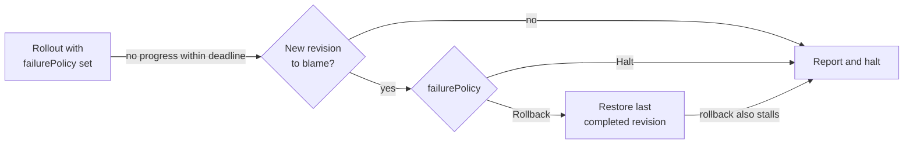

## ModelServing Automatic Rollback

### Summary

When the new revision of a ModelServing cannot become Ready, the rollout stalls
without reporting anything, and recovery waits for a person to notice. This
proposal lets the controller detect a stalled rollout and decide whether the
new revision caused it. If the user opts in, the controller then rolls back to
the last revision that completed. A rollback is an ordinary spec change handled
by the existing rolling update, so no new rollout mechanism is needed.

### Motivation

- **A failed rollout looks like a slow one.** Status stays `Progressing` or
  `UpdateInProgress` indefinitely. `progressDeadlineSeconds` exists, but only
  for in-place updates, and even there it retries the same revision rather than
  reporting a failure.
- **The damage can be total.** A single ServingGroup, the recommended setup for
  `RoleRollingUpdate`, is fully down after a bad update. `maxUnavailable: 100%`
  has the same effect for any replica count.
- **Recovery is manual and slow.** The `kthena rollout undo` command from
  [ModelServing Revision History and
  Rollback](./modelserving-revision-history-and-rollback.md) is not implemented
  yet, and it would still need someone to run it. Model rollouts take tens of
  minutes on scarce accelerators, so failures often go unattended for a long
  time.

#### Goals

- Detect a stalled rollout reliably, including across controller restarts.
- Roll back only when the new revision is to blame.
- Make rollback opt-in, at most once per failed revision, and safe against
  concurrent edits.

#### Non-Goals

- Analysis based on metrics or SLOs. The control plane must not depend on the
  router, but external tools can act on the condition this proposal adds.
- Rolling back inputs that revisions do not store, such as ConfigMaps, Secrets
  or model weights.
- Rolling back a single Role, or adding a general `paused` field.

### Design Logic

The design answers five questions in order, and each answer constrains the
next.



#### 1. When has a rollout failed?

**Decision:** A rollout fails when it makes no progress for
`progressDeadlineSeconds` while some target unit has not been Ready yet.
Progress means a new high in the number of target units created, or in the
number that are Ready. A unit is a ServingGroup, or a Role instance under
`RoleRollingUpdate`.

**Why:**

- **Readiness is the only signal the controller owns.** Using router metrics
  would couple the two planes.
- **Measure from the last progress, not from the start.** This tolerates long
  model loads and large rollouts. The rollout fails only when nothing has moved
  forward for the whole deadline.
- **Count high-water marks, not current counts.** A crash-looping unit that
  recovery deletes and recreates returns to an earlier count, so it never looks
  like progress.
- **Wait only for units that have never been Ready.** A unit that was Ready and
  then failed is left to recovery. Otherwise a canary held at a partition for
  days would fail, and roll back, on a single crash.
- **Reuse the existing field.** `progressDeadlineSeconds`, with its default of
  1800 seconds and minimum of 60, extends to every update method instead of
  adding a second setting.
- **Keep the clock in status.** A controller restart then neither resets nor
  extends the deadline.

#### 2. Is the new revision to blame?

**Decision:** Classify the evidence on target units.

| The new revision is to blame (`WorkloadFailure`) | The environment is to blame (`InfrastructureBlocked`) |
| --- | --- |
| A container crashes or restarts unexpectedly | A Pod cannot be scheduled |
| An image pull or container config error | A Volcano PodGroup is not scheduled |
| A Pod reaches phase `Failed` | A Pod is evicted or preempted |
| A Pod is scheduled and started but never becomes Ready | Revision history is missing |

**Why:**

- **Rolling back an environmental failure does not help.** The old revision
  needs the same GPUs, and the rollback costs another model reload. Rollback
  therefore requires positive evidence against the revision.
- **Evidence is recorded in status.** Recovery deletes failed Pods, so the
  evidence would otherwise disappear before the deadline passes.

#### 3. What should the controller do?

**Decision:** Add `rolloutStrategy.failurePolicy.action`:

| Action | `WorkloadFailure` | `InfrastructureBlocked` |
| --- | --- | --- |
| unset | nothing: no tracking, no status change | the same |
| `Halt` | report, stop replacing outdated units | the same |
| `Rollback` | roll back | report, stop replacing outdated units |

**Why:**

- **Reporting alone is not enough here.** Kubernetes Deployments only report,
  and leave rollback to a higher-level orchestrator. RBG offers only a manual
  `rollout undo`. Nothing sits above ModelServing, so reporting alone leaves
  users without recovery.
- **Rewriting a user's spec must be opt-in.** It surprises users and conflicts
  with GitOps tools. With no policy, nothing changes, not even status.
- **`Halt` is deliberately narrow.** It only stops replacing healthy units with
  a revision that has failed. It is not a general pause, which RBG's KEP-455
  rejected because of its interactions with scaling, recovery and surge
  capacity. A Halt lifts once a target unit becomes Ready or the spec changes.

#### 4. Which revision should it roll back to?

**Decision:** Roll back to `status.currentRevision`, the last revision that
completed, never to the numerically previous revision.

**Why:**

- **The previous revision may also be bad.** After `A → B → C` where B and C
  both failed, the previous revision is B. Revision numbers are bookkeeping and
  identity comes from content, as in RBG.
- **This depends on [#1960](https://github.com/volcano-sh/kthena/pull/1960).**
  That fix ensures `currentRevision` is not overwritten by a target that never
  became Ready. Revision cleanup already keeps `currentRevision`.

#### 5. How is a rollback applied safely?

**Decision:**

- **Change the spec.** Restore only each Role's `entryTemplate`,
  `workerTemplate` and `workerReplicas` from the snapshot, and keep everything
  else.
- **Record intent first.** Write the intent to status, then write the spec with
  a `resourceVersion` precondition.
- **Roll back at most once** per failed revision.

**Why:**

- **A spec change reuses everything.** Scale-up, recovery, partition recovery,
  in-place updates and coordinated rollouts all derive their target from the
  spec. A rollback that only changes status, as Argo Rollouts does, would need
  a new pinned-target concept in every one of those paths. Kthena also has no
  separate stable set to fall back to. A spec change is also how the manual
  undo and RBG's `rollout undo` work, so both share one code path.
- **Restore only Role templates.** The update webhook makes `plugins`,
  `schedulerName` and the set of Role names immutable. `replicas` and rollout
  controls are operational fields owned by users and the autoscaler.
- **Intent first.** A restart between deciding and writing then resumes the
  rollback or abandons it, and never applies it twice. RBG uses the same
  pattern with `rolloutReplacementState`.
- **`resourceVersion` makes a concurrent user edit win.** The rollback is
  abandoned instead of overwriting it.
- **Once per revision prevents loops.** If a GitOps tool re-applies the failed
  revision, its second failure halts instead of rolling back again. If the
  rollback's own rollout stalls, the controller reports `RollbackFailed` and
  halts.

### Design Details

#### API

```yaml
spec:
  rolloutStrategy:
    progressDeadlineSeconds: 1800   # existing field, now applies to every update method
    failurePolicy:
      action: Rollback              # Halt | Rollback; unset disables failure detection
```

```go
type RolloutFailurePolicy struct {
	// +kubebuilder:validation:Enum={Halt,Rollback}
	Action RolloutFailureAction `json:"action"`
}

type ModelServingStatus struct {
	// ... existing fields ...
	RolloutProgress *RolloutProgress   `json:"rolloutProgress,omitempty"`
	LastRollback    *AutomaticRollback `json:"lastRollback,omitempty"`
}

// RolloutProgress keeps the deadline clock and the failure evidence for one target revision.
type RolloutProgress struct {
	Revision         string      `json:"revision"`
	MaxTargetUnits   int32       `json:"maxTargetUnits"`
	MaxReadyUnits    int32       `json:"maxReadyUnits"`
	LastProgressTime metav1.Time `json:"lastProgressTime"`
	WorkloadFailures int32       `json:"workloadFailures,omitempty"`
}

// AutomaticRollback is written before the spec, so a restart can resume or abandon it.
type AutomaticRollback struct {
	FromRevision string      `json:"fromRevision"`
	ToRevision   string      `json:"toRevision"`
	Phase        string      `json:"phase"` // Pending | Applied | Completed | Abandoned
	Reason       string      `json:"reason"`
	StartTime    metav1.Time `json:"startTime"`
}
```

A new `RolloutFailed` condition is independent of `Available`, `Progressing`
and `UpdateInProgress`, like `CoordinatedRoleRolloutBlocked`. It is added only
once a rollout fails.

| Status | Reasons |
| --- | --- |
| `True` | `WorkloadFailure`, `InfrastructureBlocked`, `RollbackNotApplicable`, `RollbackFailed` |
| `False` | `RolledBack`, `RolloutResumed` |

Each transition also emits an event.

#### Rollback Preconditions

If any precondition fails, the controller halts with reason
`RollbackNotApplicable`.

1. The failure reason is `WorkloadFailure`.
2. `currentRevision` differs from `updateRevision` and resolves to a snapshot
   owned by this ModelServing.
3. `updateRevision` has not been rolled back since the last completed rollout,
   and is not itself the result of a rollback.
4. The snapshot's `plugins` and `schedulerName` equal the current values.

#### Interactions

- **Autoscaler and manual rollback.** Both are preserved. The autoscaler only
  writes `replicas`, and a manual undo during a rollback wins through the
  `resourceVersion` check.
- **Partitions.** Only units beyond the partition move back. A partitioned
  canary with `Rollback` is the safest setup.
- **In-place updates.** An in-place update that exceeds the deadline counts as
  evidence against the target revision. Its existing recovery is unchanged. An
  image-only rollback then completes in place.
- **Early rollback `A → B → A`.** This needs dedicated tests with `maxSurge`
  and coordinated Roles, because RBG documents a stall in the same situation.

#### Test Plan

- **Unit tests:**
  - High-water progress and restart safety.
  - Every row of the evidence table.
  - Each policy against each failure reason.
  - Each precondition.
  - Persisting intent, then resuming or abandoning it.
  - Once-per-revision protection.
- **End-to-end tests:**
  - A bad image on one ServingGroup rolls back.
  - An unschedulable revision halts without rolling back.
  - A partitioned canary rolls back.
  - Re-applying the failed revision halts.
  - A controller restart between recording intent and writing the spec.
  - Early rollback with `maxSurge`.

### Alternatives

- **Roll back after N crashes instead of a deadline.** Faster, but noisy while
  large models start. It could be added later as an extra trigger.
- **A separate rollback CRD or controller.** It adds a state machine where a
  policy on the existing rollout strategy is enough.

