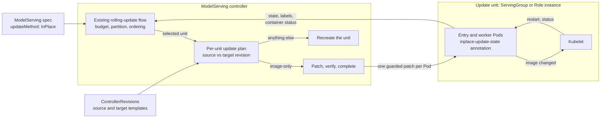
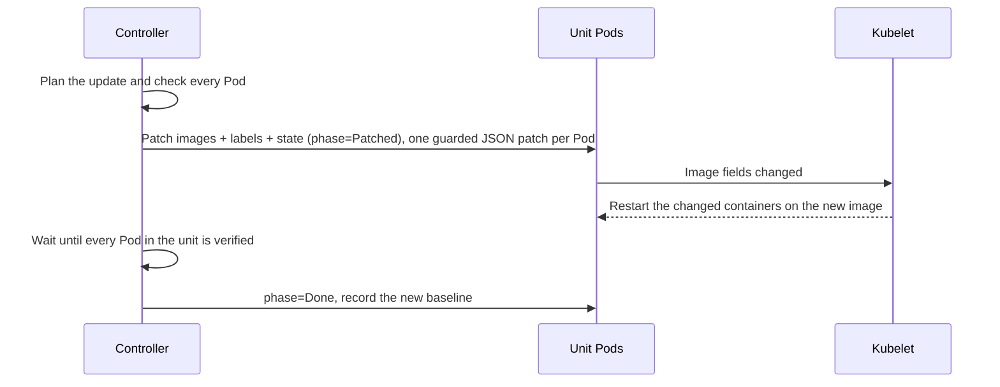
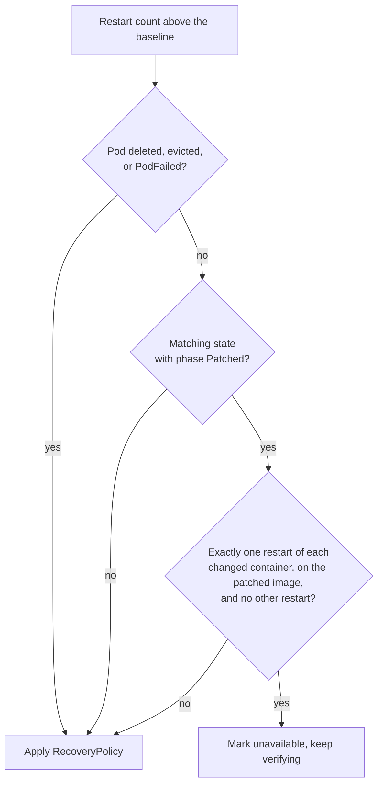

## ModelServing In-Place Rolling Update

### Summary

This proposal adds an in-place update method to `ModelServing` rollouts. When an update only changes regular-container images, Kthena patches `spec.containers[*].image` on the existing Pods instead of deleting and recreating them. Kubelet restarts only the changed containers. Pod names, UIDs, IPs, node assignments, Pod-scoped volumes, Services, and PodGroups are preserved.

The update method is a new field, `rolloutStrategy.updateMethod`, that is independent of the rollout granularity in `rolloutStrategy.type`. Under `ServingGroupRollingUpdate` the unit of update is a ServingGroup; under `RoleRollingUpdate` it is a single Role instance.

`InPlace` means "in place when possible". The controller decides per unit: a unit whose change is image-only is patched, and any other unit is recreated exactly as under `Recreate`, with an `InPlaceUpdateFallback` event that explains why. There is no admission webhook for the update method.

All in-progress state lives on the Pods being updated. Every step is one guarded patch to one Pod, and the next step is derived from observed Pod state, so a restarted controller resumes by running the same reconciliation. `ModelServing.status` gains no new fields.

### Motivation

`ServingGroupRollingUpdate` and `RoleRollingUpdate` replace outdated resources. Replacement is necessary for immutable Pod changes, but it is unnecessarily expensive when only a container image changes. Recreating a ServingGroup or Role can lose:

- Pod identity, IP, and node placement;
- accelerator and topology assignments;
- Pod-scoped data such as downloaded models or caches in `emptyDir`;
- existing Services and PodGroups; and
- scheduling and gang-admission work already completed for the workload.

Large inference workloads are particularly sensitive to rescheduling, image distribution, model initialization, and cache warm-up. An in-place update still restarts the affected process and does not preserve process memory, but it avoids repeating unrelated scheduling and data-preparation work.

Directly patching images is not enough:

- The controller treated any container with `restartCount > 0` as an error Pod and applied the recovery policy, so the expected restart would recreate the Role or ServingGroup.
- Rollout selection assumed that every Pod in a ServingGroup carries the same revision label.
- A change that is not image-only, or a Pod that drifted from its revision, cannot be applied by an image patch.

The in-place method therefore needs a per-unit eligibility check, restart attribution, a resumable per-Pod protocol, and completion tracking.

#### Goals

- Add an opt-in update method that patches images when only images change, and preserves Pod identity and placement.
- Support it at both existing granularities: ServingGroup and Role.
- Reuse the existing rolling-update flow: the same `maxUnavailable` budget, `partition`, ordering, and candidate selection as `Recreate`.
- Recreate a unit as under `Recreate` when it cannot be updated in place, and report why.
- Keep all in-progress state on the Pods, so that every step is idempotent and resumable after a controller restart.
- Tell the restart caused by the image change apart from restarts for other reasons.
- Detect an update that does not finish with a progress deadline, as Deployment does.

#### Non-Goals

- Refreshing an unchanged mutable image tag.
- Updating init-container images or non-image Pod fields, including in-place resource resize.
- Surging while units are updated in place. A Pod that is updated in place is not a new Pod, so there is nothing to surge.
- Changing the target of an unfinished in-place update in place. The unit is recreated instead; see [Retarget and rollback](#retarget-and-rollback).
- Automatically rolling back a failed update.
- Withdrawing traffic from a unit before its containers restart. This is planned through the Kthena Router; see [Future work](#future-work).
- Installing OpenKruise controllers, CRDs, webhooks, or node components.

### Proposal

Users select the update method with `spec.rolloutStrategy.updateMethod`. The granularity stays in `spec.rolloutStrategy.type`.

```yaml
apiVersion: workload.serving.volcano.sh/v1alpha1
kind: ModelServing
metadata:
  name: llama
spec:
  replicas: 4
  rolloutStrategy:
    type: ServingGroupRollingUpdate
    updateMethod: InPlace
    progressDeadlineSeconds: 1800
    rollingUpdateConfiguration:
      maxUnavailable: 1
  template:
    roles:
      - name: server
        replicas: 1
        workerReplicas: 2
        entryTemplate:
          spec:
            containers:
              - name: inference
                image: example.com/inference:v2
```

A single-ServingGroup deployment with several Role replicas uses Role granularity, so only one Role instance is out of service at a time:

```yaml
spec:
  replicas: 1
  rolloutStrategy:
    type: RoleRollingUpdate
    updateMethod: InPlace
  template:
    roles:
      - name: decode
        replicas: 4
        maxUnavailable: 1
        # ...
```

Omitting `updateMethod`, or setting it to `Recreate`, keeps the existing replacement behavior of either `type`. Existing manifests do not change.

| `type`                      | `updateMethod`        | Behavior                                                              |
| --------------------------- | --------------------- | --------------------------------------------------------------------- |
| `ServingGroupRollingUpdate` | omitted or `Recreate` | Replace outdated ServingGroups (existing)                             |
| `ServingGroupRollingUpdate` | `InPlace`             | Patch images per ServingGroup, or recreate a ServingGroup that cannot |
| `RoleRollingUpdate`         | omitted or `Recreate` | Replace outdated Role instances (existing)                            |
| `RoleRollingUpdate`         | `InPlace`             | Patch images per Role instance, or recreate an instance that cannot   |

#### Architecture at a glance



| Component | Responsibility |
| --------- | -------------- |
| ModelServing controller | Selects units with the existing rolling-update flow, decides per unit between an in-place update and a recreate, and drives in-place units through patch, verify, and complete |
| ControllerRevisions | Hold the source and target templates that the per-unit eligibility check compares |
| Pod annotation | The only in-progress state: the per-Pod update state |
| Kubelet | Restarts only the containers whose image changed, and reports the running image and restart counts |

#### Update units

| `type`                      | Unit of update                                                   | Budget and partition                                                           |
| --------------------------- | ---------------------------------------------------------------- | ------------------------------------------------------------------------------ |
| `ServingGroupRollingUpdate` | One ServingGroup: every entry and worker Pod in it               | `rolloutStrategy.rollingUpdateConfiguration`, counted in ServingGroups         |
| `RoleRollingUpdate`         | One Role instance (one `role-id`): its entry Pod and its workers | The Role's own `maxUnavailable` and `partition`, counted in Role instances |

The unit is the smallest set of Pods that must move together:

- Inside a Role instance, the entry and worker processes form one distributed engine. They must run the same image, and their restarts are coupled. A Role instance is therefore never split.
- Across Role instances there is no such coupling at the process level. Updating one Role instance while others keep serving has the same cross-Role effect as `RoleRollingUpdate` replacement has today.
- Users who need prefill and decode to switch versions together choose `ServingGroupRollingUpdate`.
- Under `RoleRollingUpdate`, only Roles whose template changed are updated.

#### User Stories

##### Story 1: Patch-release engine upgrade on a multi-node deployment

An operator runs a large model with one entry Pod and several worker Pods per ServingGroup. The weights are downloaded into an `emptyDir` by an init container, and gang scheduling took minutes to place the group. A patch release of the inference engine only changes the image. With `ServingGroupRollingUpdate` and `updateMethod: InPlace`, each group's entry and worker containers restart with the new image on the same nodes, the downloaded weights are reused, and the group counts as updated once every Pod is Ready on the new image.

##### Story 2: Single ServingGroup with replicated Roles

A deployment has one ServingGroup with a `prefill` Role (2 replicas) and a `decode` Role (4 replicas). With `RoleRollingUpdate` and `updateMethod: InPlace`, Kthena updates one Role instance at a time within each Role's `maxUnavailable`. The service keeps serving throughout the update.

##### Story 3: A change that is not image-only

The operator changes an image and an argument together. The controller recreates each unit as under `Recreate`, within the same `maxUnavailable` budget, and emits one `InPlaceUpdateFallback` event per unit that names the reason. No request is rejected.

#### Notes/Constraints/Caveats

- A unit counts as unavailable while it is updated. If a unit is the only one serving, for example `replicas: 1` under `ServingGroupRollingUpdate`, the service is unavailable until it is Ready on the new image. To avoid this, set `maxUnavailable: 0` and `maxSurge: 1`, which makes the whole ModelServing fall back to `Recreate` with surge.
- Traffic is not withdrawn before the containers restart. Requests in flight on a restarting container fail, and kubelet removes the Pod from Service endpoints only once it reports NotReady.
- `RoleRollingUpdate` acts on all ServingGroups at the same time, as it does today.
- Init-container images and unchanged mutable tags are not updated. An omitted `imagePullPolicy` is not re-resolved: a Pod keeps its admitted pull policy after its image tag changes.
- Unchanged containers keep their container IDs, but applications must tolerate independent restarts of their peers.
- Stable Pod identity does not preserve process memory. Router state keyed by Pod, such as the KV-cache-aware plugin's block index, may still describe the pre-restart cache.
- After an in-place update, container restart counts stay above zero. The controller compares against a recorded baseline instead of `restartCount > 0`; see [Restart attribution](#restart-attribution).

#### Risks and Mitigations

| Risk | Mitigation |
| ---- | ---------- |
| A crash between steps leaves the Pods of one unit in different states | Every step is idempotent and derived from the Pods' own state; see [Controller restart and crash points](#controller-restart-and-crash-points) |
| The in-memory datastore derives a ServingGroup's revision from its Pod labels, which already show the target revision while a unit is in update | A unit with an unfinished update is kept outdated in the store at its source revision and Role template hash until it completes |
| A change cannot be applied by an image patch | The unit is recreated as under `Recreate`, within the same budget, and an event reports why |
| A Pod's live image differs from its source revision, for example after a manual edit | The patch never overwrites it: the unit is recreated with reason `UnexplainedImageDrift` |
| A bad target image crash-loops or never becomes ready | An unexpected restart follows the `RecoveryPolicy`. A unit that is not Ready on the target image within `progressDeadlineSeconds` has its unverified Pods follow the `RecoveryPolicy`. A unit never takes more than its one budget slot |
| The revision history of a unit's source revision was cleaned up | The unit is recreated with reason `RevisionHistoryMissing`. A Role that did not change keeps an old revision label, so its source template is found by its Role template hash in any retained revision |
| Events on the ModelServing are rate-limited by the client to 25 per object and type | Only `InPlaceUpdateStarted`, `InPlaceUpdateCompleted`, `InPlaceUpdateFallback`, and Warnings are emitted; the expected restart and the image patch are only logged |
| Controller downgrade during or after an in-place update | See [Version skew](#version-skew) |

### Design Details

#### API

```go
type RolloutStrategy struct {
    Type RolloutStrategyType `json:"type"`

    // UpdateMethod selects how outdated ServingGroups or Roles are moved to the desired revision.
    // Supported values are Recreate (default) and InPlace.
    //
    // InPlace patches container images on existing Pods when only regular-container images change.
    // Otherwise the ServingGroup, or the Role instance under RoleRollingUpdate, is recreated, and an InPlaceUpdateFallback event reports why.
    //
    // +kubebuilder:default=Recreate
    // +kubebuilder:validation:Enum={Recreate,InPlace}
    // +optional
    UpdateMethod UpdateMethod `json:"updateMethod,omitempty"`

    // ProgressDeadlineSeconds is the maximum time for a ServingGroup or Role instance updated in place to become ready on the target image.
    // After it passes, Pods that are not ready follow the RecoveryPolicy.
    // It only applies to in-place updates, and defaults to 1800 seconds.
    // +kubebuilder:validation:Minimum=60
    // +optional
    ProgressDeadlineSeconds *int32 `json:"progressDeadlineSeconds,omitempty"`

    RollingUpdateConfiguration *RollingUpdateConfiguration `json:"rollingUpdateConfiguration,omitempty"`
    // ...
}

// UpdateMethod defines how outdated Pods are moved to the desired revision.
type UpdateMethod string

const (
    // RecreateUpdateMethod deletes outdated Pods and creates new ones.
    RecreateUpdateMethod UpdateMethod = "Recreate"

    // InPlaceUpdateMethod patches container images on existing Pods when possible, and recreates them otherwise.
    InPlaceUpdateMethod UpdateMethod = "InPlace"
)
```

`updateMethod` has the CRD default `Recreate`, which applies only to objects that set `rolloutStrategy`; the controller treats an empty value as `Recreate` as well. `progressDeadlineSeconds` has no CRD default; the controller applies the 1800-second default at runtime, which is longer than Deployment's 600 seconds because loading a large model routinely takes several minutes. No status fields are added.

There is no admission webhook for these fields. Every change is accepted, and the controller decides per unit whether it can be updated in place. An earlier version of this design rejected ineligible changes at admission; see [Alternatives](#admission-webhook-for-eligibility).

#### Eligibility

The controller compares each unit's actual source revision with the target revision when it selects the unit. `inplace.PlanUpdate` returns either the changed regular-container images of each Pod template, or the reason the change cannot be applied in place:

- **ServingGroup units.** The new images are copied into the source ModelServing by Role and container name, and the result is compared with the target using the canonical revision data (`utils.BuildRevisionData`). The comparison covers exactly the fields that define a revision's Pods: the Roles' entry and worker templates, `workerReplicas`, `spec.schedulerName`, and plugins, after the same normalization the revision hash uses. Scaling and rollout fields, `gangPolicy`, and `networkTopology` are not part of the revision data, so they never block an in-place update.
- **Role instance units.** The same copy is compared with the Role template hash, so only the Role being updated is checked.

Copying images by container name means that any other difference, such as a renamed or added container, a changed argument, an init-container image, or a Pod template label, still makes the comparison fail. A plan is computed once per source revision (and Role) in each reconciliation.

Before any Pod of a unit is patched, every Pod is checked against its source template:

- the Pod has `restartPolicy: Always` and no regular container sets its own restart policy or restart rules, because kubelet restarts a container on a new image only then;
- the Pod's containers match the target template; and
- every live image equals the image of the Pod's source revision. Any other live image is drift, and the patch must not overwrite it.

A failure at any of these checks recreates the unit with a `Fallback` that carries the reason:

| Reason | Cause |
| ------ | ----- |
| `InPlaceUpdateIneligible` | The change is not image-only, the Pod's restart behavior is not `Always`, or a Pod belongs to no template of the target revision |
| `UnexplainedImageDrift` | A live image differs from the Pod's source revision |
| `RevisionHistoryMissing` | A Pod has no revision label, or the ControllerRevision of its source revision is missing or unreadable |
| `InPlaceRetargetNotSupported` | The target changed while the unit's update was unfinished |

A failure to read the revision history from the API server is an error, not a fallback: the reconciliation fails and is retried.

The whole ModelServing falls back to `Recreate`, including `maxSurge`, when:

- a configured plugin does not support in-place updates (see [Plugin semantics](#plugin-semantics)); or
- under `ServingGroupRollingUpdate`, `maxUnavailable` resolves to 0, because an in-place update takes its unit out of service.

Under `RoleRollingUpdate`, a Role whose `maxUnavailable` resolves to 0 is recreated in the same way, while other Roles are still updated in place. A failure to build the plugin chain is an error and is retried, not a fallback.

#### Revisions

The target revision of every unit is the ModelServing's current revision. Before the first Pod of a rollout is patched, the controller records the target revision's ControllerRevision, so a later update can read it as its source. The revision name excludes Role replicas and rolling-update settings, so an existing ControllerRevision of the same name already holds the same Pod templates and is reused instead of being rewritten.

A unit's source revision is the revision label of its Pods. Under `RoleRollingUpdate`, a Role that did not change in a previous rollout keeps an older revision label, whose ControllerRevision may have been cleaned up. Its source template is then found by its Role template hash in any retained ControllerRevision. The listed ControllerRevisions fill the per-reconciliation cache, so each is read once.

While a unit is in update, its Pod labels already show the target revision. The controller keeps such a unit outdated in the in-memory store at its source revision and Role template hash, taken from the Pods' update state, until the update completes. This also holds after the store is rebuilt from Pod labels, and under either update method.

#### Pod state

Each Pod being updated carries one controller-owned annotation:

```text
modelserving.volcano.sh/inplace-update-state
```

Its value is versioned JSON:

```json
{
  "version": 1,
  "ownerUID": "<ModelServing UID>",
  "podUID": "<Pod UID>",
  "sourceRevision": "<revision>",
  "targetRevision": "<revision>",
  "sourceRoleTemplateHash": "<hash>",
  "phase": "Patched | Done",
  "startedAt": "<RFC3339>",
  "baseline": {
    "<container name>": {"containerID": "<id>", "restartCount": 0}
  },
  "patched": {
    "<changed container name>": {"image": "<target image>", "restartCount": 0, "imageID": "<id>"}
  }
}
```

- A state whose `ownerUID` or `podUID` does not match the live objects is ignored, as if absent. A stale or malformed state can never exempt a restart from recovery.
- A unit is **in update** while any of its Pods has a matching state with `phase: Patched`. That is the only definition of an in-progress update.
- `baseline` holds the restart counts at patch time. `patched` holds, for each container whose image the patch changed, the target image and the container's restart count and image ID at the moment of the patch. Both are written in the same guarded request as the image change, so the recorded counts are exact.
- A `Done` state is kept as the restart baseline for the Pod: at completion, `baseline` is replaced by the restart counts after the update, and `patched` is cleared.
- The state is the only annotation this feature writes. The patch only changes the changed container images and the revision and Role template hash labels.

#### Update flow



1. **Patch.** After every Pod of the unit passes the checks under [Eligibility](#eligibility), each Pod gets one JSON patch that:
   - tests the Pod's UID and resource version, and for each changed container its name, current image, and pull policy, plus `restartPolicy: Always`;
   - replaces only the changed regular-container images from the update plan;
   - sets the revision and Role template hash labels to the target; and
   - writes the state with `phase: Patched`, the baseline, and the `patched` record.

   Because the image, labels, and state change in one request, each Pod is either fully patched or untouched. A Pod whose images do not change still gets the label and state change, so the whole unit converges to one revision. The checks prevent a known incompatibility from leaving the unit partly patched; a later Pod's patch can still fail after earlier ones succeeded, and the next reconciliation patches the remaining Pods.
2. **Verify.** A Pod is verified when its state matches, its spec images and labels match the target revision, it still has `restartPolicy: Always`, every changed container runs the patched image and has restarted exactly once since the patch, every container is ready, and the Pod is `PodReady`, which also covers readiness gates. A container runs the patched image when its reported image matches under OCI normalization, or when its image ID changed since the patch, which covers runtimes that report the image under another name.
3. **Complete.** Only after every Pod in the unit is verified, each state is set to `phase: Done` with the current container IDs and restart counts as the new baseline. The unit then counts as updated, and its budget slot is released.

`inplace.PlanUnit` derives the next step from the unit's Pods alone: patch the Pods without an unfinished update that do not carry the target labels, wait while any patched Pod is not verified, complete when all are, and recreate the unit when a Pod is updating to another target. At most three steps run per reconciliation, and every Pod event of a unit in update requeues the ModelServing.

#### Reconciliation

In-place updates reuse the existing rolling-update flow. Traversal, partition, the `maxUnavailable` budget, the ordering (unavailable units first, then the highest ordinals), and candidate selection are the same as under `Recreate`. The update method only changes what happens to each selected unit: it is updated in place, or recreated when it cannot be.

- **Units in update continue outside the budget.** At the start of each reconciliation, every unit with an unfinished update is moved forward, including units protected by `partition`, so an update that started always reaches completion or its deadline.
- **Units in update count as unavailable.** A unit in update counts against the budget even before its Pod events reach the store.
- **Budget.** Under `ServingGroupRollingUpdate`, the budget is `maxUnavailable` counted in ServingGroups. Surge ServingGroups add to it and missing ones take from it. Under `RoleRollingUpdate`, each Role uses its own `maxUnavailable`, and a Role without `maxUnavailable` updates all its outdated instances at once, as under `Recreate`.
- **Partition.** `partition` prevents starting an update on protected units, as under `Recreate`.
- **Surge.** `maxSurge` only applies when the whole ModelServing, or under `RoleRollingUpdate` a whole Role, falls back to `Recreate`. A single unit that cannot be updated in place is recreated within `maxUnavailable`, without a surge unit.
- **Pod loading.** Only ServingGroups that are outdated or have Pods with an unfinished update load their Pods.

#### Progress deadline

A unit that is not verified within `progressDeadlineSeconds` of its earliest `startedAt` ends its update:

- Pods that are not verified, including Pods that were never patched, are deleted and follow the `RecoveryPolicy`. Verified Pods complete their update.
- Under `RecoveryPolicy: None`, Pods are not deleted: patched Pods are kept and complete their update. If a Pod in the unit was never patched, the unit is recreated instead, because completing it would start the update again.
- A `ProgressDeadlineExceeded` Warning event reports the unit, the target revision, and the number of unverified Pods.

The controller requeues the ModelServing when the deadline passes, because no Pod event may arrive before then.

#### Controller restart and crash points

Every action is idempotent, and every precondition is observable on the Pods. A restarted controller rebuilds its datastore from the informers and runs the same reconciliation.

| Crash after | Restarted controller observes | Result |
| ----------- | ----------------------------- | ------ |
| Patching k of N Pods | k Pods with target labels and `phase: Patched`, N−k Pods on the source revision | The unit counts as in update; the remaining Pods are patched. Already patched Pods are not patched again |
| A patch that the API server applied but the controller did not see acknowledged | Target labels and `phase: Patched` | Treated as patched |
| Completing k of N Pods | k Pods `Done`, N−k Pods verified and `Patched` | The remaining Pods are completed |
| Switching to `Recreate` mid-update | Pods with `phase: Patched` under `Recreate` | See [Switching back to Recreate](#switching-back-to-recreate) |

A conflict on any guarded patch makes the controller re-read the Pod on the next reconciliation; a Pod is never patched from stale state.

#### Restart attribution

The controller does not classify a restart from `restartCount > 0` alone, because counts are cumulative and a completed in-place update leaves them above zero. It compares each container against a baseline:

- a Pod with a matching `Done` state uses the baseline recorded in the state;
- a Pod without a state keeps the previous behavior, where any restart is unexpected; this is equivalent to a baseline of zero at creation.

While a Pod has a matching state with `phase: Patched` (the **update window**), restarts are split per container:

| Restart | Detection | Handling |
| ------- | --------- | -------- |
| Image change | A container in `patched` whose restart count is exactly one above its `patched` count and that runs the patched image | Expected. The Pod is marked unavailable and is never deleted for it |
| Other | Any further restart of a container in `patched`, a restart on another image, or any restart of a container that was not patched, including init containers | Follows the `RecoveryPolicy`, as outside the window |

- A Pod in the window that is not ready, for example while kubelet restarts the patched container, is marked unavailable and is not deleted.
- During the window, the recovery grace period of an unexpected restart is at least 2 minutes, so the peers of a multi-node Role instance can reconnect before recovery.
- A Ready Pod in the window is classified before the ready handling, so an extra restart that is already over is not absorbed into the baseline at completion.
- An unexpected restart in the window is reported with an `InPlaceUpdateRestart` Warning event that gives the image-change and other restart counts and the last termination reason. The expected restart is only logged.
- Pod deletion, eviction, and `PodFailed` follow the `RecoveryPolicy` in all cases.
- The autoscaler's metric collector uses the same classification, so an expected restart does not mark a Pod as failed.



#### Retarget and rollback

If the target revision changes while a unit is in update, for example because the image is changed again or reverted, the unit is recreated on the new target with reason `InPlaceRetargetNotSupported`. Changing the target in place is listed under [Future work](#future-work).

Rollback is done by reverting the image in the spec. Completed units are updated back in place, because the revert is an image-only change. Units whose update is unfinished are recreated.

#### Switching back to Recreate

Switching `updateMethod` to `Recreate` needs no extra state. A unit with an unfinished update stays outdated in the store at its source revision, whatever its labels say, so the normal `Recreate` path replaces it within the existing budget, and the state disappears with the Pods. The extended recovery grace period applies only while `updateMethod` is `InPlace`. Units whose Pods are all `Done` are left alone.

#### Component Changes

ModelServing controller:

- **Rollout.** The existing rolling-update flow takes an optional in-place rollout. Under `InPlace`, units in update are continued first, and each selected unit is updated in place or recreated.
- **Eligibility.** `inplace.OnlyImagesChanged`, `inplace.OnlyRoleImagesChanged`, and `inplace.PlanUpdate` compare revisions; `inplace.CheckPatchable` checks each live Pod.
- **Pod updates.** `inplace.PodUpdater` writes the guarded patch and completes the update; `inplace.PlanUnit` derives the next step.
- **Pod events and recovery.** Restart classification runs before the ready handling for Pods in the update window, and before grace-period recovery.
- **Datastore.** Units with an unfinished update are kept at their source revision and Role template hash. A Pod index finds the Pods with an unfinished update per ModelServing.
- **RBAC.** The controller manager's ClusterRole gains `patch` on `pods`. It does not need `pods/status`.

Autoscaler:

- **Metric collection.** The expected restart of an in-place update does not count as a failed Pod.

#### Status, Events, and Diagnostics

No status fields are added. Existing counters keep their meaning: a ServingGroup with an unfinished in-place update is not counted as updated, because it stays at its source revision in the store until it completes.

| Event | Type | Emitted when |
| ----- | ---- | ------------ |
| `InPlaceUpdateStarted` | Normal | The first Pod of a unit is patched |
| `InPlaceUpdateCompleted` | Normal | Pods of a unit complete their update |
| `InPlaceUpdateFallback` | Normal | A unit, a Role, or the whole ModelServing is recreated instead, with the reason. ModelServing- and Role-level fallbacks are reported once until the reason changes |
| `InPlaceUpdateRestart` | Warning | A Pod in the update window restarts unexpectedly |
| `ProgressDeadlineExceeded` | Warning | A unit is not verified within `progressDeadlineSeconds` |

The image patch and the expected image-change restart are logged at level 2 instead, to stay within the client's event rate limit.

#### Plugin semantics

Plugins mutate Pods only at creation (`OnPodCreate`), so an image patch does not run them again. A plugin supports in-place updates when it implements:

```go
// InPlaceUpdatePlugin is implemented by plugins whose Pod mutations stay valid after an in-place image patch.
// Without it, outdated ServingGroups are recreated instead.
type InPlaceUpdatePlugin interface {
    SupportsInPlaceUpdate() bool
}
```

If any configured plugin does not implement it, or returns false, the whole ModelServing falls back to `Recreate`. The built-in `lws-standard-labels` plugin supports in-place updates. A change to the plugin configuration is part of the revision data, so it is never applied in place.

#### Version skew

- **New CRD not applied.** The API server prunes the unknown `updateMethod` field, and the object is updated by replacement. Helm does not update CRDs during `helm upgrade`, so operators must apply the new CRDs.
- **New CRD, older controller.** The older controller ignores `updateMethod` and updates by replacement.
- **Downgrade.** An older controller does not understand the update state and treats any `restartCount > 0` as an error. Pods that were updated in place are then recreated under their `RecoveryPolicy`. To control when that happens, switch to `updateMethod: Recreate` and roll them out (for example with a template annotation change) before downgrading.

### Test Plan

The unit tests cover:

| Area | Coverage |
| ---- | -------- |
| Eligibility | Image-only changes at ServingGroup and Role level; scaling and rollout fields changing with the image; changes that render the same Pods; non-image changes, init containers, labels, renamed containers, added and removed Roles, `workerReplicas`, scheduler, and plugins; the changed images returned by `PlanUpdate` |
| Update flow | One guarded patch per Pod; partial patch and resumption after a controller crash; a stale informer cache; the patch, verify, and complete steps; readiness gates; an extra restart after the patch |
| Fallbacks | Drift, missing revision history, ineligible changes, restart policies, unsupported plugins, a plugin chain that cannot be built, `maxUnavailable` resolving to 0 at ServingGroup and Role level |
| Rollout | Budget, ordering, partition, surge and missing ServingGroups, units in update counted as unavailable, partition raised during an update, Role budgets, Role source lookup by hash, removed Roles, scaling fields changing during a rollout |
| Restart attribution | Classification inside and outside the update window; the event dedupe; the extended grace period; the autoscaler's failure detection |
| Progress deadline | The default and configured deadline; verified Pods completing; unverified and unpatched Pods under each `RecoveryPolicy` |
| Switching to Recreate | A unit with an unfinished update is recreated; the extended grace period no longer applies |

The feature was also validated by hand on a Kind cluster: an image-only update kept every Pod UID and restarted each container once, one ServingGroup at a time, and a change that was not image-only recreated each ServingGroup within the budget with one `InPlaceUpdateFallback` event per unit.

Kind-based E2E coverage in `test/e2e/controller-manager` is listed under [Future work](#future-work).

### Future work

- **Traffic withdrawal.** Withdraw a unit from Kthena Router traffic and let in-flight requests finish before its containers restart, and keep it out of traffic until it is verified. The planned design coordinates the controller and the router through two Pod annotations, `modelserving.volcano.sh/traffic-draining` (written by the controller) and `modelserving.volcano.sh/traffic-drained` (written by the router once the Pod's engine metrics report no running or waiting requests), with a `--drain-timeout` flag that bounds the wait. The update state would then gain a phase before `Patched`.
- **Retarget in place.** Move an unfinished update to a new eligible target without recreating the unit, which would also roll back failed units in place.
- **Fast failure and halting.** Fail a unit early on a crash-looping or invalid target image, and stop selecting new units while a unit has failed.
- **Rollout condition.** Report the rollout's progress and failures in a ModelServing condition, in addition to events.
- **Surge for single-unit fallbacks.** Apply `maxSurge` when an individual unit falls back to `Recreate`.
- **E2E tests.** Kind-based tests for identity preservation, fallbacks, and the progress deadline.

### Alternatives

#### A new `RolloutStrategyType` value

An `InPlaceRollingUpdate` value next to `ServingGroupRollingUpdate` and `RoleRollingUpdate` would mix two independent choices, the unit of update and the update method, and would need yet another value for Role-level in-place updates. It would also be unsafe under version skew: an older controller sends every value other than `ServingGroupRollingUpdate` down the Role replacement path. A separate field keeps the two choices orthogonal, and an older controller simply ignores it.

#### Admission webhook for eligibility

The first version of this design rejected, at admission, any change that was not image-only while `InPlace` was in effect, and added rules for `maxSurge`, `maxUnavailable`, plugins, switching from `Recreate`, and changes during an unfinished update. It was dropped during review:

- the controller has to repeat every check against the live Pods and the stored revisions anyway, so the webhook duplicated the safety boundary;
- several rules blocked legitimate changes, for example a rollback while an update was stuck; and
- recreating a unit that cannot be updated in place is the behavior users already get from `Recreate`, so falling back is safe.

#### Field-by-field eligibility check

Comparing each template field, with explicit rules for restart and pull policies, needs a list of fields that must stay in step with what defines a revision. Copying the new images into the source and comparing the canonical revision data or the Role template hash covers exactly the revisioned fields with no list to maintain. A JSON-patch diff between two ControllerRevisions, as some projects use, is the same idea but depends on the serialized form and on array indexes in two different revision data formats.

#### Readiness gate for traffic withdrawal

A Kthena readiness gate on every Pod, set to `False` before patching, would also remove the Pod from Service endpoints. It is not planned because:

- readiness gates are immutable after Pod creation, so existing workloads would need a one-time replacement rollout before they could use in-place updates;
- gated Pods never become Ready while the controller is down, which would also block normal scale-up and recovery; and
- a readiness change gives no confirmation that in-flight requests have finished.

#### Use OpenKruise

OpenKruise provides mature in-place update utilities and workload resources such as CloneSet and Advanced StatefulSet. Importing its Pod updater would couple Kthena to OpenKruise API types, state keys, readiness behavior, and fallback semantics. Adopting its workloads would add CRDs and controllers whose ownership and status models do not understand ServingGroups, Roles, PodGroups, plugins, or recovery policy. Kthena therefore owns a narrow image-only updater; its per-Pod state annotation follows the same approach as OpenKruise's `apps.kruise.io/inplace-update-state`.
