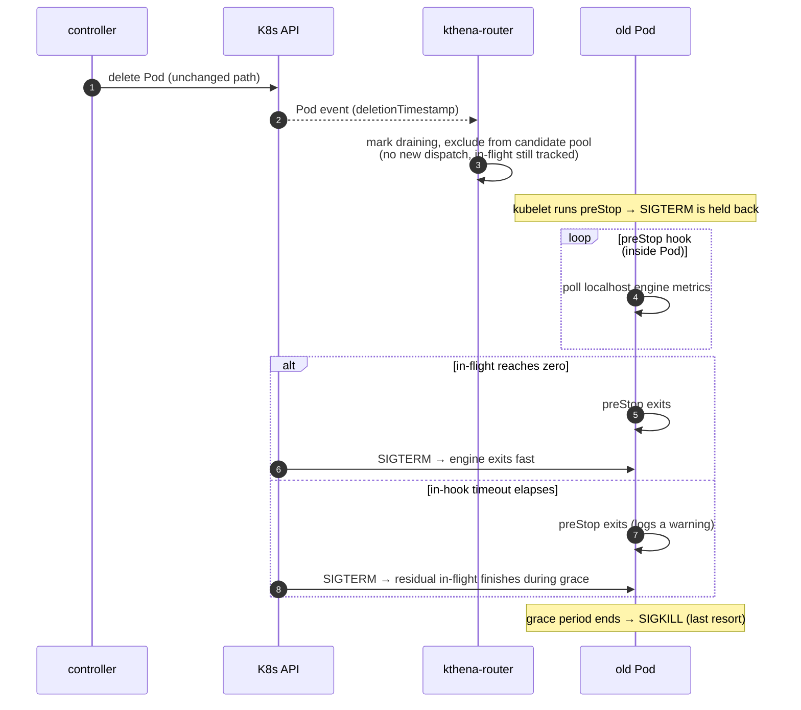

## Lossless Upgrade for ModelServing

> **Revision note (2026-11)**: the mechanism in this proposal has been redesigned
> after the community review. The earlier version added a two-phase annotation
> handshake between the controller and the router, with the controller gating the
> delete. The feedback was that the controller is already complex and should not
> grow further, and multi-replica router deployments raised an in-flight
> visibility question. This version moves the whole drain to the Pod boundary:
> the router drains on `deletionTimestamp` (stop dispatching only), and a
> `preStop` hook inside the Pod judges in-flight completion from engine metrics.
> The controller stays untouched. The earlier design and the finalizer
> discussion are kept in [Alternatives](#alternatives).

### Summary

This proposal adds a drain step to `ModelServing` rolling updates: an old Pod is
deleted only after its in-flight inference requests finish, instead of being
SIGKILLed immediately by `DeleteCollection`. The drain lives at the Pod
boundary:

- The **controller issues the delete unchanged** — its delete path grows by
  nothing (only two optional env vars injected at Pod creation, for PD
  deployments).
- The **router drains reactively**: when it sees `deletionTimestamp` it stops
  dispatching new requests to that Pod while keeping the Pod tracked, so
  in-flight requests finish against real traffic.
- A **`preStop` hook inside the Pod** polls the engine's own metrics and exits
  only once in-flight reaches zero; SIGTERM then reaches an idle engine.
- `terminationGracePeriodSeconds` (plus an in-hook timeout) bounds the wait, so
  the update always completes.

This is best-effort lossless: the normal path is lossless for engines whose
metrics the hook can read (vLLM including ascend, SGLang), and residual cases
fall back to the grace period — never worse than today.

### Motivation

Updating a `ModelServing` (new image, engine config change) deletes
old-revision ServingGroups/Roles via `DeleteCollection` with empty
`DeleteOptions` — old Pods are removed immediately, with no wait for in-flight
requests. LLM inference requests, especially streaming, often run for tens of
seconds to minutes, so an immediate delete SIGKILLs in-flight work and clients
see 502 / connection resets.

Lossless upgrade has two halves:

- **No downtime**: already guaranteed by the existing rolling strategy
  (`maxUnavailable: 0` + `maxSurge: 1`). This proposal does not change it.
- **No interruption**: the missing half — stop new traffic, wait for in-flight
  to finish, then delete.

#### Goals

- Drain an old Pod before its containers are terminated: no new dispatch, then
  in-flight finishes, then SIGTERM.
- Keep the **controller's delete path unchanged** — the drain must not add
  controller complexity (community feedback on the earlier revision).
- No Redis dependency, no new annotations or finalizers, no K8s API access from
  inference Pods, and no new engine metrics.
- Cover PD disaggregated workloads: a prefill Pod waits for its paired decodes
  to drain before exiting (pairing resolved via an injected env + headless
  service DNS — no API access needed).
- Be robust to multi-replica router deployments by construction (see
  [Multi-replica routers](#multi-replica-routers)).

#### Non-Goals

- Engines whose metrics the hook cannot parse: those Pods fall back to the
  grace period (same behavior as today, bounded by `preStop` +
  `terminationGracePeriodSeconds`).
- Changing the rolling strategy itself.
- Absolute lossless: normal path is lossless, residual cases fall back to the
  grace period.

### Proposal

Three components, each with one small job:

| Component | Job |
|-----------|-----|
| controller | issues the delete as today; at Pod creation, injects env vars (paired decode discovery for PD prefill Pods, and `GRACE_SECONDS` for the hook's auto-correction — see [Configuration](#configuration)) |
| router | on `deletionTimestamp`: mark the Pod draining — keep it tracked, exclude it from all scheduling-candidate queries (no new dispatch, in-flight still served) |
| Pod (`preStop` hook) | poll the engine's own metrics; exit only when in-flight reaches zero; kubelet then sends SIGTERM to an idle engine |

Because the hook runs before SIGTERM, the container keeps serving its in-flight
requests at full speed while the drain completes — the drain and the engine
teardown never overlap.

#### User Stories

- **Image update under live traffic**: without drain, a Pod serving a long
  streaming request is killed mid-response. With drain, the old Pod finishes its
  in-flight response before SIGTERM — no client-visible interruption.
- **Scale-down**: the Pod about to be removed drains first, so no request is
  dropped.
- **PD disaggregated update**: under the default ServingGroup-level drain, the
  whole group drains together; the prefill Pod's hook waits until every paired
  decode Pod reaches zero in-flight — its KV has been delivered (push) or
  pulled, so no PD request is broken.

#### Risks and Mitigations

- **preStop fails silently** (tooling missing in the image, script bug, RBAC):
  the hook exits early and the Pod degrades to today's behavior. Mitigation:
  the hook logs every step, kubelet emits a `FailedPreStopHook` event on
  failure, and the grace period still bounds termination — degraded, not stuck.
- **Drain and engine shutdown share the grace budget**: preStop execution time
  counts against `terminationGracePeriodSeconds`. Mitigation: document that the
  grace period must cover the in-hook drain timeout plus the engine's SIGTERM
  shutdown, and keep the in-hook timeout modest by default.
- **Drain window length under PD group drain**: waits for the slowest Pod
  (typically decode). Safe, but lengthens the window; the in-hook timeout
  bounds it.

### Design Details

#### Router: drain on deletionTimestamp

Today the router reacts to a deleted Pod by removing it from the store (losing
in-flight tracking). The change is small and local: on `deletionTimestamp`
(consistent across every router replica through each replica's own Pod
informer), mark the Pod draining instead — keep the `PodInfo` (in-flight
metrics keep being scraped) and exclude it from all scheduling-candidate
queries. The exclusion points already exist as `IsDraining` filters in
`GetPodsByModelServer`, `GetDecodePods`, `GetPrefillPods`,
`GetPrefillPodsForDecodeGroup`, and `GetPodsByInferencePool`; the router
surface stays "stop dispatching only" — it never judges completion and never
writes to Pods, so **no `pods/patch` permission is needed**.

#### preStop: judge in-flight from engine metrics

The hook (part of the Pod template, engine-agnostic) polls
`localhost:<port>/metrics` and reads the engine-agnostic counters
(`RequestRunningNum` / `RequestWaitingNum`, mapped per engine through the
`backend/vllm` / `backend/sglang` adapters' same metric names). Exit condition:
the counters stay at zero for N consecutive polls (with a short settle delay) —
the repetition closes the dispatch-to-admission window where a request has been
forwarded by the router but not yet admitted by the engine. The hook also runs
with an internal timeout — the effective wait is `min(DRAIN_TIMEOUT,
GRACE_SECONDS - SHUTDOWN_RESERVE)` (see
[Configuration](#configuration)): if zero is not reached in time, it logs a
warning and exits, letting SIGTERM + grace handle the residual.

Judging from engine metrics has a visibility advantage: the counters reflect
direct-to-engine traffic as well, and they are local to the Pod — no K8s API
access, no ServiceAccount/RBAC changes, no cross-component signaling.

#### PD disaggregation: pairing without API access

A PD request has a prefill phase (compute KV) and a decode phase (generate),
connected by a KV handoff (SGLang push, NIXL/Mooncake pull). On the push/pull
connectors a prefill Pod's own metrics fire too early — SGLang's prefill
`num_running_reqs` is always 0 (the request lives in a separate inflight
queue), and NIXL's prefill reports zero before decode finishes pulling — so a
prefill cannot judge itself.

The rule from the earlier revision still holds — a prefill is safe to exit
only when every paired decode Pod is at zero in-flight — but the pairing is
resolved without any controller/router signaling:

- At Pod creation the controller injects two env vars into PD prefill Pods:
  the paired decode role's headless service DNS name and its metrics port.
- The hook resolves the headless service DNS each poll, so the decode list is
  always current (recreated or scaled decodes are picked up automatically; a
  decode that no longer resolves is treated as drained — it cannot pull KV
  anymore).
- The hook polls each decode's metrics endpoint directly. PD deployments
  already require prefill↔decode network reachability for KV transfer, and the
  metrics port is the serving port, so the endpoints are reachable.

| Topology | Hook exit condition |
|----------|--------------------|
| Single-pod / aggregated | own `Running==0 && Waiting==0` (N consecutive polls) |
| PD decode | own `Running==0 && Waiting==0` (reliable on all connectors) |
| PD prefill | every paired decode at zero (own counters ignored where unreliable) |

Under the default `ServingGroupRollingUpdate` the whole group drains together
and the budget unit equals the drain unit, so prefill and decode are never
deleted independently. Residual cases (e.g. cross-request KV reuse) fall back
to the in-hook timeout and the grace period.

#### Multi-replica routers

The drain signal (`deletionTimestamp`) is persisted on the Pod object, and
every router replica watches Pods independently, so every replica drains the
Pod — there is no "replica A saw it, replica B did not" state to lose. The
replicas' informer latencies differ by milliseconds; requests dispatched in
that window become the Pod's in-flight work, and the hook waits for exactly
that — a longer drain, never a lost request. Because completion is judged from
engine metrics inside the Pod, no replica's local in-flight counter is trusted
for the drain decision, so the multi-replica counter-splitting concern raised
in the community review does not apply to this design.

#### Configuration

**Enablement**: lossless drain is on by default — the built-in engine templates
ship with the preStop hook and a default `DRAIN_TIMEOUT`. The switch lives at
the Pod template layer: `DRAIN_TIMEOUT=0` (or removing the hook) disables the
wait for that workload — the hook exits immediately and the Pod degrades to
today's delete behavior. An explicit one-off fast delete remains available via
the platform escape hatch (`kubectl delete pod --force --grace-period=0`, which
skips preStop entirely). The router drains unconditionally either way; for Pods
without a hook this is harmless (SIGTERM follows within seconds) and strictly
better than today (in-flight tracking is kept instead of dropped).

**Three values, one auto-correction**: the hook reads two env vars and the
controller injects a third at Pod creation (the grace period is already in the
Pod spec being rendered):

- `DRAIN_TIMEOUT` — how long the hook waits for in-flight to drain (user
  intent; e.g. 300s)
- `GRACE_SECONDS` — the Pod's `terminationGracePeriodSeconds`, injected by the
  controller (e.g. 600)
- `SHUTDOWN_RESERVE` — time reserved for the engine's SIGTERM shutdown (e.g.
  60s, template default)

The hook's effective wait is `min(DRAIN_TIMEOUT, GRACE_SECONDS -
SHUTDOWN_RESERVE)`. This auto-correction removes a silent misconfiguration
trap: if a user sets `DRAIN_TIMEOUT` longer than the grace period, the kubelet
would SIGKILL the Pod mid-drain with no SIGTERM window at all — with the
minimum, the hook always yields before the grace deadline and the engine keeps
a shutdown window. Users who set a modest `DRAIN_TIMEOUT` see exactly that
value; an oversized one is clipped, not honored. `SHUTDOWN_RESERVE` has a
conservative template default (60s) since engine SIGTERM exit time varies.

**Deployment practice**: keeping `maxUnavailable: 0` + `maxSurge: 1` remains
the recommended configuration so serving capacity never dips during an update,
but it is not an enablement condition — the drain activates on deletion
regardless, and with `maxUnavailable > 0` the drain still protects whatever
in-flight the deleted Pod holds (the temporary capacity dip is the existing
semantics of that setting, not something the drain adds).

#### Status

The earlier revision implemented the controller-side two-phase gate
(`chenhui/lossless-upgrade` branch). Under this redesign those controller
changes will be reverted, and the remaining work is: the router's
deletionTimestamp-driven drain (small, local change) and the preStop hook
scripts for the engine templates.

### Test Plan

- Unit tests: preStop hook parsing and exit conditions (N-consecutive-zero,
  in-hook timeout, DNS resolution edge cases — decode gone treated as drained);
  router drain-on-deletionTimestamp (Pod kept, excluded from candidates).
- E2E: rolling update of a single-pod ModelServing under load — in-flight
  requests complete, no client-visible interruption, converge to
  `spec.replicas`; PD disaggregated update under `ServingGroupRollingUpdate` —
  the prefill Pod's hook does not exit while a paired decode still has
  in-flight.

### Alternatives

- **Controller-side two-phase annotation handshake** (the earlier revision of
  this proposal): the controller annotated draining Pods, the router confirmed
  in-flight zero by writing `traffic-drained` back, and the controller deleted
  on confirmation or timeout. Rejected after community review: it grew the
  controller's delete path (a two-phase state machine on top of an already
  complex component), and its in-flight judgment involved the router's local
  `onFlight` counter, which under multi-replica deployments without Redis
  splits per-replica and can falsely report zero (mitigable with Redis, but a
  real constraint). Its core intellectual asset — the zero-check rule
  (engine counters, PD prefill waits for paired decodes) — is carried over
  verbatim into the preStop hook.
- **Finalizer-based gating** (community discussion): a finalizer can hold back
  the deletion of the API object, but not the container teardown — the kubelet
  kills the container as soon as `deletionTimestamp` is set, regardless of
  finalizers. Unless combined with a blocking preStop (below), the drain would
  happen after the engine is already being terminated. An owner-side finalizer
  additionally reduces to the annotation handshake with an extra layer.
- **preStop waiting for a router-written confirmation** (annotation or
  finalizer): workable, but the hook then needs API read access (SA + RBAC) on
  every inference Pod, and the drain correctness depends on the hook surviving
  to see the signal — the same waiter/deleter separation problem. Judging from
  local engine metrics removes both the permission requirement and the
  cross-component wait.
- **preStop with a fixed sleep**: simplest (no polling at all), but every Pod
  waits the full fixed duration even when it drains in one second — update
  time scales as N × fixed value. Rejected in favor of metric-based exit.
