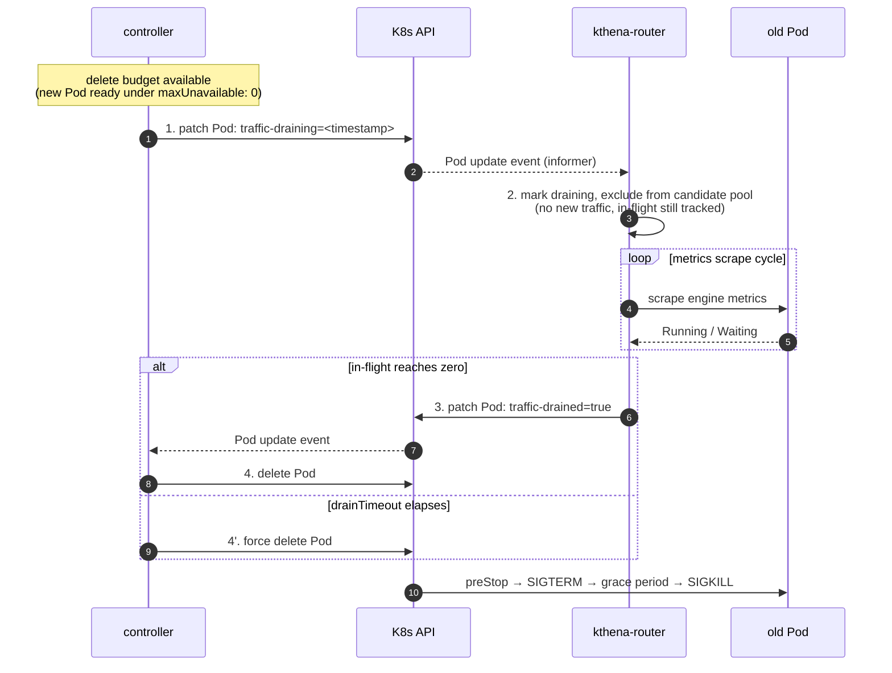

## Lossless Upgrade for ModelServing

### Summary

This proposal adds a drain step to `ModelServing` rolling updates: an old Pod is
deleted only after its in-flight inference requests finish (or a timeout
fallback fires), instead of being SIGKILLed immediately by `DeleteCollection`.
The drain is a two-phase annotation handshake between
`model-serving-controller` and `kthena-router` over two Pod annotations. Drain
granularity follows the existing rollout
strategy (ServingGroup or Role instance), so the mechanism is group-aware,
including for PD disaggregated workloads.

This is best-effort lossless: the normal path is fully lossless, and residual
cases (stuck requests, engines the router does not adapt) fall back to a
`drainTimeout` so the update always completes.

### Motivation

Updating a `ModelServing` (new image, engine config change) deletes
old-revision ServingGroups/Roles via `DeleteCollection` with empty
`DeleteOptions` — old Pods are removed immediately, with no wait for in-flight
requests. LLM inference requests, especially streaming, often run for tens of
seconds to minutes, so an immediate delete SIGKILLs in-flight work and clients
see 502 / connection resets.

Lossless upgrade has two halves:

- **No downtime**: already guaranteed by the existing rolling strategy
  (`maxUnavailable: 0` + `maxSurge: 1`). This proposal does not change it.
- **No interruption**: the missing half — a drain step before the delete.

#### Goals

- Drain an old Pod before deleting it: stop new traffic, wait for in-flight to
  finish, then delete.
- Cover both rollout strategies (`ServingGroupRollingUpdate` /
  `RoleRollingUpdate`), plus scale-down and failure-rebuild — all converge on
  the same deletion path.
- Group-aware drain for PD disaggregated workloads (prefill judged together
  with its paired decodes).
- Work for engines the router already adapts (vLLM including ascend, SGLang).

#### Non-Goals

- Engines the router does not support (MindIE): no MindIE traffic flows through
  the router, so there is nothing to drain; the timeout fallback still ensures
  the update completes.
- Changing the rolling strategy itself.
- Absolute lossless: normal path is lossless, residual cases fall back to
  `drainTimeout`.

### Proposal

The controller and router cooperate over two Pod annotations:

- `modelserving.volcano.sh/traffic-draining` (controller; RFC3339 timestamp) —
  start draining: the router stops scheduling new requests to the Pod.
- `modelserving.volcano.sh/traffic-drained` (router; `true`) — in-flight
  reached zero, the Pod is safe to delete.

Deletion has two triggers (either fires the delete):

- **drained (precise)**: the router confirms in-flight zero, the controller
  deletes immediately.
- **drainTimeout (fallback)**: after `--drain-timeout` elapses since the
  earliest draining timestamp, the controller force-deletes; residual in-flight
  is bounded by `terminationGracePeriodSeconds` + preStop.

The two phases in one picture — the controller declares the drain, the router
confirms it:

Phase 1 is the controller's declaration (steps 1-2): the Pod stops receiving
new traffic but stays alive with its in-flight tracked. Phase 2 is the router's
confirmation (step 3) followed by the actual delete (step 4): only the party
that actually holds the traffic declares "in-flight reached zero".

#### User Stories

- **Image update under live traffic**: without drain, a Pod serving a long
  streaming request is killed mid-response. With drain, the old Pod finishes its
  in-flight response before removal — no client-visible interruption.
- **Scale-down**: the Pod about to be removed drains first, so no request is
  dropped.
- **PD disaggregated update**: the whole ServingGroup drains together; a
  prefill Pod is deleted only once its paired decodes are also at zero in-flight
  — its KV has been delivered (push) or pulled, so no PD request is broken.

#### Risks and Mitigations

- **Drain gets stuck** (engine unreachable, metrics scrape failing):
  `drainTimeout` forces deletion, so the update always completes.
- **Router restart during drain**: drain state is re-derived from the Pod
  annotation after restart.
- **Long drain window under PD group drain**: waits for the slowest Pod
  (typically decode); users wanting independent drain can choose
  `RoleRollingUpdate` (see PD section).

### Design Details

#### Controller

A drain gate is added to the two deletion convergence points,
`deleteServingGroup` and `DeleteRole`, so rolling update, scale-down, and
failure-rebuild all share one drain path (failure-recovery deletes can bypass
via `skipDrain`). Phase 1 annotates the Pods with `traffic-draining` and
requeues; Phase 2 waits for `traffic-drained` on every Ready Pod, or for
`drainTimeout` measured from the earliest draining timestamp. Pods that are
NotReady, or that fail annotation after retries, are force-deleted (the K8s
`DeletionTimestamp` still removes them from scheduling).

#### Router

The router observes the annotation via the Pod informer and sets an in-memory
draining flag on the `PodInfo`. Draining Pods stay in the store (in-flight
tracking preserved) but are excluded from all scheduling-candidate queries.
`store.Run` scrapes engine metrics per Pod and patches `traffic-drained=true`
once in-flight reaches zero (`markPodDrainedIfZero`).

#### Drain zero-check

Drain completion is judged from engine metrics (`RequestRunningNum` /
`RequestWaitingNum`, engine-agnostic via the `backend/vllm` / `backend/sglang`
adapters), with the router's `onFlight` counter as a final confirmation. The
zero check requires all three counts at zero — `Running==0 && Waiting==0 &&
OnFlight==0` — where onFlight covers requests dispatched by the router but not
yet admitted by the engine.

- Engine metrics are the primary signal: they see all traffic sources
  (including direct-to-engine) and need no Redis (a multi-replica router
  without Redis cannot aggregate onFlight and could falsely report zero).
- onFlight closes the dispatch-to-admission window engine metrics alone cannot
  see.

For PD, a prefill Pod's own metrics are unreliable (SGLang prefill
`num_running_reqs` is always 0; NIXL prefill reports zero before decode finishes
pulling), so a prefill is judged from **both** its own counts and its paired
decodes' counts — safe to delete only when it and every paired decode are all at
zero. No new engine metrics are introduced.

#### Drain granularity follows rollout strategy

| Strategy | Drain unit | What gets `traffic-draining` |
|----------|-----------|------------------------------|
| `ServingGroupRollingUpdate` (default) | whole ServingGroup | all Pods of all roles in the group |
| `RoleRollingUpdate` | role instance | the entry + worker Pods of one role instance |

There is no per-Pod drain path: the drain unit equals the budget unit
(`maxUnavailable`/`maxSurge` count the strategy's deletion unit, not Pods), so
budget and drain are never mismatched.

#### PD disaggregation

A PD request has a prefill phase (compute KV) and a decode phase (generate),
connected by a KV handoff (HTTP passthrough, SGLang push, NIXL/Mooncake pull).
On the push/pull connectors a prefill Pod's own metrics fire too early — the KV
may still be needed by a decode. Since decode runs the normal engine loop on
every connector, decode metrics are reliable: the group-aware rule "prefill at
zero **and** every paired decode at zero" is precise on the normal path and
needs no new scrape surface. Residual cases (e.g. cross-request KV reuse) fall
back to `drainTimeout`.

#### Configuration

A `--drain-timeout` flag on `kthena-controller-manager`, **default `0`
(disabled)**; a positive value enables drain. Helm exposes it as
`controllerManager.drainTimeout`. Drain is enabled only when **all three**
conditions hold (checked per deletion unit); otherwise deletion proceeds
immediately as before:

- `drainTimeout > 0`;
- the deletion unit's `maxUnavailable == 0` (a new Pod must be ready before an
  old one is deleted, so the drain window never reduces availability);
- the deletion unit's `maxSurge > 0` (a replacement Pod can be created first).

Under `RoleRollingUpdate` each role is judged by its own `maxSurge` /
`maxUnavailable`. `drainTimeout` bounds the wait **before** delete;
`terminationGracePeriodSeconds` bounds the engine's SIGTERM grace **after** —
both should cover the longest expected generation.

#### RBAC and engine coverage

Both ClusterRoles (`kthena-controller-manager`, `kthena-router`) get
`pods/patch` for writing the annotations. Drain works for engines the router
already adapts (vLLM including ascend, SGLang); MindIE is not routed by the
router and is covered only by the timeout fallback.

### Test Plan

- Unit tests: drain gate on both convergence points, annotation retry /
  force-delete, router `markPodDrainedIfZero` (including the PD paired-decode
  rule).
- E2E: rolling update under `RoleRollingUpdate` with `maxUnavailable: 0` +
  `maxSurge: 1` — old Pod drained then deleted after in-flight finishes; PD
  update under `ServingGroupRollingUpdate` — prefill not deleted while a paired
  decode still has in-flight.

### Alternatives

- **`onFlight` as the primary signal**: rejected — it misses direct-to-engine
  traffic, and multi-replica routers without Redis cannot aggregate it. It still
  participates in the final zero check.
- **`preStop` hook only**: rejected — a preStop can delay termination but cannot
  make the router stop dispatching new traffic (the router watches Pods
  directly, not via Service/Endpoints). Kept as a secondary safety net.
