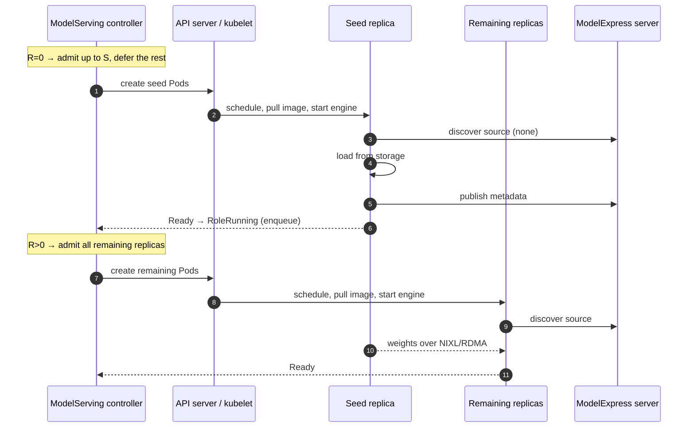

## Support ModelExpress P2P Bootstrap Acceleration

### Summary

When many ModelServing replicas start together, every role replica loads the full checkpoint from storage at once, and the fleet is ready only as fast as that contended load. [ModelExpress (MX)](https://github.com/ai-dynamo/modelexpress) copies post-processed weights from a ready serving replica over NIXL/RDMA (DeepSeek-V4-Pro, TP=8: 11s versus 8m53s for a cold Hugging Face pull). It only helps replicas that start **after** a compatible source is serving.

This proposal adds an optional `spec.bootstrapAccelerateStrategy` to ModelServing. Instead of creating every role replica at once, the controller creates them in two stages per pool:

- While a pool has no ready replica, it creates an initial seed batch of up to the role's `initialSeedReplicas` role replicas. They find no source, so they load from storage and then become MX sources.
- Once a seed replica is ready, it creates all remaining role replicas. They pull weights P2P from the ready replicas.

All replicas are identical: each one tries P2P first and falls back to storage. The controller only decides **when** to create them.

### Motivation

Weight loading dominates bootstrap of large models on initial deployment, scale-up, and rolling update. MX only helps if replicas start in source-aware order, and only the ModelServing controller sees every ServingGroup, role replica, revision, and desired count.

#### Goals

- Most role replicas start up via P2P from ready peers on initial deployment, scale-up, and rolling update.
- Bounded cold-start concurrency: only the initial seed batch loads from storage before a source is ready.
- Opt-in and revision-neutral; no behavior change without the field.
- Stateless: nothing beyond existing Pods and the datastore.
- No semantic change to recovery, rolling update (`maxUnavailable`, `maxSurge`, `partition`), or scale-down.

#### Non-Goals

- Deploying MX or its metadata backend, or configuring the engine command line (`--load-format modelexpress`). The controller only injects the MX environment variables into selected engine containers (see [Environment injection](#environment-injection)).
- Calling MX APIs from the controller. A Running role replica is treated as a source.
- Choosing the load path. MX's fallback chain (P2P → cache → storage → native loader) does that.
- ModelBooster integration, and cross-role or cross-layout sources.

### Proposal

#### Constraints from the current controller

| Fact | Consequence |
|---|---|
| A role replica is one entry Pod plus `workerReplicas` worker Pods ([Role](../../pkg/apis/workload/v1alpha1/servinggroup_types.go#L54-L86)). | Admit per role replica; one role replica is one MX source. |
| The revision and the role template hash are hashes of `template.roles` ([revision_util.go](../../pkg/model-serving-controller/utils/revision_util.go#L42-L71)). | A new `Role` field would re-hash and roll every ModelServing on upgrade, so the policy lives at `spec.bootstrapAccelerateStrategy`. |
| Every role replica is created by [scaleUpServingGroups](../../pkg/model-serving-controller/controller/model_serving_controller.go#L723) or [scaleUpRoles](../../pkg/model-serving-controller/controller/model_serving_controller.go#L1004). This covers initial deployment, scale-up, recovery, and rolling-update re-creation. The datastore is updated synchronously right after the Pods are created. | One admission hook covers every scenario, and no create expectations are needed. |
| A role becomes `RoleRunning` when all its Pods are Ready, which enqueues the ModelServing ([checkRoleReady](../../pkg/model-serving-controller/controller/model_serving_controller.go#L1916-L1962)). | Reused as "source ready" and as the trigger to create the remaining replicas. |
| With `schedulerName: volcano`, each ServingGroup has one PodGroup, created before its Pods. Its `minMember` counts $\min(\texttt{minRoleReplicas}[r], \texttt{role.replicas})$ replicas of every role $r$, and defaults to all of them ([calculateRequirements](../../pkg/model-serving-controller/podgroupmanager/manager.go#L350-L383)). `minRoleReplicas` is immutable. | A group's gang-required replicas must be created together, or the created ones never schedule. Replicas beyond them schedule on their own. The seed budget $S$ must be able to hold them. See [Seed budget and gang](#seed-budget-and-gang). |
| A ServingGroup is Running only when every role has `role.replicas` Running replicas ([checkServingGroupReady](../../pkg/model-serving-controller/controller/model_serving_controller.go#L1888-L1914)), and missing replicas of an existing group are created by `manageRoleReplicasPerGroup` → `scaleUpRoles`. | A group can be created with only its gang-required replicas and completed later; until then it counts as unavailable. |
| Rolling update paces on `len(groups) - minAvailable - newUnavailable` ([manageRollingUpdate](../../pkg/model-serving-controller/controller/model_serving_controller.go#L1373)). | A group that is not created yet lowers `len(groups)` just like an unavailable one. See [Rolling update](#3-rolling-update). |

#### Batch creation

The controller changes when role replicas are created; a built-in ModelServing plugin injects MX environment variables into in-scope Pods. Templates and existing labels are unchanged. Every engine runs the same MX load path: it looks for a compatible ready source, loads P2P if there is one, and otherwise falls back to storage. The seed batch simply finds no source.



#### User Stories (Optional)

##### Story 1

Initial deployment of 32 single-role replicas with `roles: [{name: prefill, initialSeedReplicas: 2}]`. The controller creates 2 seed replicas first and all remaining 30 once a seed replica is ready, so storage serves 2 cold loads instead of 32.

##### Story 2

Autoscaling from 4 to 16 replicas. The 4 serving replicas are already ready sources, so all 12 new ones are created at once and load P2P.

##### Story 3

Rolling update of the engine image on 32 replicas. The first new-revision seed batch loads from storage, and every later rollout step loads P2P from already-updated replicas.

#### Notes/Constraints/Caveats (Optional)

- The engine must be MX-enabled (vLLM ≥ 0.23 with `--load-format modelexpress`, or SGLang `remote_instance` with the `modelexpress` backend) and able to reach the MX server. Otherwise the policy only limits initial cold-start concurrency.
- Readiness must imply that the weights are loaded; a `/health` probe is enough for that. A source publishes its MX metadata only after its readiness endpoint (`MX_ARTIFACT_READY_URL`, set through `modelExpress.readyURL` or defaulting to `/health` for vLLM) responds, so a `RoleRunning` replica may briefly not be discoverable. The next batch's scheduling and engine startup usually cover this gap; a reader that still finds no source falls back to storage. For strict P2P, add a readiness check that also confirms the source is published on the MX server.
- Deferred replicas are scheduled, and pull their image, only after a seed replica is ready, so these steps don't overlap the seed batch's load. Pre-pull the engine image on GPU nodes to keep the second wave short. In exchange, deferred replicas hold no GPUs while they wait.
- A full-download init container still blocks P2P loading. Use a shared cache, `MX_MODEL_URI`, or no downloader.

#### Risks and Mitigations

| Risk | Mitigation |
|---|---|
| A first-batch replica never becomes Ready (unschedulable, or crash-looping) and stalls its pool. | Failed replicas are re-created by the recovery policy and re-admitted. An unschedulable replica would block the fleet without the feature too. Events and V(4) logs make it visible. Removing the policy creates everything on the next reconcile. |
| Between batches, other workloads take the capacity that later batches need. | Same as any scale-up; reserve capacity with a Volcano queue or quota. |
| A role's `initialSeedReplicas` is smaller than its gang requirement. | The controller raises $S$ to at least $g$ at runtime, so a gang unit always fits when $I=0$. See [Seed budget and gang](#seed-budget-and-gang). |
| MX known issue (nvbug 6519532): a source may stop serving new readers after one of its readers is deleted. Rolling update and scale-down delete readers. | Affected replicas stall until `MX_TRANSFER_TIMEOUT`, then try another source or fall back to storage. Document a lower `MX_TRANSFER_TIMEOUT`. |
| Controller downgrade | Safe: an old controller simply creates the missing replicas. |
| Security | No new privileges or RBAC. In-scope Pods get plain/downward-API environment variables; the MX server address is configured on the controller. |

### Design Details

#### 1. API

A new optional field on `ModelServingSpec`:

```go
// ModelServingSpec defines the specification of the ModelServing resource.
type ModelServingSpec struct {
	// ...existing fields...

	// BootstrapAccelerateStrategy creates role replicas in batches so that most of them
	// load model weights peer-to-peer from ready replicas instead of from storage.
	// +optional
	BootstrapAccelerateStrategy *BootstrapAccelerateStrategy `json:"bootstrapAccelerateStrategy,omitempty"`
}

// BootstrapAccelerateStrategyProvider identifies the peer-to-peer weight transfer system.
// +kubebuilder:validation:Enum={ModelExpress}
type BootstrapAccelerateStrategyProvider string

const (
	BootstrapAccelerateStrategyProviderModelExpress BootstrapAccelerateStrategyProvider = "ModelExpress"
)

// BootstrapAccelerateStrategy configures source-aware creation of role replicas.
type BootstrapAccelerateStrategy struct {
	// Provider is the weight transfer system used by the inference engines.
	// +kubebuilder:default=ModelExpress
	// +optional
	Provider BootstrapAccelerateStrategyProvider `json:"provider,omitempty"`

	// Roles limits bootstrap acceleration to the listed roles and configures each of them.
	// At least one role must be specified.
	// +kubebuilder:validation:MinItems=1
	// +listType=map
	// +listMapKey=name
	// +required
	Roles []BootstrapRole `json:"roles"`

	// ModelExpress configures the ModelExpress provider. If unspecified, no MX
	// environment variables are injected and users configure the engine themselves.
	// +optional
	ModelExpress *ModelExpressConfig `json:"modelExpress,omitempty"`
}

// BootstrapRole configures bootstrap acceleration for one role.
type BootstrapRole struct {
	// Name is the name of a role in spec.template.roles.
	Name string `json:"name"`

	// InitialSeedReplicas is the number of this role's replicas that may be created while
	// no ready source exists for it. A percentage is taken of the desired role replicas
	// (spec.replicas * role.replicas) and rounded up, e.g. 10% of 3 is 1.
	// With gang scheduling, the effective budget is at least the role's minRoleReplicas
	// (default: all role replicas in one ServingGroup). A desired count of zero creates nothing.
	// +kubebuilder:validation:XIntOrString
	// +kubebuilder:default=1
	// +optional
	InitialSeedReplicas *intstr.IntOrString `json:"initialSeedReplicas,omitempty"`
}

// ModelExpressConfig holds values injected into the Pods of in-scope roles.
type ModelExpressConfig struct {
	// EngineContainers names the regular containers running the inference engine
	// in entry and worker Pods of in-scope roles. Only these containers receive MX envs.
	// +kubebuilder:validation:MinItems=1
	// +listType=set
	EngineContainers []string `json:"engineContainers"`

	// ReadyURL is the engine endpoint that MX polls before a source publishes its
	// metadata; it may differ from the Pod readiness probe. It is injected as
	// MX_ARTIFACT_READY_URL only if that variable is not already set in the container.
	// If empty, MX uses the engine's default (http://127.0.0.1:8000/health for vLLM).
	// +optional
	ReadyURL string `json:"readyURL,omitempty"`
}
```

```yaml
spec:
  replicas: 16
  bootstrapAccelerateStrategy:
    roles:
    - name: prefill
      initialSeedReplicas: 1
    modelExpress:
      engineContainers: ["engine"]
      readyURL: http://127.0.0.1:8000/health
  template:
    roles:
    - name: prefill
      replicas: 1
      entryTemplate:
        spec:
          containers:
          - name: engine
            image: <vllm-0.23+-with-modelexpress>
            args: ["serve", "/models/deepseek-v4", "--load-format", "modelexpress", "--tensor-parallel-size", "8"]
            readinessProbe:
              httpGet: {path: /health, port: 8000}
```

**Validation** ([validateModelServing](../../pkg/model-serving-controller/webhook/validator.go#L82)): each `roles[].name` must name an existing role, and names are unique (enforced by the list-map schema); each `roles[].initialSeedReplicas` is a positive integer or `1%`–`100%`, with percentages rounded up. A seed count below the gang minimum is accepted and raised to $g$ at runtime, including the default of 1 (see [Seed budget and gang](#seed-budget-and-gang)). `modelExpress.readyURL`, if set, must be an absolute `http` or `https` URL. The field is mutable and takes effect on the next reconcile.

**Revision neutrality.** `ModelServingRevision` hashes canonical workload revision data; `RoleRevisionHash` and `CalRoleTemplateHash` hash one role's effective template inputs; `BuildRevisionData` captures roles, `schedulerName`, and user `plugins`. None includes `BootstrapAccelerateStrategy`. MX variables are added to generated Pods, not to the templates, so they do not change these revision inputs. Unit tests lock this in.

When `modelExpress` is specified, `engineContainers` must be nonempty and contain nonempty, unique container names, and the webhook requires every in-scope role's entry template and worker template (if any) to contain at least one of them.

The automatically enabled MX plugin is not written into `spec.plugins` or the ControllerRevision. Policy edits therefore never trigger a rollout.

#### 2. Admission

##### Pools

Admission is computed per **pool** = (role name, role template hash). Only replicas in the same pool count as sources for each other. For partition-protected ordinals, the role template comes from the ControllerRevision.

The pool key is the same input the managed plugin turns into `MX_MODEL_REVISION`, so the controller's notion of a compatible source mirrors the identity ModelExpress itself matches on. Nothing is persisted on Pods: $R$ and $I$ are read from the datastore (`RoleTemplateHash` and `Status`), which `syncAll` rebuilds from the Pods' labels after a restart.

The template hash does not cover the controller's ModelExpress server address, `modelExpress.engineContainers`, or whether a role was in scope when its Pods were created. After enabling the strategy on an existing fleet or changing those settings, Running replicas of the current template still count as sources even though they may not publish to the expected server. New replicas are then created together and ModelExpress falls back to storage for them, which is the behavior without the feature. Roll the Pods to benefit; changing `initialSeedReplicas` or `readyURL` needs no roll.

##### Budget

| Symbol | Meaning |
|---|---|
| $R$ | Ready sources: replicas in the pool that are `RoleRunning`. |
| $I$ | In flight: created replicas in the pool that are neither `RoleRunning` nor `Deleting`. |
| $D$ | Desired replicas: $\texttt{spec.replicas} \times \texttt{role.replicas}$. |
| $g$ | Gang minimum per ServingGroup: $\min(\texttt{role.replicas}, \max(1, \texttt{minRoleReplicas}[r]))$ with a PodGroup, otherwise 1. |

$$
S = \min\bigl(D,\ \max(g,\ \texttt{initialSeedReplicas})\bigr)
$$

`initialSeedReplicas` defaults to 1, and percentages are rounded up against $D$. While $R = 0$, the free seed budget is $S - I$, and replicas that don't fit stay missing until a later reconcile. Once $R > 0$, the pool has a ready source and all remaining replicas in that pool are admitted.

##### Units

Replicas are admitted in units, so that gang scheduling stays satisfiable:

- **New ServingGroup:** its PodGroup plus its **gang core** (ordinals $0..g_r-1$ of each in-scope role) plus all out-of-scope replicas. `scaleUpRoles` adds the rest later.
- **Existing group missing part of its core** (for example after `RoleRecreate`): the missing core replicas form one unit.
- **Any other missing replica:** a unit of one.

A unit is admitted only if it fits in every in-scope pool with $R_p = 0$ that it touches ($u_p \le S_p - I_p$); pools with $R_p > 0$ and out-of-scope roles are not limited. Units go in lowest-ordinal order. Once a unit is denied, later units touching the same pool are also denied in this reconcile, so small units cannot starve a gang core.

##### Seed budget and gang

When `initialSeedReplicas` and the gang core disagree, the gang wins:

- **Floor:** $S \ge g$, so at least one gang core fits when $I = 0$.
- **No overshoot while $R = 0$:** admission never pushes $I$ above $S$ before a source is ready. If $S$ drops below $I$ (policy lowered while $R = 0$), creation pauses until in-flight replicas finish or one becomes ready.
- **Per role:** each role counts only its own sources, and a multi-role core needs room in every pool that still has $R = 0$.
- **`minRoleReplicas`** only raises the effective seed budget. Lowering it shrinks the core and reduces cold starts.

**Example.** Prefill/decode (PD), `replicas: 4`, each group has 2 prefill + 4 decode, `minRoleReplicas: {prefill: 1, decode: 2}` ($g_P = 1$, $g_D = 2$), default `initialSeedReplicas: 1`. The gang floor raises the seed budgets to 1P and 2D.

| Batch | $(R_P, R_D)$ | Created |
|---|---|---|
| 1 | (0, 0) | Group 0 core (1P + 2D, cold). Group 1's core doesn't fit $S_P$. |
| 2 | (1, 2) | Groups 1, 2, and 3 cores plus all 4 non-core P and 8 non-core D replicas (7P + 14D, P2P). |

Storage serves 3 cold loads instead of 24.

**Examples** ($D = 8$, $g = 1$; cumulative created replicas):

| Policy | Batches |
|---|---|
| `initialSeedReplicas: 1` | 1 → 8 |
| `initialSeedReplicas: 2` | 2 → 8 |
| Scale 8 → 16 | 8 → 16 |

#### 3. Rolling update

`manageRollingUpdate` is unchanged. Replicas it deletes are re-created through `scaleUpServingGroups`/`scaleUpRoles` on a later reconcile, and those pass admission like any other missing replica.

**R1. A changed role template is a new pool.** It starts with a first batch of $S$; replicas with a different template hash are not counted in its $R$.

- Why not share sources across revisions: MX matches sources by `SourceIdentity` (model, revision, TP/PP/EP, dtype, quantization, engine/torch/CUDA versions, GPU arch). The controller can't tell from a template diff whether that identity changed. Counting incompatible old replicas would release a large batch that all falls back to storage.
- If the change is identity-neutral (for example, resources, probes, `--max-num-seqs`), the new pool's first batch still finds old-revision sources through MX and loads P2P. The only cost is that the first batch is the role's `initialSeedReplicas` wide.
- Roles whose template didn't change keep their pool. Under `ServingGroupRollingUpdate`, their re-created replicas join the existing pool (usually $R > 0$) and are admitted immediately.

**R2. Pacing stays with the rollout.** A deferred group is absent from the datastore, which lowers `len(groups)` in `maxScaleDown` exactly as one unavailable new group would. `maxUnavailable` is never exceeded.

- Only the first step of a changed pool (while $R = 0$) is narrowed, to $S$.
- Once a seed replica is ready ($R > 0$), admission stops gating that pool and the rollout runs at its normal pace.
- With `maxSurge` ≥ 1, the seed batch is surge replicas and loads while old capacity is intact.

**R3. Outdated replicas** already exist and are not affected. Missing partition-protected ordinals are re-created from their ControllerRevision and admitted in their old pool.

**R4. Deleting sources.** A replica pulling from a deleted source retries another candidate (MX tries up to 3) and then falls back to storage. On clean shutdown MX marks the source `STALE`, and the MX server's reaper removes stale metadata from its backend (Redis).

**R5. Rollback.** Reverting to a template whose hash still has Running replicas resolves to that pool, so re-created replicas are admitted with $R > 0$ immediately.

**R6. `RoleRollingUpdate`.** The same rules apply per role, and unchanged roles are not touched. In PD disaggregation, updating only `prefill` restarts from a seed batch only in the prefill pool.

**Example.** `replicas: 8`, `maxUnavailable: 2`, `maxSurge: 0`, `initialSeedReplicas: 1`, new engine image:

1. The rollout deletes groups 7 and 6. The new pool has $R=0$ and $S=1$, so only group 6 is created, and 7 stays missing. `maxScaleDown` = 7 − 6 − 1 = 0.
2. Group 6 is Running, so $R=1 > 0$. Group 7 is created, `maxScaleDown` = 8 − 6 − 1 = 1, and group 5 is deleted. From here $R > 0$ and the rollout keeps 2 groups in flight at its normal pace.

Storage serves 1 cold load instead of 8.

#### 4. Controller changes

A new package `pkg/model-serving-controller/bootstrap/` holds a pure `Admitter`. [syncModelServing](../../pkg/model-serving-controller/controller/model_serving_controller.go) builds one `Admitter` per reconcile from the datastore ($R$, $I$ per pool), attaches it to the reconcile context, and both creation paths consult it:

```text
syncModelServing
├─ admitter := newBootstrapAdmitter(ms); ctx = bootstrap.WithAdmitter(ctx, admitter)
├─ syncServingGroupReplicas → scaleUpServingGroups       (A) new groups
├─ syncRoleReplicas → for each group: core deficit      (B)
│                   → for each role:  scaleUpRoles       (C) units of one
└─ rollout, services, status                              unchanged
```

- **(A) New groups.** For each missing ordinal, `AdmitGroup` the unit (the gang core of in-scope roles). If it is admitted, create the PodGroup (`minMember` unchanged), then only the core's in-scope replicas plus all out-of-scope replicas, then `AddServingGroup`. If it is denied, the group is not created: no PodGroup and no Pods.
- **(B) Core deficit.** Before the per-role loop, if an existing group is missing part of its core (for example after `RoleRecreate`), those replicas across all roles are admitted as one unit (`PlanGroupCore`) and created together. If the unit is denied, (C) skips them. A repair must fit the budget but ignores pools blocked by an earlier denial in the same reconcile: new groups are reconciled first, and a deferred new group must never starve an existing group whose core was only partially created.
- **(C) Remaining replicas.** In `scaleUpRoles`, each missing in-scope replica beyond the core is a unit of one (`AdmitReplica`). Out-of-scope roles are not gated.
- A denied unit blocks its pools for the rest of the reconcile ([Order](#2-admission)). Admitted replicas are added to $I$, and they are also in the datastore right after creation, so the next reconcile sees them.
- **Observation.** Nothing new is persisted. Each reconcile counts $R$ and $I$ per (role, template hash) from the datastore's Role records; legacy records without a hash resolve it from their ControllerRevision. A replica that is not Running yet is in flight; a replica is a source only once every Pod is Ready.
- **Wake-ups.** No new handlers. `RoleRunning` transitions already enqueue (the next batch), and so do deletions (lower $I$) and spec edits.
- **Disabling** the policy: the next reconcile creates every missing replica. **Crash safety:** no batch progress is persisted; after a restart, `syncAll` rebuilds the datastore from observed Pods and admission is recomputed.
- **Events:** `BootstrapBatchCreated` per pool with the count and the number of ready sources; deferred counts are logged at V(4).
- **In-place updates.** The managed plugin does not implement `InPlaceUpdatePlugin`, because `MX_MODEL_REVISION` is bound to the role template hash at creation and cannot be patched in place. With the strategy set, `updateMethod: InPlace` falls back to recreating outdated replicas, which then pass admission like any other missing replica.
- **Configuration.** The ModelExpress server address is a controller flag, `--modelexpress-server-address` (Helm: `controllerManager.modelExpressServerAddress`).

##### Environment injection

A built-in `modelexpress` plugin implements the existing [OnPodCreate hook](../../pkg/model-serving-controller/plugins/manager.go#L86-L100). `buildPluginChain` appends it automatically after user plugins when `bootstrapAccelerateStrategy.provider` is `ModelExpress`, scoped to the strategy's roles and both entry and worker Pods. Users do not need a duplicate `spec.plugins` entry; explicit registration of this managed plugin is rejected. Its `OnPodReady` is a no-op. Admission remains in the controller because a per-Pod plugin cannot defer a whole gang unit.

The plugin injects the variables below **only into inference-engine containers**, selected by `modelExpress.engineContainers` from `pod.spec.containers`. Init containers and unselected regular containers (including sidecars) are never modified. The webhook requires every in-scope template to contain a selected engine container; if a user plugin still leaves a rendered Pod without one, the plugin fails that Pod's creation with a `PluginError` event and the reconcile is retried. The plugin does not infer engine containers from images or command lines. If `modelExpress` is omitted, nothing is injected; users configure their engine containers themselves.

`GenerateEntryPod` and `GenerateWorkerPod` remain unchanged. A variable already defined in a selected container wins, including values added by earlier plugins. Inject `MX_SERVER_ADDRESS` (from the controller's ModelExpress server address configuration) and `MX_ARTIFACT_READY_URL` (from `modelExpress.readyURL`) only when the variable is absent and the corresponding value is nonempty; no deprecated endpoint variable is injected. This integration requires an MX client that supports `MX_SERVER_ADDRESS`. Clients that read only the deprecated `MODEL_EXPRESS_URL` (for example, TRT-LLM live transfer) are unsupported, and because MX prefers `MODEL_EXPRESS_URL` when both are set, templates or images (for example, a Dockerfile `ENV`) that set it must remove it. Injected `env` entries take precedence over `envFrom`, and the plugin does not resolve `envFrom`; users who supply any variable below through `envFrom` must move it to `env` (or leave the corresponding field empty).

For the central-server deployment covered by this proposal, inject the following into selected engine containers when the variable is not already set ([MX P2P environment variables](https://github.com/ai-dynamo/modelexpress/blob/main/docs/DEPLOYMENT.md#p2p-environment-variables)):

| Variable | Value | Why |
|---|---|---|
| `MX_MODEL_REVISION` | `<role template hash>-<WORKER_INDEX>` (`modelserving.volcano.sh/role-template-hash` plus the Pod's position in its replica: `0` for the entry, `1..N` for workers) when not already set in the container | Scopes the MX source identity to one weight shard of one role template revision: a worker only reads from the same position of another replica, never from an entry or another rank, unless the user supplies an explicit checkpoint revision. |
| `MX_SERVER_ADDRESS` | Controller's `--modelexpress-server-address`; inject only when the variable is absent and the address is nonempty | The client's gRPC endpoint; do not assume `localhost:8001` points to an external MX server. |
| `MX_P2P_METADATA` | `'1'` | Enables P2P weight metadata registration and discovery. |
| `MX_METADATA_PORT` | `'5555'` | Fixed base TCP port for NIXL metadata exchange (never `0` in Kubernetes). |
| `MX_WORKER_GRPC_PORT` | `'6555'` | Fixed base TCP port for worker gRPC status/coordination (never `0` in Kubernetes). |
| `MX_NIXL_BACKEND` | `UCX` | Default NIXL transport backend for InfiniBand/RoCE/TCP; override in container `env` when using `LIBFABRIC` (e.g., AWS EFA). |
| `MX_INSTANT_TENSOR` | `'0'` | Disables per-tensor streaming by default in favor of standard batch weight transfer. |
| `MX_ARTIFACT_TRANSFER` | `'1'` | Enables transfer of runtime/compiled artifacts alongside model weights. |
| `MX_POOL_REG` | `'1'` | Registers memory with NIXL once per pool instead of per transfer. |
| `MX_VMM_ARENA` | `'1'` | Allocates receive buffers from a VMM arena, avoiding per-transfer allocation and registration. |
| `MX_ARTIFACT_READY_URL` | `modelExpress.readyURL`; inject only when the variable is absent and the URL is nonempty | The engine endpoint a source polls before publishing. Set it when the engine's port or path differs from the MX default, or when the Pod readiness probe checks a different endpoint; a URL that never responds keeps the source from ever publishing. |
| `MODEL_EXPRESS_LOG_LEVEL` | `INFO` | Default log verbosity for the ModelExpress client. |
| `NIXL_LOG_LEVEL` | `INFO` | Default log verbosity for NIXL transfer operations. |
| `UCX_LOG_LEVEL` | `WARN` | Suppresses noisy UCX info logs unless overridden. |
| `MX_WORKER_HOST` | Downward API `status.podIP` | The address that readers use to reach this source. Auto-detection can pick an unroutable interface on multi-NIC GPU nodes. |

Example of the environment entries injected into a selected engine container:

```yaml
- name: MX_MODEL_REVISION
  value: 56eba4e34d3d031b8a62ac6bfb87a723-0
- name: MX_SERVER_ADDRESS
  value: 215.80.6.74:8001
- name: MX_P2P_METADATA
  value: '1'
- name: MX_METADATA_PORT
  value: '5555'
- name: MX_WORKER_GRPC_PORT
  value: '6555'
- name: MX_NIXL_BACKEND
  value: UCX
- name: MX_INSTANT_TENSOR
  value: '0'
- name: MX_ARTIFACT_TRANSFER
  value: '1'
- name: MX_POOL_REG
  value: '1'
- name: MX_VMM_ARENA
  value: '1'
- name: MX_ARTIFACT_READY_URL
  value: http://127.0.0.1:40390/health
- name: MODEL_EXPRESS_LOG_LEVEL
  value: INFO
- name: NIXL_LOG_LEVEL
  value: INFO
- name: UCX_LOG_LEVEL
  value: WARN
- name: MX_WORKER_HOST
  valueFrom:
    fieldRef:
      fieldPath: status.podIP
```

Pod IP is a sensible default for `MX_WORKER_HOST`, not a guarantee of RDMA reachability. Users must override it when the advertised address needs another interface. NetworkPolicy and the GPU/RDMA device allocation must permit the worker gRPC/NIXL port ranges and data-plane traffic. Multiple engines sharing one Pod network, or host-network Pods sharing a node, need nonoverlapping port ranges; Kthena does not allocate those automatically.

**Configuration ownership.** Keep cluster-level endpoint configuration (the ModelExpress server address) in `kthena-controller-manager` configuration, and keep workload-specific values (`readyURL` and `engineContainers`) in `modelExpress` or the selected engine container's template. `MX_WORKER_HOST`, `MX_MODEL_REVISION`, `MX_SERVER_ADDRESS`, and the standard MX/NIXL/UCX runtime defaults above are injected automatically when not already present in the container's `env`. Custom ports, alternate `MX_NIXL_BACKEND` values (for example `LIBFABRIC` for AWS EFA), NIC pinning, source selection, and timeouts can be overridden explicitly in the engine container's `env`. No arbitrary env passthrough API is needed.

When `MX_ARTIFACT_TRANSFER=1` is used with disaggregated roles that have incompatible compilation settings, users should supply distinct `MX_ARTIFACT_COMPILE_CONFIG_DIGEST` values in the role templates. `VLLM_PLUGINS=modelexpress` is needed only for vLLM older than 0.23, not injected universally. The decentralized `k8s-service` backend needs its own Service/rank routing and pinned source identity, so it is outside this central-server integration.

The injection happens at Pod creation, so changing the ModelExpress configuration affects only new Pods and doesn't trigger a rollout.

| Feature | Behavior |
|---|---|
| Gang scheduling / network topology | A group's gang core is created together with its PodGroup, and seed budgets are at least $g$ ([Seed budget and gang](#seed-budget-and-gang)). Deferred groups get no PodGroup yet. |
| `RoleRecreate` / `ServingGroupRecreate` recovery | Re-created replicas pass admission, usually with $R > 0$. |
| Pod re-creation inside an existing role replica | Not gated. The replacement Pod runs the MX plugin and rejoins its replica's pool. |
| Scale-down | Deferred replicas don't exist, so there is nothing to delete. |
| kthena-router | Unchanged. |
| User plugins | Existing hooks are unchanged; the managed MX plugin runs last. Effective plugin configuration participates in source identity. |

#### Test Plan

Unit tests (table-driven, `-race` where concurrent):

- **Admitter:** $S$ when $R=0$ and unbounded when $R>0$, per-role integer and percentage seeds, the default of 1 when a seed is unset, the gang floor $g$, $D=0$, whole-unit fit across pools, blocking after a denied unit, $I > S$ after the seed policy is lowered while $R=0$, and the batch sequences in the examples above.
- **Pool identity:** replicas of another role template are neither sources nor in flight for the current pool; Running replicas without a template hash are not sources; legacy datastore records resolve their hash from the ControllerRevision.
- **Controller:** new-group core creation with its PodGroup, core-deficit units, units of one, out-of-scope roles ungated, a failed unit render creating nothing, disabling the policy, and rolling-update pacing (`maxUnavailable`, `maxSurge`, `partition`, rollback).
- **Revision neutrality:** adding, editing, or removing the strategy does not change `ModelServingRevision`, `CalRoleTemplateHash`, or `BuildRevisionData`.
- **Environment injection:** only selected engine containers change; init containers and sidecars are untouched; `MX_MODEL_REVISION`, `MX_SERVER_ADDRESS`, `MX_P2P_METADATA`, `MX_METADATA_PORT`, `MX_WORKER_GRPC_PORT`, `MX_NIXL_BACKEND`, `MX_INSTANT_TENSOR`, `MX_ARTIFACT_TRANSFER`, `MX_POOL_REG`, `MX_VMM_ARENA`, `MX_ARTIFACT_READY_URL`, `MODEL_EXPRESS_LOG_LEVEL`, `NIXL_LOG_LEVEL`, `UCX_LOG_LEVEL`, and `MX_WORKER_HOST` are injected as expected; existing user-specified variables win; changing `readyURL` keeps the pool; nothing is injected when `modelExpress` is omitted; `MODEL_EXPRESS_URL` is never injected.
- **Webhook:** unknown or duplicate `roles[].name`, invalid `roles[].initialSeedReplicas`, malformed `readyURL`, missing engine containers in templates, and explicit registration of the managed plugin.

E2E (`test/e2e/controller-manager`): a multi-replica ModelServing with the strategy and a stub engine (no MX needed) verifies batch order, gang cores with `schedulerName: volcano`, and a rolling update.

### Alternatives

- **Create all Pods and gate the engine with an injected init container** (released by a Pod label through the downward API): overlaps scheduling and image pulls with the first batch's load. However, waiting Pods hold GPUs, it needs Pod `patch` RBAC, a gate image, and downward-API refresh latency, and a gate crash triggers recovery.
- **`schedulingGates`:** adds Pod patching and interacts with PodGroup `minMember`, with no clear gain over deferring creation.
- **Policy on `Role`:** re-hashes every existing role on upgrade and rolls the fleet.
- **Plugin-only batching:** plugins only have per-Pod hooks and cannot defer a whole gang unit. Use a plugin for MX Pod configuration, but keep admission in the controller.
- **Pods self-coordinate via MX/Redis:** needs backend credentials in every Pod and has no view of desired replicas or rollouts.
- **Query MX `ListSources`:** more precise (catches wedged sources) but couples the controller to MX networking and auth. Possible later behind `provider`.
- **Share pools across revisions** (for example, a user-declared source key): removes the first batch for identity-neutral updates, but a misconfiguration causes a fallback stampede.