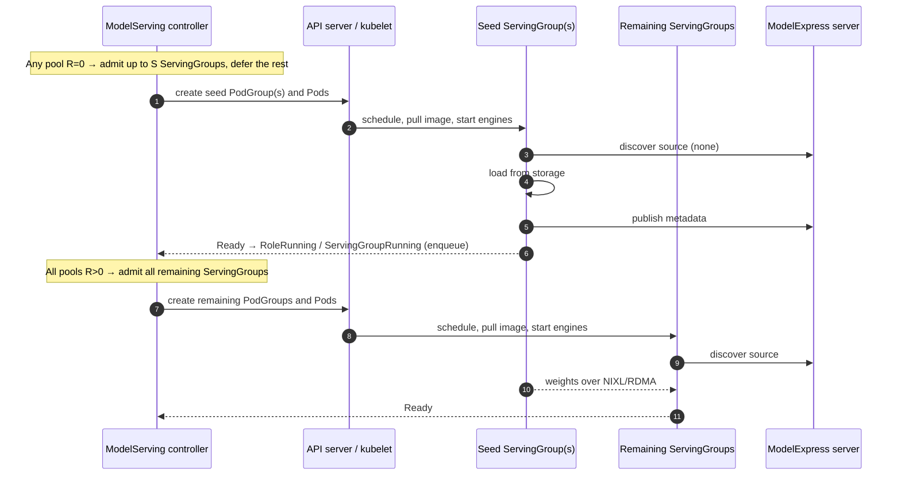

## Support ModelExpress P2P Bootstrap Acceleration

### Summary

When many ModelServing replicas (`ServingGroup`s) start together on initial deployment, scale-up, or rolling update, every role replica loads the full checkpoint from storage at once, and the fleet is ready only as fast as that contended load. [ModelExpress (MX)](https://github.com/ai-dynamo/modelexpress) copies post-processed weights from a ready serving replica over NIXL/RDMA (DeepSeek-V4-Pro, TP=8: 11s versus 8m53s for a cold Hugging Face pull). It only helps replicas that start **after** a compatible source is serving.

This proposal adds an optional `spec.bootstrapAccelerateStrategy` to ModelServing that selects seeds at **`ServingGroup` granularity** rather than `Role` granularity, avoiding conflicts with `ServingGroup`-scoped gang scheduling, network topology, and cross-role coordination. Instead of creating every `ServingGroup` at once, the controller creates them in two stages:

- While any in-scope role pool of a target `ServingGroup` has no ready replica, the controller creates an initial seed batch of up to `initialSeedReplicas` whole `ServingGroup`s. Cold roles in the seed batch find no source, load from storage, and then publish MX metadata.
- Once every in-scope role pool has a ready source replica, the controller creates all remaining `ServingGroup`s. Their engines pull weights P2P from the ready replicas.

All Pods are identical: each engine tries P2P first and falls back to storage. Role creation inside an already-created `ServingGroup` is never gated; the controller only decides **when** to create whole `ServingGroup`s.

### Motivation

Weight loading dominates bootstrap of large models when multiple `ServingGroup`s start on initial deployment, scale-up, or rolling update. MX only helps if replicas start in source-aware order, and only the ModelServing controller sees every `ServingGroup`, role template revision, readiness state, and desired count.

At the same time, `ServingGroup` is the atomic scheduling and cross-role coordination boundary in ModelServing, whereas individual `Role`s within one `ServingGroup` are tightly coupled:

- **Gang scheduling and network topology** ([manager.go](../../pkg/model-serving-controller/podgroupmanager/manager.go#L353-L388)): with `schedulerName: volcano`, one `PodGroup` spans the entire `ServingGroup` (`minMember`, `SubGroupPolicy`, and `NetworkTopology.GroupPolicy`), defaulting `minRoleReplicas` to all `role.replicas`. Selecting seeds per `Role` either splits a `ServingGroup` into partial waves—breaking group topology co-placement and requiring runtime gang-floor overrides of user seed counts—or fragments per-role budgets across different `ServingGroup`s so no group satisfies its gang.
- **Role coordination** ([role_rolling_update_coordinator.go](../../pkg/model-serving-controller/controller/role_rolling_update_coordinator.go), [role_coordinated_expansion.go](../../pkg/model-serving-controller/controller/role_coordinated_expansion.go#L74)): under `RoleRollingUpdate` with `roleCoordination`, cross-role `maxSkew`, startup `dependencies`, and staged `PodGroup` subgroup expansion (`stageCoordinatedExpansionGang`) govern role starts inside each `ServingGroup`. Once a role's dependency gate opens, `stageCoordinatedExpansionGang` advances its `PodGroup` subgroup minimum to full `role.replicas`; a second per-role seed gate in `scaleUpRoles` holding back part of that role would deadlock scheduling, distort `maxSkew` progress, or leave coordinated replacement slots unfilled while old dependencies remain pinned.

Selecting and admitting seeds as whole `ServingGroup`s bounds cold-start load across `ServingGroup`s while preserving every intra-group gang, topology, and role-coordination invariant.

#### Goals

- Most `ServingGroup`s start up via P2P from ready peers on initial deployment, scale-up, and `ServingGroupRollingUpdate` (and multi-step `RoleRollingUpdate` waves also pull P2P via MX environment injection).
- Bounded cold-start concurrency across groups: at most `initialSeedReplicas` seed `ServingGroup`s cold-load an unready role pool from storage before a source is ready.
- Zero conflict with gang scheduling, network topology, `RoleRollingUpdate`, or `RoleCoordination`.
- Opt-in and revision-neutral; no behavior change without the field.
- Stateless: nothing beyond existing Pods and the datastore.
- No semantic change to recovery, rolling update (`maxUnavailable`, `maxSurge`, `partition`, `roleCoordination`), or scale-down.

#### Non-Goals

- Deploying MX or its metadata backend, or configuring the engine command line (`--load-format modelexpress`). The controller only injects the MX environment variables into selected engine containers (see [Environment injection](#environment-injection)).
- Calling MX APIs from the controller. A Running role replica is treated as a source.
- Choosing the load path. MX's fallback chain (P2P → cache → storage → native loader) does that.
- Sub-`ServingGroup` (per-`Role`) seed gating inside a single `ServingGroup`, ModelBooster integration, and cross-role or cross-layout sources.

### Proposal

#### Constraints from the current controller

| Fact | Consequence |
|---|---|
| `spec.replicas` scales whole `ServingGroup`s via [scaleUpServingGroups](../../pkg/model-serving-controller/controller/model_serving_controller.go#L1009) (and whole-group revision reset in [syncRoleReplicas](../../pkg/model-serving-controller/controller/model_serving_controller.go#L1108) when all Pods of an outdated group are gone), updating the datastore synchronously right after creation. | Gate whole `ServingGroup`s at those group-creation points; no create expectations are needed. |
| A role replica is one entry Pod plus `workerReplicas` worker Pods ([Role](../../pkg/apis/workload/v1alpha1/servinggroup_types.go#L54-L86)), and becomes `RoleRunning` when all its Pods are Ready, which enqueues the ModelServing ([handleReadyPod](../../pkg/model-serving-controller/controller/model_serving_controller.go#L2213-L2264)). | One `RoleRunning` replica is one complete MX source across all worker ranks, and wakes reconciliation so remaining `ServingGroup`s are created once every in-scope role pool has a source. |
| The workload revision and role template hash are derived from `schedulerName`, `plugins`, and `template.roles` ([revision_util.go](../../pkg/model-serving-controller/utils/revision_util.go#L56-L74), [revision_data.go](../../pkg/model-serving-controller/utils/revision_data.go#L75-L155)). | A new `Role` field would re-hash and roll every ModelServing on upgrade, so the policy lives at `spec.bootstrapAccelerateStrategy`. |
| With `schedulerName: volcano`, each `ServingGroup` has one `PodGroup` created before its Pods, covering `minMember`, `SubGroupPolicy`, and `NetworkTopology` across its roles ([calculateRequirements](../../pkg/model-serving-controller/podgroupmanager/manager.go#L353-L388)). | Creating an admitted `ServingGroup` in full with its `PodGroup` satisfies gang and topology constraints natively without gang-floor overrides or partial-group backfill; deferred `ServingGroup`s create neither `PodGroup` nor Pods. |
| Inside an existing `ServingGroup`, [scaleUpRoles](../../pkg/model-serving-controller/controller/model_serving_controller.go#L1236) handles `RoleRecreate`, `RoleRollingUpdate`, and `RoleCoordination` (`maxSkew`, `dependencies`, and [stageCoordinatedExpansionGang](../../pkg/model-serving-controller/controller/role_coordinated_expansion.go#L74)). | Leaving existing `ServingGroup`s ungated avoids any conflict or scheduling deadlock with `RoleCoordination` and intra-group recovery. |
| `ServingGroupRollingUpdate` paces deletions on `len(groups) - minAvailable - newUnavailable` ([manageRollingUpdateWithPolicy](../../pkg/model-serving-controller/controller/model_serving_controller.go#L1776)). | A `ServingGroup` that is not created yet lowers `len(groups)` just like an unavailable one. See [Rolling update](#3-rolling-update). |

#### Batch creation

The controller changes when whole `ServingGroup`s are created; a built-in ModelServing plugin injects MX environment variables into in-scope Pods. Templates and existing labels are unchanged. Every engine runs the same MX load path: it looks for a compatible ready source, loads P2P if there is one, and otherwise falls back to storage. Cold roles in the seed `ServingGroup` batch simply find no source.



#### User Stories (Optional)

##### Story 1

Initial deployment of 32 `ServingGroup`s (single-role or disaggregated PD) with `bootstrapAccelerateStrategy: {initialSeedReplicas: 2}`. The controller creates 2 seed `ServingGroup`s first and all remaining 30 once every in-scope role has a ready source, so storage serves 2 `ServingGroup`s instead of 32.

##### Story 2

Autoscaling `spec.replicas` from 4 to 16 `ServingGroup`s. The 4 serving groups already have ready sources for every role, so all 12 new `ServingGroup`s are created at once and load P2P.

##### Story 3

`ServingGroupRollingUpdate` of the engine image across 32 `ServingGroup`s. The first new-revision seed `ServingGroup` batch loads from storage, and every later rollout step loads P2P from already-updated groups.

#### Notes/Constraints/Caveats (Optional)

- The engine must be MX-enabled (vLLM ≥ 0.23 with `--load-format modelexpress`, or SGLang `remote_instance` with the `modelexpress` backend) and able to reach the MX server. Otherwise the policy only limits initial cold-start concurrency across `ServingGroup`s.
- Readiness must imply that the weights are loaded; a `/health` probe is enough for that. A source publishes its MX metadata only after its readiness endpoint (`MX_ARTIFACT_READY_URL`, set through `modelExpress.readyURL` or defaulting to `/health` for vLLM) responds, so a `RoleRunning` replica may briefly not be discoverable. The next batch's scheduling and engine startup usually cover this gap; a reader that still finds no source falls back to storage. For strict P2P, add a readiness check that also confirms the source is published on the MX server.
- Deferred `ServingGroup`s are scheduled, and pull their image, only after compatible seed sources are ready, so these steps don't overlap the seed batch's load. Pre-pull the engine image on GPU nodes to keep the second wave short. In exchange, deferred `ServingGroup`s hold no GPUs while they wait.
- Within an admitted seed `ServingGroup` that sets `role.replicas > 1` (for example `2 prefill + 4 decode`), all replicas of that group are created together so gang scheduling, `NetworkTopology.GroupPolicy`, and `RoleCoordination` stay intact; cold loads are bounded to `initialSeedReplicas × role.replicas` rather than `spec.replicas × role.replicas`. For single-`ServingGroup` deployments (`spec.replicas: 1`) updated via `RoleRollingUpdate`, P2P wave sizing is controlled directly by each role's `maxUnavailable` and `maxSurge`.
- A full-download init container still blocks P2P loading. Use a shared cache, `MX_MODEL_URI`, or no downloader.

#### Risks and Mitigations

| Risk | Mitigation |
|---|---|
| A seed `ServingGroup` never becomes Ready (unschedulable, or crash-looping) and stalls remaining `ServingGroup`s. | Failed roles inside the seed group are re-created immediately by `RoleRecreate` (ungated), and `ServingGroupRecreate` deletes the failed seed group so a replacement seed group is admitted. An unschedulable group would block the fleet without the feature too. Events and V(4) logs make deferral visible. Removing the policy creates all remaining `ServingGroup`s on the next reconcile. |
| Between batches, other workloads take the capacity that later batches need. | Same as any scale-up; reserve capacity with a Volcano queue or quota. |
| MX known issue (nvbug 6519532): a source may stop serving new readers after one of its readers is deleted. Rolling update and scale-down delete readers. | Affected replicas stall until `MX_TRANSFER_TIMEOUT`, then try another source or fall back to storage. Document a lower `MX_TRANSFER_TIMEOUT`. |
| Controller downgrade | Safe: an old controller simply creates the missing `ServingGroup`s. |
| Security | No new privileges or RBAC. In-scope Pods get plain/downward-API environment variables; the MX server address is configured on the controller. |

### Design Details

#### 1. API

A new optional field on `ModelServingSpec`:

```go
// ModelServingSpec defines the specification of the ModelServing resource.
type ModelServingSpec struct {
	// ...existing fields...

	// BootstrapAccelerateStrategy creates ServingGroups in source-aware batches so that
	// most of them load model weights peer-to-peer from ready replicas instead of storage.
	// +optional
	BootstrapAccelerateStrategy *BootstrapAccelerateStrategy `json:"bootstrapAccelerateStrategy,omitempty"`
}

// BootstrapAccelerateStrategyProvider identifies the peer-to-peer weight transfer system.
// +kubebuilder:validation:Enum={ModelExpress}
type BootstrapAccelerateStrategyProvider string

const (
	BootstrapAccelerateStrategyProviderModelExpress BootstrapAccelerateStrategyProvider = "ModelExpress"
)

// BootstrapAccelerateStrategy configures source-aware creation of ServingGroups.
type BootstrapAccelerateStrategy struct {
	// Provider is the weight transfer system used by the inference engines.
	// +kubebuilder:default=ModelExpress
	// +optional
	Provider BootstrapAccelerateStrategyProvider `json:"provider,omitempty"`

	// InitialSeedReplicas is the number of seed ServingGroups that may be created
	// while any in-scope role pool of the group has no ready source. A percentage
	// (1%–100%) is taken of spec.replicas and rounded up, e.g. 10% of 3 is 1.
	// A desired count of zero creates nothing.
	// +kubebuilder:validation:XIntOrString
	// +kubebuilder:default=1
	// +optional
	InitialSeedReplicas *intstr.IntOrString `json:"initialSeedReplicas,omitempty"`

	// Roles optionally restricts weight-transfer source tracking and provider
	// environment injection to the named roles in spec.template.roles (for example,
	// excluding a non-engine router or tokenizer role). When empty, all roles in
	// spec.template.roles are in scope. Seed admission is always whole-ServingGroup.
	// +listType=set
	// +optional
	Roles []string `json:"roles,omitempty"`

	// ModelExpress configures the ModelExpress provider. If unspecified, no MX
	// environment variables are injected and users configure the engine themselves.
	// +optional
	ModelExpress *ModelExpressConfig `json:"modelExpress,omitempty"`
}

// ModelExpressConfig holds values injected into the Pods of in-scope roles.
type ModelExpressConfig struct {
	// EngineContainers names the regular containers running the inference engine
	// in entry and worker Pods of in-scope roles. Only these containers receive MX envs.
	// +kubebuilder:validation:MinItems=1
	// +listType=set
	EngineContainers []string `json:"engineContainers"`

	// ReadyURL is the engine endpoint that MX polls before a source publishes its
	// metadata; it may differ from the Pod readiness probe. It is injected as
	// MX_ARTIFACT_READY_URL only if that variable is not already set in the container.
	// If empty, MX uses the engine's default (http://127.0.0.1:8000/health for vLLM).
	// +optional
	ReadyURL string `json:"readyURL,omitempty"`
}
```

```yaml
spec:
  replicas: 16
  bootstrapAccelerateStrategy:
    initialSeedReplicas: 1
    modelExpress:
      engineContainers: ["engine"]
      readyURL: http://127.0.0.1:8000/health
  template:
    roles:
    - name: prefill
      replicas: 1
      entryTemplate:
        spec:
          containers:
          - name: engine
            image: <vllm-0.23+-with-modelexpress>
            args: ["serve", "/models/deepseek-v4", "--load-format", "modelexpress", "--tensor-parallel-size", "8"]
            readinessProbe:
              httpGet: {path: /health, port: 8000}
```

**Validation** ([validateModelServing](../../pkg/model-serving-controller/webhook/validator.go#L113)): `initialSeedReplicas`, if set, must be a positive integer or `1%`–`100%`, with percentages rounded up against `spec.replicas`. If `roles` is specified, each entry must be nonempty, unique, and name an existing role in `spec.template.roles`; an empty or omitted `roles` selects all roles in `spec.template.roles`. Because seeds are admitted as whole `ServingGroup`s, no gang-minimum comparison or runtime floor override is needed. `modelExpress.readyURL`, if set, must be an absolute `http` or `https` URL. The field is mutable and takes effect on the next reconcile.

**Revision neutrality.** `ModelServingRevision` hashes canonical workload revision data; `RoleRevisionHash` and `CalRoleTemplateHash` hash one role's effective template inputs; `BuildRevisionData` captures roles, `schedulerName`, and user `plugins`. None includes `BootstrapAccelerateStrategy`. MX variables are added to generated Pods, not to the templates, so they do not change these revision inputs. Unit tests lock this in.

When `modelExpress` is specified, `engineContainers` must be nonempty and contain nonempty, unique container names, and the webhook requires every in-scope role's entry template and worker template (if any) to contain at least one of them.

The automatically enabled MX plugin is not written into `spec.plugins` or the ControllerRevision. Policy edits therefore never trigger a rollout.

#### 2. Admission

##### Pools

Source compatibility is tracked per **pool** = (role name, role template hash) for each in-scope role (`role.replicas > 0`). Only `RoleRunning` replicas in the same pool count as ready sources for that pool. For partition-protected `ServingGroup` ordinals, the group's workload—and therefore its role templates—comes from its ControllerRevision.

The pool key is the same input the managed plugin turns into `MX_MODEL_REVISION` (prefixed with the ModelServing's namespace and name, since pools never span ModelServings), so the controller's notion of a compatible source mirrors the identity ModelExpress itself matches on. Nothing is persisted on Pods: $R_p$ and $I_p$ are read from the datastore (`RoleTemplateHash` and `Status`), which `syncAll` rebuilds from the Pods' labels after a restart.

The template hash does not cover the controller's ModelExpress server address, `modelExpress.engineContainers`, or whether a role was in scope when its Pods were created. After enabling the strategy on an existing fleet or changing those settings, Running replicas of the current template still count as sources even though they may not publish to the expected server. New `ServingGroup`s are then created together and ModelExpress falls back to storage for them, which is the behavior without the feature. Roll the Pods to benefit; changing `initialSeedReplicas` or `readyURL` needs no roll.

##### Budget and `ServingGroup` unit

| Symbol | Meaning |
|---|---|
| $D$ | Desired `ServingGroup`s: `spec.replicas`. |
| $S$ | Seed `ServingGroup` budget: $\min\bigl(D,\ \max(1,\ \texttt{initialSeedReplicas})\bigr)$ when $D > 0$, and $0$ when $D = 0$. |
| $R_p$ | Ready source replicas: non-deleting role replicas in pool $p$ that are `RoleRunning`. |
| $I_p$ | In-flight seed `ServingGroup`s for cold pool $p$: non-deleting `ServingGroup`s associated with pool $p$ while $R_p = 0$. |

`initialSeedReplicas` defaults to 1, and percentages (`1%`–`100%`) are rounded up against $D = \texttt{spec.replicas}$.

Admission gates **only whole `ServingGroup` creation** (never individual `Role` replicas inside an existing `ServingGroup`):

- A candidate `ServingGroup` for workload $W$ touches the pools $P(W) = \{(r, \text{RoleRevisionHash}(W, r))\}$ of its in-scope roles with `role.replicas > 0` (out-of-scope roles and zero-replica roles add no pool constraint).
- Any pool $p \in P(W)$ with $R_p > 0$ already has a ready P2P source and imposes no limit.
- If $P(W)$ contains any cold pool ($R_p = 0$), the `ServingGroup` is admitted if and only if $I_p + 1 \le S$ for every cold pool $p \in P(W)$.
- **Admitted `ServingGroup`:** $I_p$ increments by $1$ for every pool $p \in P(W)$, and the controller creates the group's `PodGroup` (`minMember`, `SubGroupPolicy`, and `NetworkTopology` unchanged) together with **all** of its roles and replicas (`0 .. role.replicas - 1`).
- **Denied `ServingGroup`:** neither its `PodGroup` nor any of its Pods is created; the group remains absent until a later reconcile. Candidate `ServingGroup`s are evaluated in ascending ordinal order.
- **No overshoot while $R_p = 0$:** if $S$ drops below $I_p$ (policy lowered while $R_p = 0$), existing groups keep running and further cold `ServingGroup` creation pauses until a source is ready or in-flight groups drop below $S$.
- **Existing `ServingGroup`s are ungated:** once a `ServingGroup` exists, `syncRoleReplicas` (`scaleUpRoles`) creates or repairs missing role replicas inside that group without consulting bootstrap admission, preserving gang scheduling, `NetworkTopology.GroupPolicy`, `RoleRecreate`, `RoleRollingUpdate`, and `RoleCoordination`.

**Example (disaggregated PD).** `spec.replicas: 4` `ServingGroup`s, each group has `2 prefill + 4 decode`, `schedulerName: volcano` (with or without `minRoleReplicas` / `networkTopology`), default `initialSeedReplicas: 1` ($S = 1$).

| Batch | $(R_P, R_D)$ | Created `ServingGroup`s |
|---|---|---|
| 1 | $(0, 0)$ | `ServingGroup` 0 in full (`PodGroup` + 2P + 4D, cold). `ServingGroup`s 1–3 are deferred ($I_P = 1, I_D = 1 = S$). |
| 2 | $(\ge 1, \ge 1)$ | `ServingGroup`s 1, 2, and 3 in full (6P + 12D, P2P). If `prefill` finishes before `decode` in group 0 ($R_P \ge 1, R_D = 0$), groups 1–3 wait until `decode` also has $R_D \ge 1$. |

Storage serves 1 `ServingGroup` (6 role replicas) instead of 4 `ServingGroup`s (24 role replicas), and every `ServingGroup` schedules its `PodGroup` and topology domain as one intact unit.

**Examples** ($D = 8$ `ServingGroup`s; cumulative created `ServingGroup`s):

| Policy | Batches |
|---|---|
| `initialSeedReplicas: 1` | 1 → 8 |
| `initialSeedReplicas: 2` | 2 → 8 |
| `initialSeedReplicas: 25%` | 2 → 8 |
| Scale `spec.replicas` 8 → 16 | 8 → 16 |

#### 3. Rolling update

`manageRollingUpdateWithPolicy` is unchanged. Under `ServingGroupRollingUpdate`, `ServingGroup`s it deletes are re-created through `scaleUpServingGroups` on a later reconcile and pass whole-`ServingGroup` admission like any other missing group.

**R1. A changed in-scope role template starts a cold pool.** A new `ServingGroup` whose workload touches a changed pool starts with $R_p = 0$ and is limited to $S$ seed `ServingGroup`s; replicas with a different template hash are not counted in $R_p$.

- Why not share sources across revisions: MX matches sources by `SourceIdentity` (model, revision, TP/PP/EP, dtype, quantization, engine/torch/CUDA versions, GPU arch). The controller can't tell from a template diff whether that identity changed. Counting incompatible old replicas would release a large batch of `ServingGroup`s that all fall back to storage.
- If the change is identity-neutral (for example, resources, probes, `--max-num-seqs`), the seed `ServingGroup` batch still finds old-revision sources through MX and loads P2P. The only cost is that the first step is `initialSeedReplicas` `ServingGroup`s wide.
- Roles whose template didn't change keep their existing warm pool ($R_p > 0$). In PD disaggregation, if `ServingGroupRollingUpdate` updates only `prefill`, the seed `ServingGroup` cold-loads only `prefill` while its `decode` replicas immediately pull P2P from the remaining old `ServingGroup`s; if only an out-of-scope role changed, all pools have $R_p > 0$ and no seed throttle applies.

**R2. Pacing stays with `ServingGroupRollingUpdate`.** A deferred `ServingGroup` is absent from the datastore, which lowers `len(groups)` in `maxScaleDown` exactly as one unavailable new group would. `maxUnavailable` is never exceeded.

- Only the first step of a rollout with a cold pool (while any $R_p = 0$) is narrowed, to $S$ `ServingGroup`s.
- Once every in-scope pool has a ready replica ($R_p > 0$), admission stops gating and the rollout runs at its normal `maxUnavailable` / `maxSurge` pace.
- With `maxSurge` ≥ 1, up to $\min(\texttt{maxSurge}, S)$ surge `ServingGroup`s form the seed batch and load while old capacity is intact.

**R3. Outdated `ServingGroup`s** already exist and are not affected. Missing partition-protected `ServingGroup` ordinals (`ordinal < partition`) are re-created from `CurrentRevision` and admitted against their historical pools.

**R4. Deleting sources.** A replica pulling from a deleted source retries another candidate (MX tries up to 3) and then falls back to storage. On clean shutdown MX marks the source `STALE`, and the MX server's reaper removes stale metadata from its backend (Redis).

**R5. Rollback.** Reverting to a revision whose in-scope role template hashes still have `RoleRunning` replicas resolves to warm pools ($R_p > 0$), so re-created `ServingGroup`s are admitted immediately.

**R6. `RoleRollingUpdate` and `RoleCoordination`.** `RoleRollingUpdate` (typically used with a single `ServingGroup`, optionally paired with `roleCoordination`) updates individual role replicas inside existing `ServingGroup`s via `deleteOutdatedRoles` and `scaleUpRoles`. Because bootstrap admission gates only whole `ServingGroup` creation, it does not gate `scaleUpRoles`: role rollout concurrency, `roleCoordination.maxSkew`, startup `dependencies`, and staged `PodGroup` subgroup expansion (`stageCoordinatedExpansionGang`) run without interference or deadlock. Meanwhile, the managed `modelexpress` plugin still injects MX environment variables into every new Pod of in-scope roles, so once the first updated role wave (bounded by that role's `maxUnavailable` / `maxSurge`) is Ready, subsequent rollout steps discover those MX sources and load P2P automatically.

**Example (`ServingGroupRollingUpdate`).** `spec.replicas: 8`, `maxUnavailable: 2`, `maxSurge: 0`, `initialSeedReplicas: 1`, new engine image:

1. The rollout deletes `ServingGroup`s 7 and 6. The new pool has $R=0$ and $S=1$, so only `ServingGroup` 6 is created, and 7 stays missing. `maxScaleDown` = 7 − 6 − 1 = 0.
2. `ServingGroup` 6 becomes Running, so $R \ge 1 > 0$. `ServingGroup` 7 is created, `maxScaleDown` = 8 − 6 − 1 = 1, and `ServingGroup` 5 is deleted. From here $R > 0$ and the rollout keeps 2 `ServingGroup`s in flight at its normal pace.

Storage serves 1 seed `ServingGroup` instead of 8.

#### 4. Controller changes

A new package `pkg/model-serving-controller/bootstrap/` holds a pure `Admitter`. [syncModelServing](../../pkg/model-serving-controller/controller/model_serving_controller.go#L669) builds one `Admitter` per reconcile from the datastore ($R_p$, $I_p$ per pool), attaches it to the reconcile context, and whole-`ServingGroup` creation consults it:

```text
syncModelServing
├─ admitter := newBootstrapAdmitter(ctx, ms); ctx = bootstrap.WithAdmitter(ctx, admitter)
├─ syncServingGroupReplicas → scaleUpServingGroups          (A) new ServingGroups (gated)
├─ syncRoleReplicas         → whole-group revision reset    (B) empty outdated group (gated)
│                           → manageRoleReplicasPerGroup    (C) existing groups (ungated)
└─ rollout, services, status                                unchanged
```

- **(A) New `ServingGroup`s.** For each missing ordinal in `[0, expectedCount)`, resolve its `workload` (`CurrentRevision` if `ordinal < partition`, else `newRevision`) and call `AdmitGroup(workload) bool`. If admitted, create the `PodGroup` (`minMember`, `SubGroupPolicy`, and `NetworkTopology` unchanged), create all roles and replicas of the `ServingGroup`, and `AddServingGroup`. If denied, the `ServingGroup` is not created: no `PodGroup` and no Pods.
- **(B) Empty outdated `ServingGroup` reset.** In `syncRoleReplicas`, when `RolloutStrategy` is not `RoleRollingUpdate` and an outdated `ServingGroup` already has zero live or terminating Pods left, re-creating it onto its target revision also checks `AdmitGroup(workload)`. If denied, re-creation waits until compatible sources are ready.
- **(C) Existing `ServingGroup`s.** `manageRoleReplicasPerGroup` and `scaleUpRoles` are not gated by `Admitter`. Partial group creation recovery, `RoleRecreate`, `RoleRollingUpdate`, and `RoleCoordination` create missing role replicas immediately within existing `ServingGroup`s.
- Admitted `ServingGroup`s increment $I_p$ by 1 for each touched pool in `Admitter`, and are recorded in the datastore right after Pod creation so the next reconcile sees them.
- **Observation.** Nothing new is persisted. Each reconcile computes $R_p$ and $I_p$ per `(role, templateHash)` from non-deleting `ServingGroup`s in the datastore; legacy `Role` records without a stored hash resolve it from their ControllerRevision. Each `RoleRunning` replica increments $R_p$, and each non-deleting `ServingGroup` that carries pool $p$ (via an observed non-deleting `Role` record, or via its group revision while role records for that role are not yet created) counts once toward $I_p$.
- **Wake-ups.** No new handlers. Both `RoleRunning` and `ServingGroupRunning` transitions already enqueue the ModelServing ([handleReadyPod](../../pkg/model-serving-controller/controller/model_serving_controller.go#L2213-L2264)), and so do deletions (lowering $I_p$) and spec edits.
- **Disabling** the policy: the next reconcile creates every missing `ServingGroup`. **Crash safety:** no batch progress is persisted; after a restart, `syncAll` rebuilds the datastore from observed Pods and admission is recomputed.
- **Events:** `BootstrapBatchCreated` summarizing admitted `ServingGroup`s and ready source counts; deferred `ServingGroup`s are logged at V(4).
- **In-place updates.** The managed plugin does not implement `InPlaceUpdatePlugin`, because `MX_MODEL_REVISION` is bound to the role template hash at creation and cannot be patched in place. With the strategy set, `updateMethod: InPlace` falls back to recreating outdated units, which then pass `ServingGroup` admission (under `ServingGroupRollingUpdate`) or roll per role with MX injection (under `RoleRollingUpdate`).
- **Configuration.** The ModelExpress server address is a controller flag, `--modelexpress-server-address` (Helm: `controllerManager.modelExpressServerAddress`).

##### Environment injection

A built-in `modelexpress` plugin implements the existing [OnPodCreate hook](../../pkg/model-serving-controller/plugins/manager.go#L160-L174). `buildPluginChain` appends it automatically after user plugins when `bootstrapAccelerateStrategy.provider` is `ModelExpress`, scoped to the strategy's in-scope roles (all roles when `roles` is empty) and both entry and worker Pods. Users do not need a duplicate `spec.plugins` entry; explicit registration of this managed plugin is rejected. Its `OnPodReady` is a no-op. Admission remains in the controller because a per-Pod plugin cannot defer a whole `ServingGroup` and its `PodGroup`.

The plugin injects the variables below **only into inference-engine containers**, selected by `modelExpress.engineContainers` from `pod.spec.containers`. Init containers and unselected regular containers (including sidecars) are never modified. The webhook requires every in-scope template to contain a selected engine container; if a user plugin still leaves a rendered Pod without one, the plugin fails that Pod's creation with a `PluginError` event and the reconcile is retried. The plugin does not infer engine containers from images or command lines. If `modelExpress` is omitted, nothing is injected; users configure their engine containers themselves.

`GenerateEntryPod` and `GenerateWorkerPod` remain unchanged. A variable already defined in a selected container wins, including values added by earlier plugins. Inject `MX_SERVER_ADDRESS` (from the controller's ModelExpress server address configuration) and `MX_ARTIFACT_READY_URL` (from `modelExpress.readyURL`) only when the variable is absent and the corresponding value is nonempty; no deprecated endpoint variable is injected. This integration requires an MX client that supports `MX_SERVER_ADDRESS`. Clients that read only the deprecated `MODEL_EXPRESS_URL` (for example, TRT-LLM live transfer) are unsupported, and because MX prefers `MODEL_EXPRESS_URL` when both are set, templates or images (for example, a Dockerfile `ENV`) that set it must remove it. Injected `env` entries take precedence over `envFrom`, and the plugin does not resolve `envFrom`; users who supply any variable below through `envFrom` must move it to `env` (or leave the corresponding field empty).

For the central-server deployment covered by this proposal, inject the following into selected engine containers when the variable is not already set ([MX P2P environment variables](https://github.com/ai-dynamo/modelexpress/blob/main/docs/DEPLOYMENT.md#p2p-environment-variables)):

| Variable | Value | Why |
|---|---|---|
| `MX_MODEL_REVISION` | `<namespace>/<ModelServing name>/<role template hash>-<WORKER_INDEX>` (the owning ModelServing, `modelserving.volcano.sh/role-template-hash`, and the Pod's position in its replica: `0` for the entry, `1..N` for workers) when not already set in the container | Scopes the MX source identity to one weight shard of one role template revision of one ModelServing. The role template hash alone is equal for identical templates in other namespaces or ModelServings, whose volumes may hold different weights behind the same model path, so the ModelServing is part of the identity; this is also the scope of the admission pools. A worker only reads from the same position of another replica, never from an entry or another rank: MX separates positions by rank only when the engine initializes `torch.distributed` across Pods, and falls back to the local device index otherwise. Users can supply an explicit checkpoint revision instead. |
| `MX_SERVER_ADDRESS` | Controller's `--modelexpress-server-address`; inject only when the variable is absent and the address is nonempty | The client's gRPC endpoint; do not assume `localhost:8001` points to an external MX server. |
| `MX_P2P_METADATA` | `'1'` | Enables P2P weight metadata registration and discovery. |
| `MX_METADATA_PORT` | `'5555'` | Fixed base TCP port for NIXL metadata exchange (never `0` in Kubernetes). |
| `MX_WORKER_GRPC_PORT` | `'6555'` | Fixed base TCP port for worker gRPC status/coordination (never `0` in Kubernetes). |
| `MX_NIXL_BACKEND` | `UCX` | Default NIXL transport backend for InfiniBand/RoCE/TCP; override in container `env` when using `LIBFABRIC` (e.g., AWS EFA). |
| `MX_INSTANT_TENSOR` | `'0'` | Disables per-tensor streaming by default in favor of standard batch weight transfer. |
| `MX_ARTIFACT_TRANSFER` | `'1'` | Enables transfer of runtime/compiled artifacts alongside model weights. |
| `MX_POOL_REG` | `'1'` | Registers memory with NIXL once per pool instead of per transfer. |
| `MX_VMM_ARENA` | `'1'` | Allocates receive buffers from a VMM arena, avoiding per-transfer allocation and registration. |
| `MX_ARTIFACT_READY_URL` | `modelExpress.readyURL`; inject only when the variable is absent and the URL is nonempty | The engine endpoint a source polls before publishing. Set it when the engine's port or path differs from the MX default, or when the Pod readiness probe checks a different endpoint; a URL that never responds keeps the source from ever publishing. |
| `MODEL_EXPRESS_LOG_LEVEL` | `INFO` | Default log verbosity for the ModelExpress client. |
| `NIXL_LOG_LEVEL` | `INFO` | Default log verbosity for NIXL transfer operations. |
| `UCX_LOG_LEVEL` | `WARN` | Suppresses noisy UCX info logs unless overridden. |
| `MX_WORKER_HOST` | Downward API `status.podIP` | The address that readers use to reach this source. Auto-detection can pick an unroutable interface on multi-NIC GPU nodes. |
| `POD_NAME`, `POD_UID`, `POD_NAMESPACE` | Downward API `metadata.name`, `metadata.uid`, `metadata.namespace` | The MX client sends them when it publishes a source. The Kubernetes metadata backend turns them into an `ownerReference`, so a source record is garbage-collected with its Pod instead of lingering until the heartbeat reaper marks it stale. The Redis backend ignores them. |
| `MX_RDMA_NIC_PIN` | `auto`; not injected when the container sets `UCX_NET_DEVICES` | Probes the PCI topology and gives each GPU rank its own RDMA NIC. Without it every rank picks a NIC independently and they can converge on one rail. The probe overwrites `UCX_NET_DEVICES`, so an explicit device selection in the template disables it; hosts without verbs devices skip the pin. |

Example of the environment entries injected into a selected engine container:

```yaml
- name: MX_MODEL_REVISION
  value: default/bootstrap-accelerate/56eba4e34d3d031b8a62ac6bfb87a723-0
- name: MX_SERVER_ADDRESS
  value: 215.80.6.74:8001
- name: MX_P2P_METADATA
  value: '1'
- name: MX_METADATA_PORT
  value: '5555'
- name: MX_WORKER_GRPC_PORT
  value: '6555'
- name: MX_NIXL_BACKEND
  value: UCX
- name: MX_INSTANT_TENSOR
  value: '0'
- name: MX_ARTIFACT_TRANSFER
  value: '1'
- name: MX_POOL_REG
  value: '1'
- name: MX_VMM_ARENA
  value: '1'
- name: MX_ARTIFACT_READY_URL
  value: http://127.0.0.1:40390/health
- name: MODEL_EXPRESS_LOG_LEVEL
  value: INFO
- name: NIXL_LOG_LEVEL
  value: INFO
- name: UCX_LOG_LEVEL
  value: WARN
- name: MX_WORKER_HOST
  valueFrom:
    fieldRef:
      fieldPath: status.podIP
- name: POD_NAME
  valueFrom:
    fieldRef:
      fieldPath: metadata.name
- name: POD_UID
  valueFrom:
    fieldRef:
      fieldPath: metadata.uid
- name: POD_NAMESPACE
  valueFrom:
    fieldRef:
      fieldPath: metadata.namespace
- name: MX_RDMA_NIC_PIN
  value: auto
```

Pod IP is a sensible default for `MX_WORKER_HOST`, not a guarantee of RDMA reachability. Users must override it when the advertised address needs another interface. NetworkPolicy and the GPU/RDMA device allocation must permit the worker gRPC/NIXL port ranges and data-plane traffic. Multiple engines sharing one Pod network, or host-network Pods sharing a node, need nonoverlapping port ranges; Kthena does not allocate those automatically.

**Configuration ownership.** Keep cluster-level endpoint configuration (the ModelExpress server address) in `kthena-controller-manager` configuration, and keep workload-specific values (`readyURL` and `engineContainers`) in `modelExpress` or the selected engine container's template. `MX_WORKER_HOST`, `MX_MODEL_REVISION`, `MX_SERVER_ADDRESS`, and the standard MX/NIXL/UCX runtime defaults above are injected automatically when not already present in the container's `env`. Custom ports, alternate `MX_NIXL_BACKEND` values (for example `LIBFABRIC` for AWS EFA), NIC pinning, source selection, and timeouts can be overridden explicitly in the engine container's `env`. No arbitrary env passthrough API is needed.

When `MX_ARTIFACT_TRANSFER=1` is used with disaggregated roles that have incompatible compilation settings, users should supply distinct `MX_ARTIFACT_COMPILE_CONFIG_DIGEST` values in the role templates. `VLLM_PLUGINS=modelexpress` is needed only for vLLM older than 0.23, not injected universally. The decentralized `k8s-service` backend needs its own Service/rank routing and pinned source identity, so it is outside this central-server integration.

The injection happens at Pod creation, so changing the ModelExpress configuration affects only new Pods and doesn't trigger a rollout.

| Feature | Behavior |
|---|---|
| Gang scheduling / network topology | Every admitted `ServingGroup` is created in full together with its `PodGroup` (`minMember`, `SubGroupPolicy`, and `NetworkTopology`); deferred `ServingGroup`s get neither `PodGroup` nor Pods. No gang-floor override or partial-group creation is needed. |
| `RoleRollingUpdate` / `RoleCoordination` | Not gated by bootstrap admission, avoiding any conflict with `maxSkew`, startup `dependencies`, or staged `PodGroup` subgroup expansion (`stageCoordinatedExpansionGang`). Pods still receive MX env injection so later rollout steps pull P2P after the first wave is Ready. |
| `ServingGroupRecreate` recovery | Whole-group re-creation passes `AdmitGroup`, usually warm with $R_p > 0$ (or re-admitted in the seed slot if the seed group itself failed while $R_p = 0$). |
| `RoleRecreate` recovery and Pod re-creation inside an existing `ServingGroup` | Not gated. Replacement roles and Pods inside an already-created `ServingGroup` are created immediately, run the MX plugin, and rejoin their pool. |
| Scale-up / scale-down | Increasing `spec.replicas` passes `AdmitGroup`; increasing `role.replicas` inside existing `ServingGroup`s is ungated and pulls P2P from already-Running replicas. Deferred `ServingGroup`s don't exist, so scale-down has nothing extra to delete. |
| kthena-router | Unchanged. |
| User plugins | Existing hooks are unchanged; the managed MX plugin runs last. Effective plugin configuration participates in source identity. |

#### Test Plan

Unit tests (table-driven, `-race` where concurrent):

- **Admitter:** whole-`ServingGroup` admission up to $S$ when any touched pool has $R_p=0$ and unbounded when all touched pools have $R_p>0$; integer, percentage (of `spec.replicas`), and default (1) `initialSeedReplicas`; $D=0$; multi-role PD holding subsequent `ServingGroup`s until every in-scope role pool has $R_p>0$; optional `roles` scoping; $I_p > S$ when `initialSeedReplicas` is lowered while $R_p=0$; and the batch sequences in the examples above.
- **Pool identity:** replicas of another role template are not sources for the current pool; Running replicas without a template hash are not sources; legacy datastore records resolve their hash from the ControllerRevision; a partially created `ServingGroup` still counts once in $I_p$ via its group revision.
- **Controller:** whole-`ServingGroup` creation with its `PodGroup` and all roles, deferred `ServingGroup`s creating neither `PodGroup` nor Pods, existing `ServingGroup`s ungated in `scaleUpRoles` (`RoleRecreate`, `RoleRollingUpdate`, `RoleCoordination`), empty outdated group reset gated by `AdmitGroup`, disabling the policy, and `ServingGroupRollingUpdate` pacing (`maxUnavailable`, `maxSurge`, `partition`, partial role template updates, rollback).
- **Revision neutrality:** adding, editing, or removing the strategy does not change `ModelServingRevision`, `RoleRevisionHash`, `CalRoleTemplateHash`, or `BuildRevisionData`.
- **Environment injection:** only selected engine containers change; init containers and sidecars are untouched; default all-roles scope when `roles` is omitted and explicit `roles` filtering when set; `MX_MODEL_REVISION`, `MX_SERVER_ADDRESS`, `MX_P2P_METADATA`, `MX_METADATA_PORT`, `MX_WORKER_GRPC_PORT`, `MX_NIXL_BACKEND`, `MX_INSTANT_TENSOR`, `MX_ARTIFACT_TRANSFER`, `MX_POOL_REG`, `MX_VMM_ARENA`, `MX_ARTIFACT_READY_URL`, `MODEL_EXPRESS_LOG_LEVEL`, `NIXL_LOG_LEVEL`, `UCX_LOG_LEVEL`, `MX_WORKER_HOST`, `POD_NAME`, `POD_UID`, `POD_NAMESPACE`, and `MX_RDMA_NIC_PIN` are injected as expected; `MX_MODEL_REVISION` differs between ModelServings with identical role templates and between positions of one replica; `MX_RDMA_NIC_PIN` is not injected when `UCX_NET_DEVICES` is set; existing user-specified variables win; changing `readyURL` keeps the pool; nothing is injected when `modelExpress` is omitted; `MODEL_EXPRESS_URL` is never injected.
- **Webhook:** invalid `initialSeedReplicas` (zero, negative, or outside `1%`–`100%`), unknown, empty, or duplicate `roles` entries, malformed `readyURL`, missing engine containers in in-scope role templates (and out-of-scope roles ignored), and explicit registration of the managed plugin.

E2E (`test/e2e/controller-manager`): a multi-`ServingGroup` ModelServing with the strategy and a stub engine (no MX needed) verifies seed-then-remaining `ServingGroup` batch order, intact full-group scheduling with `schedulerName: volcano`, and a `ServingGroupRollingUpdate`.

### Alternatives

- **Select seeds at `Role` granularity (`roles[].initialSeedReplicas`):** configuring and admitting seeds per role replica conflicts with `ServingGroup`-level scheduling and cross-role coordination. With Volcano gang scheduling and `NetworkTopology.GroupPolicy`, one `PodGroup` spans the `ServingGroup`; gating individual role replicas forces splitting a group into a "gang core" and deferred non-core replicas (weakening group topology co-placement and requiring runtime gang-floor overrides when `initialSeedReplicas < minRoleReplicas`) and can fragment role budgets across different groups during recovery so none completes its gang. Under `RoleRollingUpdate` with `RoleCoordination`, a second per-role gate in `scaleUpRoles` also conflicts with `maxSkew`, startup `dependencies`, and `stageCoordinatedExpansionGang` (which raises the `PodGroup` subgroup minimum to full `role.replicas` once dependencies are Ready, deadlocking scheduling if bootstrap admission holds back part of that role). Admitting whole `ServingGroup`s avoids both classes of conflict.
- **Create all Pods and gate the engine with an injected init container** (released by a Pod label through the downward API): overlaps scheduling and image pulls with the first batch's load. However, waiting Pods hold GPUs, it needs Pod `patch` RBAC, a gate image, and downward-API refresh latency, and a gate crash triggers recovery.
- **`schedulingGates`:** adds Pod patching and interacts with PodGroup `minMember`, with no clear gain over deferring creation.
- **Policy on `Role`:** re-hashes every existing role on upgrade and rolls the fleet.
- **Plugin-only batching:** plugins only have per-Pod hooks and cannot defer a whole `ServingGroup` and its `PodGroup`. Use a plugin for MX Pod configuration, but keep admission in the controller.
- **Pods self-coordinate via MX/Redis:** needs backend credentials in every Pod and has no view of desired `ServingGroup`s or rollouts.
- **Query MX `ListSources`:** more precise (catches wedged sources) but couples the controller to MX networking and auth. Possible later behind `provider`.
- **Share pools across revisions** (for example, a user-declared source key): removes the first batch for identity-neutral updates, but a misconfiguration causes a fallback stampede.