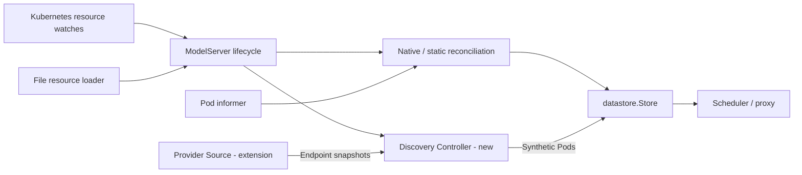

## Pluggable Endpoint Discovery in Kthena Router

### Summary

For [issue #1864](https://github.com/volcano-sh/kthena/issues/1864), add an
in-process discovery extension point. Providers return existing networking
`Endpoint` objects; a shared controller maintains synthetic Pods in
`datastore.Store`, without adding discovery I/O to inference requests.

### Motivation

Model instances may be registered outside the router's Kubernetes cluster.
Integrations need to discover them without changing scheduling or proxying.

#### Goals

- Preserve native Pod/static discovery when the extension is disabled.
- Share endpoint reconciliation across providers and static endpoints.
- Support both Kubernetes-backed and file-backed ModelServer resources.

#### Non-Goals

- CRD changes, default external providers, out-of-process plugins or dynamic loading.
- Mixed Pod/external discovery, multiple providers per router, mapping hot reload,
  or external discovery for Gateway API Inference Extension InferencePools.

### Proposal

Select one compiled-in provider and map ModelServers to its parameters.
External mode disables the Pod informer, not resource configuration loading.

| ModelServer in external mode | Membership owner |
| --- | --- |
| Mapped | Discovery controller; selector/static endpoints are ignored |
| Unmapped, with static endpoints | Shared static endpoint reconciliation |
| Unmapped, selector only | Empty pool with a warning; no Pod fallback |



Resource loading and instance discovery are independent. Kubernetes watches or
the existing file loader supply ModelServer configuration. Native mode retains
Pod/static reconciliation; external mode disables the Pod informer and assigns
mapped models exclusively to the new controller. Unmapped static models still
work. Both paths use the existing Store; the request path is unchanged.

#### User Stories

- Discover instances across clusters from a registry without watching each cluster.
- Add a registry integration while reusing the existing scheduler, proxy and Store.

#### Risks and Mitigations

- **Startup:** by default, one failing mapped model can prevent a new replica from
  becoming Ready and stall rollout. `requireInitialSnapshot: false` permits
  startup without discovery completion, accepting unavailable model pools.
- **Staleness:** lookup/validation failures retain the entire last valid snapshot,
  possibly indefinitely. Endpoint count and last-success metrics support alerts;
  they do not certify endpoint health.
- **Cold instances:** runtime inspection is asynchronous in external mode. Until
  it completes, LoRA filtering excludes new instances and GPU-cache scoring sees
  zero usage. Readiness does not imply populated metrics or inference capacity.
- **Consistency:** Store updates are serialized per ModelServer, not an atomic
  snapshot swap. A provider ignoring cancellation can delay refresh or shutdown.

### Design Details

#### Integration

Implement `discovery.Source` and register a `Factory` in
`Server.EndpointDiscoveryRegistry` before `Run`:

```go
type Source interface {
    Snapshot(context.Context) ([]networkingv1alpha1.Endpoint, error)
    Close()
}

type Factory func(types.NamespacedName, map[string]interface{}, func()) (Source, error)
type Registry map[string]Factory
```

The factory receives the ModelServer name, read-only parameters and a refresh
hint callback. It must avoid blocking I/O; Source must honor cancellation, return
immutable full snapshots and promptly release its own subscription on Close.
Providers never receive Store access. Unknown provider names fail startup.

```yaml
endpointDiscovery:
  provider: custom
  refreshInterval: 30s
  snapshotTimeout: 5s
  maxConcurrentSnapshots: 4
  requireInitialSnapshot: true
  mappings:
    - modelServer: default/example-model
      parameters:
        service: example-model
```

`custom` is integration-supplied; no external provider is registered by default.
Provider/mapping changes require restart. ModelServer validation remains
unchanged: declare valid selector/port fields or static endpoints. Details are in the
[configuration guide](../kthena/docs/user-guide/config-router.md#external-endpoint-discovery).
A complete [HTTP/JSON example](../kthena/docs/user-guide/endpoint-discovery-provider.md)
includes a custom binary, configuration and local mock backend.

#### Reconciliation

**1. Attach a source.** At startup, Router configuration selects a compiled-in
factory. When either resource loader observes a mapped ModelServer, the
controller creates its subscription and calls the factory with that model's
parameters. Each Router replica maintains its own Sources; the first lookup
starts immediately when a query slot is available.

**2. Refresh and apply.** The controller calls `Snapshot(ctx)` outside its
ModelServer lock, with a timeout and process-wide query limit (default 4).
Periodic refresh, a provider's `notify()` hint or a ModelServer spec change can
trigger another lookup. Notifications coalesce and are rate-limited. Scheduled
initial retries back off from `min(1s, refreshInterval)` to the interval;
periodic delays have approximately +/-10% jitter. Slots are released before
validation and Store reconciliation.

| Result | Store action |
| --- | --- |
| Valid full snapshot | Add/update synthetic Pods and remove omitted members |
| Successful empty snapshot | Clear this ModelServer's membership |
| Lookup error or any invalid endpoint | Keep the entire last valid snapshot |
| Cancelled/replaced subscription or changed spec version | Discard the obsolete result |

Writes are serialized per ModelServer, but not an atomic Store snapshot swap.
Endpoint names are DNS-1123 identities within the model. A same-name address/port
change updates the Pod in place: in-flight counters and name-keyed affinity
remain, while runtime metrics/models and old scrapes are invalidated. Use a new
name for a replacement that must not inherit affinity; provide PD role/group
labels when needed. The existing bounded inspection loop fetches metrics/models
asynchronously in external mode, including for unmapped static models.

**3. Handle lifecycle changes.** A spec edit reapplies the last raw snapshot
before requesting a refresh, so engine/port changes do not clear membership.
Omitted ports follow ModelServer configuration; explicit endpoint ports do not.
Deletion cancels the subscription and removes membership; a different UID starts
a fresh subscription. The controller's `Run(ctx)` / `Close()` own these workers,
with `Snapshot` and `Close` serialized for each Source.

By default, after resource/Store initialization, Server waits for the first valid applied
snapshot of every existing mapped model; empty snapshots count. Missing/deleted
models do not block it. This startup gate latches once satisfied, with no
automatic timeout bypass; later model changes cannot make the Router Unready.

#### Test Plan

Keep native/static regression tests. Cover snapshot validation and failure
retention, lifecycle/obsolete results, cancellation, query limits, retry/jitter,
readiness latching, configuration updates and cold-start scheduling. Exercise
both resource-source integrations with test-only providers.

Run affected packages with `-race`, repository lint and unit tests. The HTTP
example provides a local discovery/routing smoke test with a mock backend;
real registry and inference-engine integrations still need their own validation.

### Alternatives

- **External synchronizer:** update static endpoints or resource files without an
  in-process extension; suitable when existing resource publication is enough.
- **Provider writes Store:** duplicates ownership, deletion and failure handling.
- **Mixed discovery:** defer per-ModelServer Pod/external selection to keep initial
  ownership explicit; current mappings already identify individual ModelServers.
