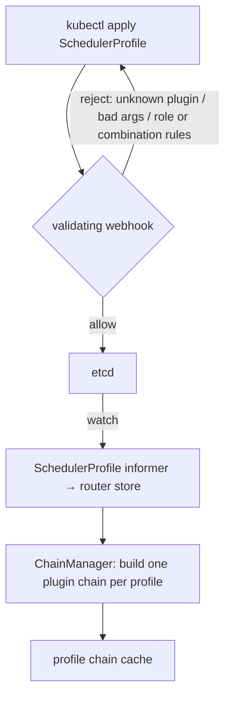
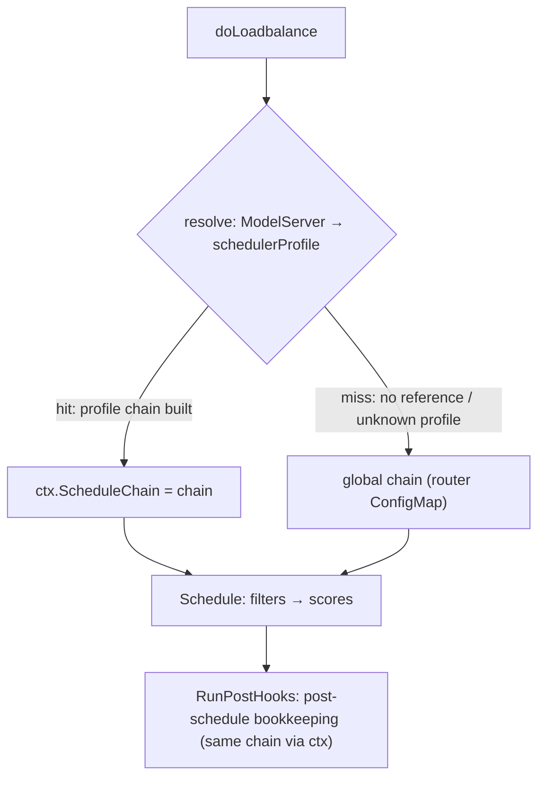

# Scheduler Profile: Per-ModelServer Plugin Combinations

authors:
- "@0xjasoncao"
reviewers:
- "@YaoZengzeng"
- TBD

approvers:
- TBD

creation-date: 2026-10-30

## Summary

The kthena router builds a single global scheduler plugin chain from its
ConfigMap, and every model served by the router is scheduled by that one
chain. Different models have different serving characteristics — a small
model tolerates deep engine queues, a latency-sensitive model needs tight
thresholds and aggressive cache affinity — so a single global chain cannot
fit all of them.

This proposal introduces `SchedulerProfile`, a CRD that holds a complete
scheduler plugin combination (filter and score plugins with weights and
args). ModelServers that need custom scheduling reference a profile by
name; unreferenced ModelServers fall back to the global scheduler
configuration. Multiple ModelServers can share one profile.

## Motivation

The starting point was
[#1899](https://github.com/volcano-sh/kthena/issues/1899): the
`least-request` filter uses a single global `maxWaitingRequests` for all
ModelServers, which is too strict for some models and too loose for
others. The field-by-field fix ([PR
#1912](https://github.com/volcano-sh/kthena/pull/1912)) addressed one
knob, but each additional per-ModelServer scheduling requirement would
add another field to the ModelServer API, and over time the spec would
grow into an unstructured mix of scheduling concerns (raised in the
community meeting of 2026-10-27).

Two further weaknesses of keeping scheduling configuration in the router
ConfigMap surfaced during the discussion:

- **Late validation.** A bad plugin combination in a ConfigMap is only
  caught when the router reloads the config — today a bad global config
  even crashes the router (`Fatalf` on load). With an API object, a
  validating webhook rejects invalid combinations at `kubectl apply`.
- **No sharing or isolation.** A ConfigMap is one global text blob
  edited by cluster administrators; it cannot be shared selectively,
  namespaced, or referenced.

### Goals

- A `SchedulerProfile` CRD whose spec reuses the existing scheduler
  configuration structure (pluginConfig + plugins with weights and args),
  so users keep writing the same format they know.
- ModelServer references a profile by name (same namespace); unset means
  global fallback.
- Validation at apply time: CRD schema for mechanical mistakes, a
  validating webhook for semantic mistakes (unknown/duplicate plugins,
  invalid plugin args, plugin role capability, plugin combinations).
- The router builds and caches one plugin chain per profile; the chain
  for a request is resolved once in `doLoadbalance` and carried on the
  request context.
- Zero change for existing users: no profile and no reference → today's
  behavior.

## Proposal

### User Stories

- Story 1: An operator runs a 7B model (fast, queue-tolerant) and a 70B
  model (slow, queue-sensitive). Each references a profile tuned to its
  capacity; traffic to each is filtered and scored by its own chain.
- Story 2: Three ModelServers share one `cache-heavy-profile` with
  prefix-cache weight 3. Updating the profile updates all three at once —
  the policy is written once and updated in one place.
- Story 3: A user applies a profile with a typo'd plugin name, a plugin
  used outside its capable role, or a negative weight. The apiserver
  schema and the validating webhook reject it at apply time — the mistake
  never reaches the router.

## Design Details

### API

`SchedulerProfile` lives in the `networking.serving.volcano.sh` group
(next to ModelServer and ModelRoute, whose scheduling behavior it
shapes). Its spec reuses the structure of the router's global scheduler
configuration:

```yaml
apiVersion: networking.serving.volcano.sh/v1alpha1
kind: SchedulerProfile
metadata:
  name: cache-heavy-profile
  namespace: default
spec:
  pluginConfig:
  - name: prefix-cache
    args:
      blockSizeToHash: 64
      maxBlocksToMatch: 256
  - name: least-request
    args:
      maxWaitingRequests: 50
  plugins:
    filter:
      enabled:
      - least-request
    score:
      enabled:
      - name: prefix-cache
        weight: 3
```

ModelServer gains one optional reference field:

```yaml
apiVersion: networking.serving.volcano.sh/v1alpha1
kind: ModelServer
spec:
  trafficPolicy:
    loadBalancer:
      schedulerProfile: cache-heavy-profile   # unset → global scheduler config
```

### How a profile relates to the global ConfigMap

A SchedulerProfile is a complete plugin combination. For a ModelServer
that references a profile, the global chain does not run at all for that
ModelServer's requests:

- Plugins not listed in the profile do not run — even if the global
  ConfigMap enables them.
- Plugins listed without a `pluginConfig` entry run with their built-in
  defaults, not the args from the global ConfigMap.

The fallback to the global chain applies only to ModelServers without a
(resolvable) profile reference. Users migrating from the global config
must copy every plugin and arg they rely on into the profile — nothing
carries over. This differs from the semantics discussed for the
field-based approach in #1899, where a per-ModelServer setting adjusted
a single knob on top of the global config.

The two also differ in validation strictness, matching their validation
layers: the ConfigMap keeps the existing lenient validation (the checks
that would abort startup), whose error is surfaced at startup as today;
a profile uses the stricter validation — full checks — and a runtime
build failure falls back (to the global chain on create, to the previous
chain on update) instead of degrading silently.

### Why a referenced CRD instead of extending ModelServer

- **Sharing**: one profile can be referenced by many ModelServers — the
  policy is written once and updated in one place, instead of being
  duplicated (and drifting) across every ModelServer that embeds it.
- **Lifecycle decoupling**: scheduling tweaks happen far more often than
  model deployments. With a separate CRD, tuning a profile never touches
  the ModelServer object.
- **Separation of concerns**: ModelServer describes what is running; the
  profile describes how its requests are scheduled.

### Validation layers

1. **Schema (apiserver)**: field types, `weight > 0`, name lengths —
   from kubebuilder markers on the CRD.
2. **Validating webhook (router)**: two kinds of checks.
    - *Structural* (webhook-local): duplicate plugin entries, score
      weight ranges.
    - *Plugin-dependent*: plugin names must be registered, args must pass
      each plugin's validator, plugins must support their declared role
      (filter vs score), and the random plugin must be the only score
      plugin (mirroring `handleRandomPluginConflicts` for the global
      config). These checks are delegated to the plugins package — the
      single source of truth for the plugin set — so the webhook does not
      depend on the scheduling engine.
3. **Chain construction (runtime)**: the last line of defense when the
   ChainManager materializes a profile into a plugin chain.

Plugin extensibility note: plugin args are intentionally free-form
(`RawExtension`) so adding a plugin never changes the profile API. CRD
schemas cannot express per-discriminant sub-structures (a field's shape
cannot be selected by another field's value), which is exactly why the
ecosystem pairs such blobs with validating webhooks — the trade-off is
documented here.

### Plugin registration (single source of truth)

The plugins package owns a single registration map
(`plugins.SchedulerPlugins`): one entry per plugin holding its args
validator and its builders for the roles it serves (score and/or
filter). All consumers derive from this map — nothing is registered or
validated anywhere else:

- the scheduler factory, when registering default plugins and building
  chains;
- the ChainManager, when materializing a profile into a chain;
- the admission webhook, when validating profile plugin entries.

Adding a plugin means adding the plugin implementation plus one entry
here; registration, validation, role capability and the known-plugin set
all follow automatically.

### Plugin-set-derived state lives on the chain

Two pieces of scheduler state are derived from the plugin set rather than
configured directly; with per-profile chains they must be derived per
chain, not globally:

- `postScheduleHooks` — the score plugins that also implement
  `PostScheduleHook`; already carried on the chain.
- `syncOnFlight` — whether scheduling must pull on-flight counts from
  Redis first (required by least-request scoring under multiple router
  replicas); derived at chain-build time from whether this chain's plugin
  set includes least-request, and carried on the chain. A profile that
  enables least-request while the global config does not now syncs
  correctly. Redis absence degrades gracefully: `SyncOnFlightCounts` is a
  no-op without a Redis-backed counter, and the chain falls back to
  local-only on-flight counts.

### Plugin lifecycle

Plugin instances are rebuilt whenever a profile is updated, so they must
not own long-lived state:

1. **Shared state moves out of plugin instances.** The prefix-cache and
   KV-block indexes, the KV event subscriber and the gauge provider are
   created once per router and shared by all chains; chains hold only
   per-profile args. Tuning a profile's args retains the learned cache
   data, and a pod is tracked by one index instead of one per
   profile. With this change the current plugins hold no instance-local
   resources.

2. **A Close hook remains as the retirement path** for any
   instance-local resources — including future plugins whose background
   work is parameterized by args and cannot be shared. The ChainManager
   calls it on a replaced chain once the requests admitted with it have
   finished their post hooks.

### Chain management and resolution

A dedicated `ChainManager` (in the scheduler package, used by the
router) owns the per-profile chains. The `SchedulerImpl` itself stays
chain-agnostic — it consumes whatever chain the request context carries.

1. Router startup: the global chain is built from the ConfigMap by
   `NewScheduler` (unchanged); the ChainManager registers a
   SchedulerProfile store callback.
2. A SchedulerProfile informer keeps the router's store in sync; the
   store callback triggers the ChainManager to build a chain per profile
   and atomically swap it into an internal cache.
3. `doLoadbalance` resolves the chain once per request — the
   ModelServer's profile reference is looked up in the ChainManager —
   and carries it on the request context (`ctx.ScheduleChain`).
4. `Schedule` consumes the context chain for filtering and scoring;
   `RunPostHooks` (after dispatch) reuses the same chain for post-schedule
   bookkeeping (e.g. prefix-cache recording). When no chain is on the
   context, both fall back to the global chain.

The full flow:

Profile chain lifecycle (control plane):



Per-request resolution (data plane) — `doLoadbalance` resolves once against
the profile chain cache and carries the result on the request context;
`Schedule` falls back to the global chain when no chain was resolved:



### Update and deletion semantics

- Profile update: rebuild the chain, swap it into the cache atomically;
  requests already scheduled finish on the chain they were admitted
  with (the resolved chain travels on the request context).
- Profile deletion: the chain is removed from the cache; referencing
  ModelServers resolve to no chain, and both `Schedule` and
  `RunPostHooks` fall back to the global chain (warning log); profile
  deletion is not blocked.

### Failure handling when building plugin chains

Each plugin's validation method (see
[Plugin registration (single source of truth)](#plugin-registration-single-source-of-truth))
returns the error and owns two validation modes. Lenient mode validates
what the ConfigMap config validates today (the conditions that would
abort startup); the global chain runs it before constructing plugins,
and the upper layer aborts startup as today. Strict mode validates
everything; the profile chain runs it before constructing plugins, and a
failure rejects the chain. The constructors no longer carry validation
logic, so their `Fatalf` calls become unreachable on both paths.

Chain building is triggered when a SchedulerProfile is created or
updated, and its failures fall into two cases:

- Chain build failure: the profile's args fail strict validation. The
  router falls back instead of taking the new chain: on create it uses
  the global chain and caches nothing; on update it keeps the previously
  built chain.
- Dangling reference: a referenced profile is deleted (or not yet
  created), so the chain cannot be resolved, and the ModelServer falls
  back to the global chain.

Both failures surface as a `SchedulerProfileResolved` condition on the
ModelServer's status:

```yaml
status:
  conditions:
  - type: SchedulerProfileResolved
    status: "False"
    reason: ProfileResolutionFailed     # or ProfileNotFound for a dangling reference
    message: 'invalid args for plugin "least-request": maxWaitingRequests must be positive'
    lastTransitionTime: "2026-10-31T08:12:00Z"
```

## Alternatives

- **Inline scheduling configuration in ModelServer.spec**: rejected —
  the configuration would be duplicated across ModelServers instead of
  shared, and every scheduling tweak would trigger ModelServer spec
  changes.
- **Per-ModelServer sections in the router ConfigMap**: rejected — a
  ConfigMap is free-form text with no schema, so a bad plugin
  combination is hard to validate and only surfaces when the router
  reloads the config instead of at `kubectl apply`.
